# cc-haha

  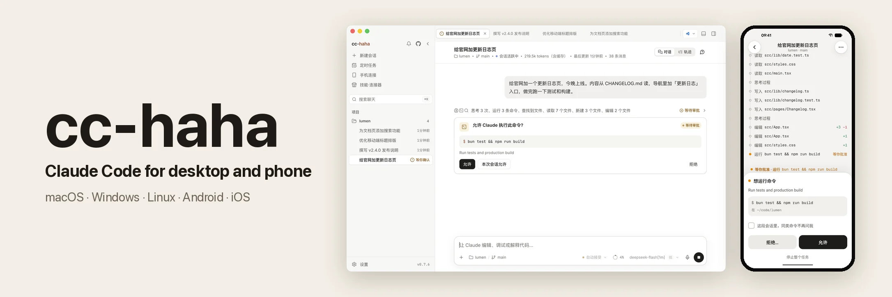

[简体中文](README.md) · **English**

cc-haha is a **desktop Claude Code workspace** for macOS, Windows, and Linux: multi-session workspaces, global search, branch / Worktree launch, diff review, built-in browser preview, GUI permission approval, any model — Claude, ChatGPT, Grok, presets, or local endpoints — image generation, visual MCP & SubAgent managers, an Agent Teams workbench, dynamic Workflow orchestration, model trace, Computer Use, skill marketplace, colour themes, desktop pets, mobile app and H5 remote access, IM integration, and scheduled tasks, all in one app. **On macOS, Computer Use can operate other apps without taking over your physical mouse or keyboard.** The companion Android / iPhone app pairs with your computer by QR code, so you can approve actions and start tasks away from your desk.

<b>Platinum Sponsor · Modelflare</b>

  <a href="https://modelflare.dev/sign-up?utm_source=github&amp;utm_campaign=cchaha">
    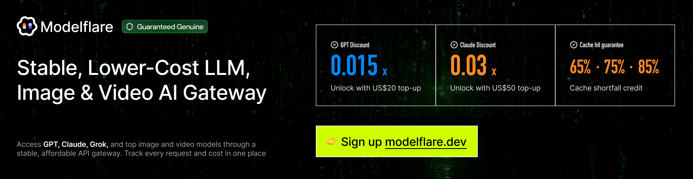
  </a>

Thanks to <a href="https://modelflare.dev/sign-up?utm_source=github&amp;utm_campaign=cchaha">Modelflare</a> for sponsoring this project! Modelflare: Full strength, stable, nothing watered down. Global SOTA models at a lower cost. Operated by US-based Havenbyte LLC, Modelflare supports GPT, Claude, Gemini, Grok, and other leading models through common compatible protocols, plus 40+ image and video models.

<b>Cache compensation is a highlight:</b> selected OpenAI groups (price-first, stable, and premium) guarantee daily cache hit rates of 65%, 75%, or 85%, and if eligible requests fall short, Modelflare refunds the difference, visible on the usage dashboard after settlement.

<b>Special offers:</b> a single top-up of US$20 unlocks the GPT discount group at a 0.015x price multiplier, and a single top-up of US$50 unlocks the Claude discount group at a 0.03x multiplier. Register via <a href="https://modelflare.dev/sign-up?utm_source=github&amp;utm_campaign=cchaha">this exclusive link</a> to get started.

  <a href="#feature-preview">Feature Preview</a> · <a href="#install">Install</a> · <a href="#desktop-highlights">Highlights</a> · <a href="#more-documentation">More Docs</a> · <a href="#sponsorship--partnership">Sponsorship</a> · <a href="#user-group">User Group</a>

---

## Feature Preview

  
  
  

<table>
  <tr>
    <td width="33%" align="center" valign="top">
      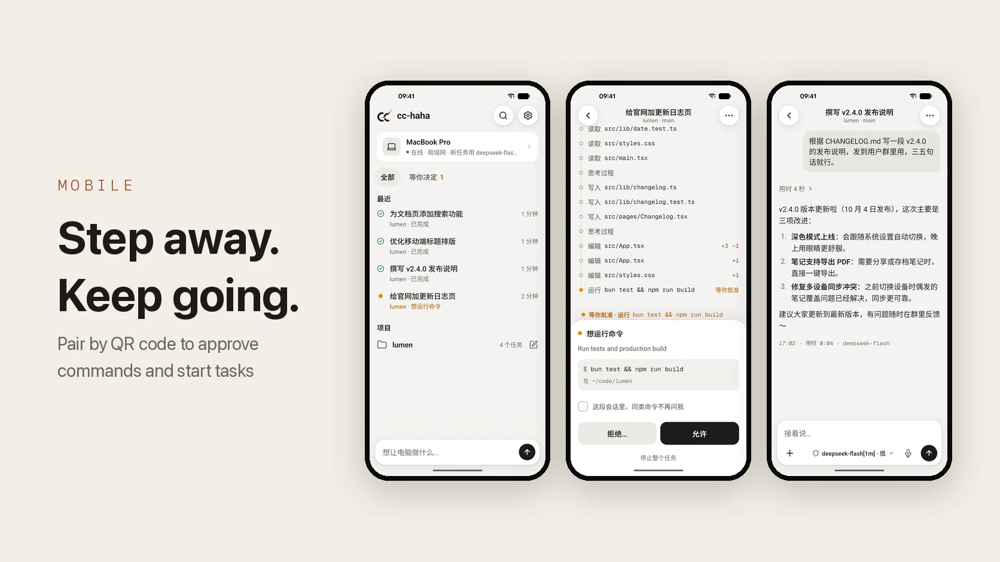
       <a href="docs/en/desktop/remote.md">Mobile app</a>
    </td>
    <td width="33%" align="center" valign="top">
      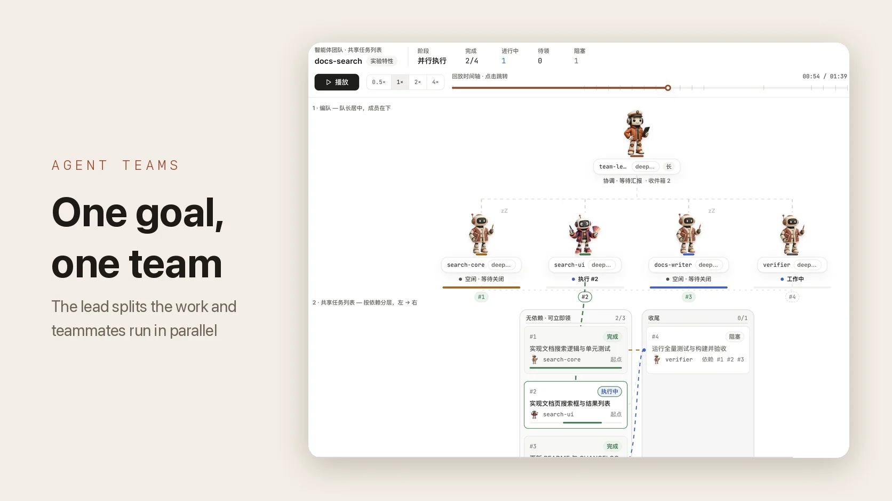
       <a href="docs/en/internals/agent.md">Agent Teams</a>
    </td>
    <td width="33%" align="center" valign="top">
      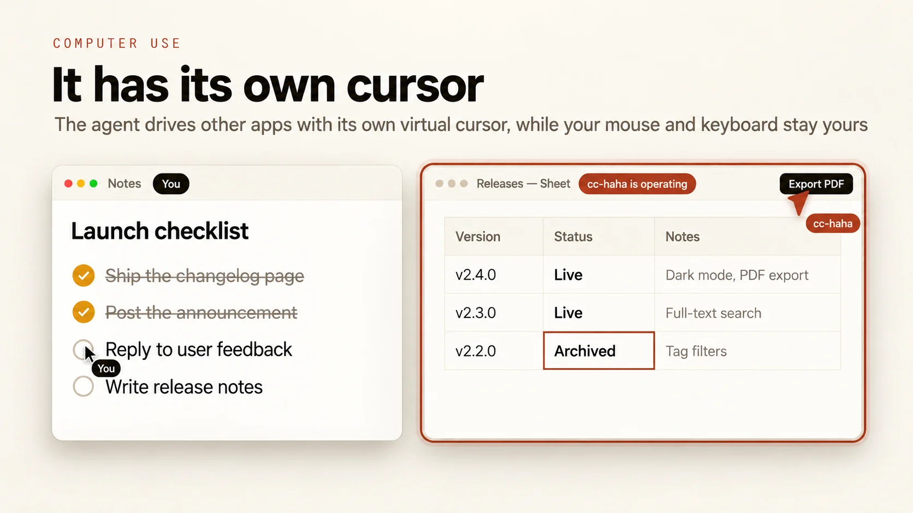
       <a href="docs/en/desktop/computer-use.md">Computer Use</a>
    </td>
  </tr>
  <tr>
    <td width="33%" align="center" valign="top">
      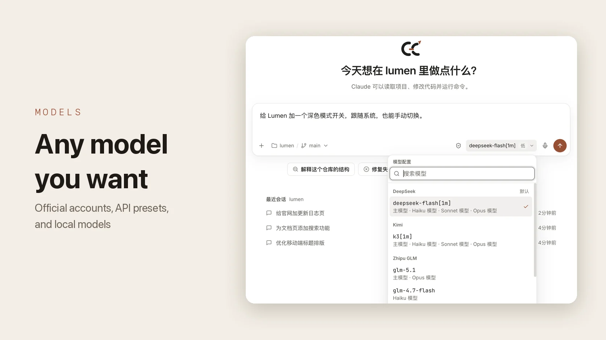
       <a href="docs/en/start/models.md">Models</a>
    </td>
    <td width="33%" align="center" valign="top">
      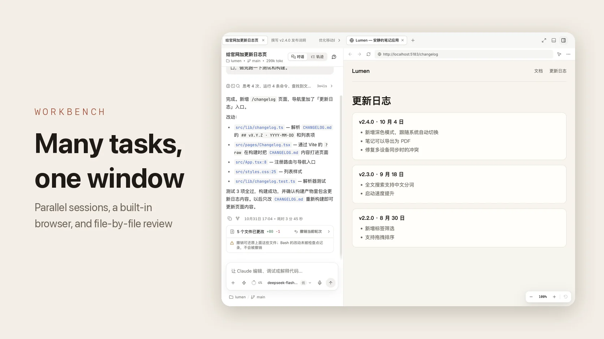
       <a href="docs/en/desktop/workspace.md">Desktop workbench</a>
    </td>
    <td width="33%" align="center" valign="top">
      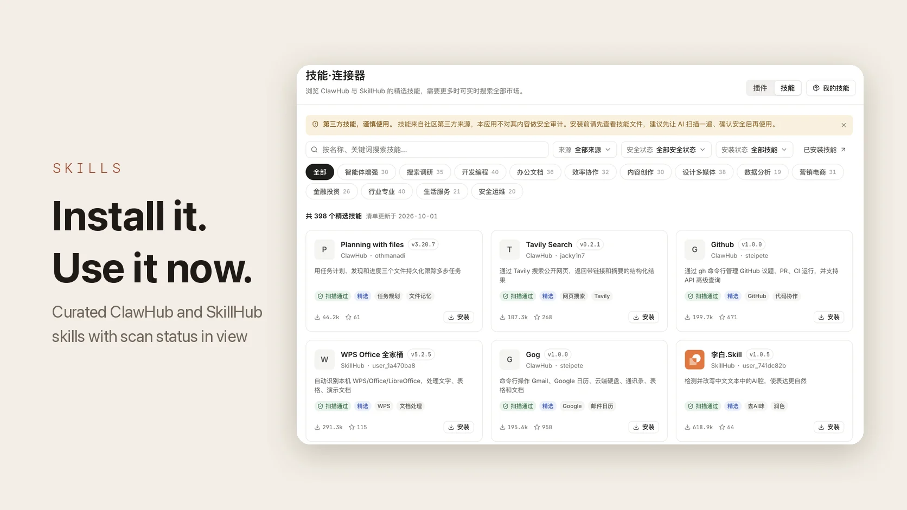
       <a href="docs/en/desktop/skills.md">Skills Market</a>
    </td>
  </tr>
</table>

---

## Sponsorship & Partnership

This project is maintained in the author's spare time. Corporate or individual sponsorships are welcome to support ongoing development. Custom features, integrations, and business partnerships are also open for discussion.

<table>
  <thead>
    <tr>
      <th width="220">Sponsor</th>
      <th align="left">Description</th>
    </tr>
  </thead>
  <tbody>
    <tr>
      <td align="center" valign="middle">
        <a href="https://aruhub.com/sign-up?aff=Z54g">
          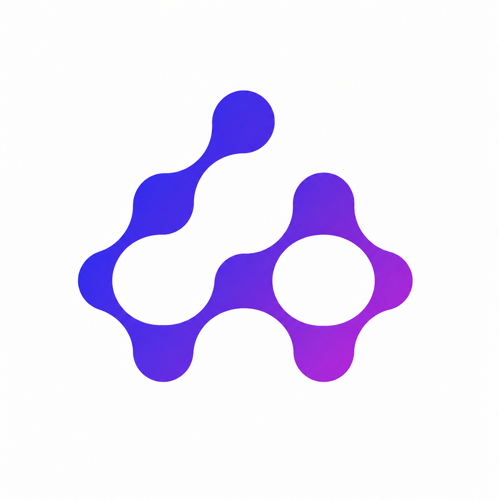
        </a>
      </td>
      <td valign="middle">
        Thanks to <a href="https://aruhub.com/sign-up?aff=Z54g">AruHub</a> for sponsoring this project! AruHub focuses on providing developers with a stable, long-term primary API upstream service. Built for high-frequency AI coding workflows such as Codex and Claude Code, it offers official GPT API access through enterprise groups and stable Claude enterprise groups for sustained use, with support for leading models including GPT and Claude. Image 2 / 2.5 is available around the clock, starting at CNY 0.04 per image. Pay-as-you-go billing supports high-volume enterprise usage, invoicing, and refunds. Register through the <a href="https://aruhub.com/sign-up?aff=Z54g">exclusive link</a> to receive US$1 in credit usable across all models, with no model restrictions.
      </td>
    </tr>
    <tr>
      <td align="center" valign="middle">
        <a href="https://moeapi.cloud/register?utm_source=github&amp;utm_campaign=cchaha">
          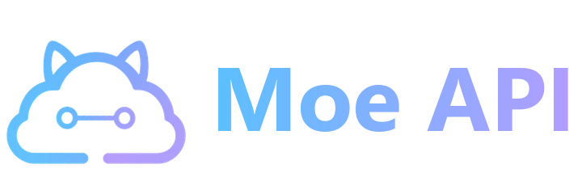
        </a>
      </td>
      <td valign="middle">
        Thanks to <a href="https://moeapi.cloud/register?utm_source=github&amp;utm_campaign=cchaha">Moe API</a> for sponsoring this project! Moe API is a unified large language model API platform for developers and teams. A single API key provides access to 120+ models, including GPT, Claude, Gemini, Grok, DeepSeek, Kimi, GLM, and Qwen, with native compatibility with OpenAI (Chat / Responses), Anthropic Messages, and Gemini protocols for direct use with cc-haha, Claude Code, Codex, and other tools. Pricing is CNY 1 per US$1 of credit: multipliers start as low as 0.1x for self-operated Codex account pools, with self-operated Gemini at 0.25x, Grok at 0.2x, third-party Claude Code account pools at 0.35x, and DeepSeek / GLM / Kimi starting at 0.5x. It also supports GPT Image and Gemini image generation. Top up via Alipay or WeChat QR code payments, with credit added in real time. Invoices are available on request and balances are refundable, making team purchasing and reimbursement convenient. Global CDN routing is available; API request and response bodies are not persistently stored on the platform.
      </td>
    </tr>
    <tr>
      <td align="center" valign="middle">
        <a href="https://www.zuiquanapi.com/"><b>最全 API Zuiquan API Directory</b></a>
      </td>
      <td valign="middle">
        Built by a friend, <a href="https://www.zuiquanapi.com/">Zuiquan API Directory</a> brings together AI API relay providers so you can find and compare options by model and price. If you're unsure which provider to choose, it's a useful place to start.
      </td>
    </tr>
  </tbody>
</table>

📧 **Contact**: relakkes@gmail.com

---

## Install

1. Download the macOS / Windows / Linux desktop installer from [Releases](https://github.com/NanmiCoder/cc-haha/releases).
2. On first launch, configure your model provider, API key, and default model in Settings.
3. Public macOS releases require signing and notarization. Draft or unsigned temporary builds may still need one-time manual approval. Unsigned Windows installers may show SmartScreen; click "More info" -> "Run anyway". See the [desktop installation guide](docs/en/start/install.md).
4. Mobile (optional; the app interface is currently Chinese only): on Android, download `cc-haha-mobile-*.apk` from Releases; on iPhone, install TestFlight and open the [public link](https://testflight.apple.com/join/Nd49JrWZ). The mobile app needs desktop v0.7.6 or later. Pair it by scanning the QR code under **Phone connection** in the desktop app: connect directly on the same Wi-Fi, or through Cloudflare when you are away. See [Mobile app and remote connection](docs/en/desktop/remote.md).

Release trust and privacy: [Code signing policy](docs/en/start/code-signing.md) · [Privacy and network access](docs/en/start/privacy.md)

---

## User Group

Scan the QR code below to join the cc-haha user group on WeCom (WeChat Work) — the conversation there is mostly in Chinese. For questions and bug reports in English, [Issues](https://github.com/NanmiCoder/cc-haha/issues) is the better place. For enterprise deployment, customization, or Agent development needs, contact the author [NanmiCoder](https://github.com/NanmiCoder).

  

---

## ☕ Buy Me a Coffee

If this project helps you, consider buying me a coffee — every bit of support keeps this project going ❤️

<table>
<tr>
<td align="center" width="33%">
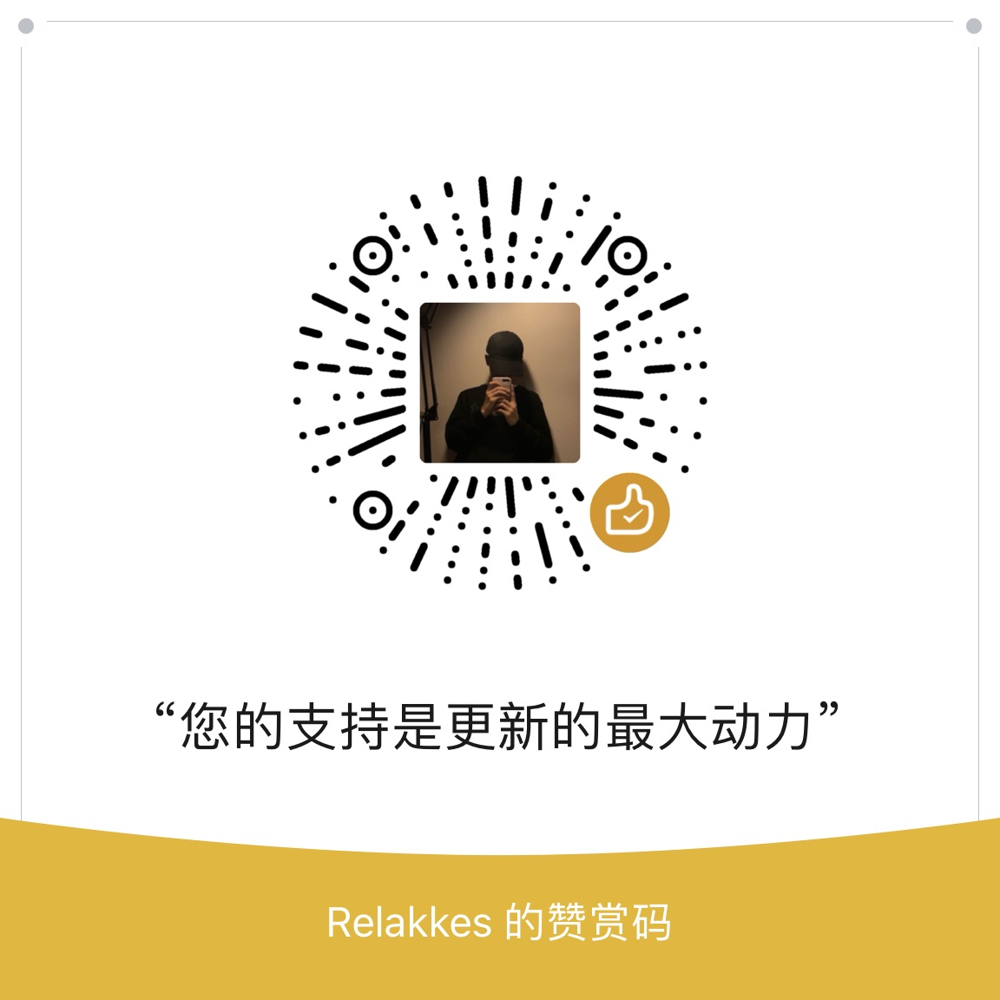 
<b>WeChat Pay</b>
</td>
<td align="center" width="33%">
 
<b>Alipay</b>
</td>
<td align="center" width="33%">
 
<b>Buy Me a Coffee</b>
</td>
</tr>
</table>

---

## Desktop Highlights

- **Multi-session workspace**: tabs, project switching, terminal entry, and session history in one place, with a resizable sidebar.
- **Global search**: press Cmd+K to search across every session and jump to the match.
- **Branch / Worktree launch**: choose a repository branch and decide whether to use the current working tree or an isolated Worktree.
- **Review edits file by file**: the workspace lists this turn's changes; open any file for a syntax-highlighted diff, or undo the whole turn.
- **Built-in browser preview**: the page your agent just edited renders right inside the app, cookies and login state included.
- **Five permission modes**: from "ask every time" to "skip permissions" — risky commands, tool calls, and follow-up questions are all approved in the GUI.
- **Bring your own model**: sign in to Claude, ChatGPT, or Grok; use presets for DeepSeek, Kimi, Zhipu GLM and others; or point it at LM Studio and Ollama running locally.
- **Image generation**: generate and edit images right in the chat — sign in with ChatGPT or Grok for instant use, or plug in any OpenAI-compatible Images API.
- **Visual MCP manager**: add and edit MCP servers in a GUI — STDIO / Streamable HTTP / SSE, with project, shared, or global scope.
- **Six colour themes**: white, paper, warm classic, celadon, ink night, and ink blue — optionally following your system's light/dark setting.
- **Skill marketplace**: discover, preview, and install third-party skills from ClawHub / SkillHub, with source and safety status shown up front.
- **Session activity panel**: track task progress, background tasks, SubAgents, and sources in one side panel.
- **Visual SubAgent manager**: create and tune SubAgents in a GUI — model, tools, and permission mode.
- **Agent Teams workbench**: visualize multi-agent collaboration in the GUI — members, tasks, a communication feed, and a dependency-lane canvas.
- **Dynamic Workflow orchestration**: the model writes and runs orchestration scripts on the fly, driving subagents concurrently or in pipelines, with phase views, interrupts, and resume.
- **Model trace**: every model request is logged locally with status and timing — search and filter to diagnose stuck or failed calls.
- **Computer Use**: let the agent take screenshots, click, type, and control desktop apps after authorization; the native macOS runtime does not take over your physical mouse or keyboard.
- **Desktop pets**: Dada, Huhu, Bubu, and Huihui change what they do with the task at hand — or raise one of your own (off by default).
- **Mobile app and H5**: pair the Android / iPhone app with your computer by QR code to approve tool calls, answer questions, start new tasks, review changes, and stop work from your phone, or connect from the phone browser. Tasks always run on the computer, so locking the phone won't interrupt them.
- **IM integration**: chat, switch projects, and approve actions through Telegram / Feishu / WeChat / DingTalk / WhatsApp / WeCom / QQ / Slack.
- **Scheduled tasks and usage stats**: run planned tasks in their own sessions and track local token usage trends.

---

## More Documentation

Full documentation site: <https://cchaha.ai>

| Section | Documents |
|------|------|
| **Getting started** | [What this is](docs/en/start/index.md) · [Download and install](docs/en/start/install.md) · [Connect a model provider](docs/en/start/models.md) · [Your first session](docs/en/start/first-session.md) · [Troubleshooting](docs/en/start/troubleshooting.md) |
| **Desktop features** | [Feature overview](docs/en/desktop/index.md) · [Computer Use](docs/en/desktop/computer-use.md) · [Desktop pets](docs/en/desktop/pets.md) · [Mobile app, H5, and IM relay](docs/en/desktop/remote.md) |
| **IM integrations** | [Overview and pairing](docs/en/im/index.md) · [Feishu](docs/en/im/feishu.md) · [Telegram](docs/en/im/telegram.md) · [WeChat](docs/en/im/wechat.md) · [DingTalk](docs/en/im/dingtalk.md) · [WhatsApp](docs/en/im/whatsapp.md) · [WeCom](docs/en/im/wecom.md) · [QQ](docs/en/im/qq.md) · [Slack](docs/en/im/slack.md) |
| **CLI** | [Install and run](docs/en/cli/index.md) · [Command reference](docs/en/cli/reference.md) · [Environment variables](docs/en/cli/env.md) |
| **Internals** | [Desktop architecture](docs/en/internals/desktop.md) · [Multi-agent system](docs/en/internals/agent.md) · [Skills system](docs/en/internals/skills.md) · [Memory system](docs/en/internals/memory.md) · [Computer Use architecture](docs/en/internals/computer-use.md) · [Local server and API](docs/en/internals/server.md) · [Channel system](docs/en/internals/channel.md) · [Project structure](docs/en/internals/structure.md) · [Contributing and quality gates](docs/en/internals/contributing.md) |

---

## Tech Stack

| Category | Technology |
|------|------|
| Language | TypeScript |
| Desktop app | Electron |
| Desktop UI | React + Vite |
| Local runtime | [Bun](https://bun.sh) |
| Terminal UI | React + [Ink](https://github.com/vadimdemedes/ink) |
| CLI parsing | Commander.js |
| API | Anthropic SDK |
| Protocols | MCP, LSP |

## Acknowledgements

Thanks to the following open-source projects and community practices for reference and inspiration:

- [React](https://github.com/facebook/react): frontend engineering and component-based UI ecosystem.
- [Electron](https://github.com/electron/electron): cross-platform desktop app capabilities and engineering practices.
- [cc-switch](https://github.com/farion1231/cc-switch): reference for model provider configuration.
- [LINUX DO](https://linux.do/): a new ideal developer community.
- [AtomGit](https://atomgit.com/NanmiCoder/cc-haha): code hosting for this project in China.

---

## ⭐ Star History

If this project helps you, please support it with a ⭐ Star so more people can discover cc-haha.

---

## License

Current terms are the [cc-haha Community Source License 1.0](LICENSE). Noncommercial personal use and internal business operations are allowed; paid client work, commercial deliverables, paid customization or secondary development, commercial distribution, and paid services require prior written commercial permission; redistributions require visible source attribution. Existing MIT grants and third-party licenses remain valid. See the [licensing guide](LICENSING.md). This is source-available, not an OSI-approved open-source license.
