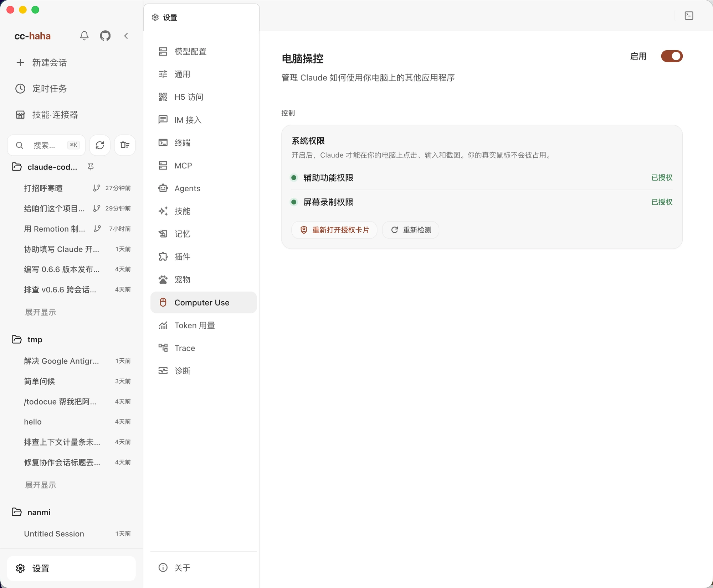

# Computer Use

Computer Use 让 Claude 读取界面元素、截图、点击和输入，完成原生笔记、文件管理器、系统设置及第三方桌面软件里的任务。macOS、Windows 和 Linux 都使用原生运行组件，无需安装 Python 或配置虚拟环境。

## 支持与后台操作

| 平台 | 环境要求 | 后台操作的边界 |
|---|---|---|
| macOS | macOS 14.4 或更新版本，辅助功能与屏幕录制权限 | 原生引擎把输入发给目标进程，不移动真实鼠标；可以在另一个应用里继续工作 |
| Windows | Windows 10 1809 / Windows Server 2019 或更新版本，已登录用户的交互桌面 | 支持后台语义操作的控件可以读取、点击、设置值。控件自身可能改变焦点，物理输入会使用真实鼠标或键盘 |
| Linux | 已登录用户的图形会话、AT-SPI 辅助功能服务；推荐 Ubuntu 24.04 或更新版本 | X11 和 Wayland 都能进行受支持的 AT-SPI 后台操作，物理输入、截图与窗口控制受桌面环境限制 |

**后台操作有条件。** 它不会为 Agent 创建独立的虚拟桌面。目标应用的内容仍会改变；切换窗口、打开系统界面、快捷键和剪贴板操作也可能影响你。请避免和 Agent 同时编辑同一个应用。

Windows 的后台文字替换依赖控件提供可设置的值；模拟逐字输入需要前台执行。最小化窗口可能无法操作，需要先恢复。Linux 的普通应用物理鼠标操作只支持 X11；Wayland 上可以使用语义操作，部分键盘功能还取决于 Mutter RemoteDesktop 能力。Wayland 截图可能要求你确认系统弹窗，剪贴板需要 `wl-clipboard`；普通应用的物理指针和可视化虚拟光标不可用。

## 开启 Computer Use

打开「设置 → Computer Use」，先查看原生运行组件状态，再打开「启用」开关并阅读确认弹窗。

**确认一次后，Computer Use 可以操作这台电脑上的所有受支持应用，不再逐个请求应用授权。** macOS 系统权限、全局开关和目标有效性检查仍然生效。Windows 和 Linux 不会显示 macOS 的权限卡，也不需要「下载 Python」或「安装环境」。



上图为 macOS 示例。Windows 和 Linux 页面显示原生运行组件及对应平台的输入限制。

### macOS 系统权限

原生权限卡会引导你为运行组件授予两项权限：

| 权限 | 用途 |
|---|---|
| 辅助功能 | 读取应用界面，向目标应用发送操作 |
| 屏幕录制 | 捕获目标窗口或屏幕 |

按权限卡提示完成系统设置，再点「重新检测」。可以通过「重新打开授权卡」再次检查；若授权后仍不生效，完全退出并重新打开 cc-haha，再重新检测。不要把页面上的检查失败当作已授权。

### Windows 和 Linux 环境

Windows 需要在当前已登录用户的桌面里运行。锁屏、UAC 安全桌面、服务的 Session 0 或另一位用户的桌面不属于可操作范围；提权应用也可能受系统权限边界限制。

Linux 应从目标应用所在的图形会话启动 cc-haha。纯 TTY、缺少会话变量的 SSH、没有桌面总线的容器，或另一位用户的会话无法提供同样的应用访问能力。出现辅助功能总线不可用时，检查桌面会话及 AT-SPI 服务后重新检测。

## 开始使用

新建会话，用自然语言说明目标、应用和允许改动的范围，例如：

```text
读取文件管理器当前窗口，告诉我有哪些文件，不要修改。
在笔记应用中新建一条标题为「测试」的空白笔记。
找到系统设置里的显示器页面，但不要修改任何选项。
```

在桌面聊天中输入 `/computer-use` 加上任务，或明确写「使用 Computer Use」，可以指定这轮使用原生桌面工具。工具不可用时，聊天会提示原因。

Agent 会先观察界面，再操作并重新读取结果。界面变化后需要重新观察，旧坐标或旧元素引用不一定仍然有效。没有暴露辅助功能控件的界面，后台语义操作可能无法完成；这时需要换一种入口，或明确使用会占用前台的物理操作。

同一时间只有一条产品会话能持有 Computer Use 控制锁。主 Agent 与子 Agent 可以协作并显示各自的光标，操作按队列执行，共享应用状态和剪贴板。虚拟光标用于显示操作位置。

在 Windows 上，标有 `Agent` 的光标会在可绘制的操作开始时出现，按所在显示器的缩放比例绘制。回合中两次操作之间最多停留约 45 秒，回合结束或停止后收起。Wayland 上的语义操作通过工具结果反馈。

## 中断与排查

用会话的**停止按钮**中断任务；在 CLI 中使用 **Ctrl+C**。不要依赖在其他应用里按 Esc 就能全局停止。结束后可在设置中关闭 Computer Use；新会话将不再注入相关工具。

| 页面或任务提示 | 处理方式 |
|---|---|
| 原生运行组件缺失 | 更新或重新安装完整应用，再重新检测；从源码运行时先构建原生组件，见[架构与构建](../internals/computer-use.md#构建与分发) |
| Linux 辅助功能总线不可用 | 确认 cc-haha 和目标应用在同一图形用户会话，且 AT-SPI 服务可用；不要通过反复重启应用猜测权限状态 |
| macOS 缺权限或检查失败 | 重新打开授权卡，按提示授权并重新检测；必要时完全退出后重开 |
| Windows 后台输入被拒绝 | 使用支持的后台设置值操作，或允许任务使用前台物理输入；先恢复最小化窗口 |
| Wayland 指针或窗口命令不支持 | 使用语义操作，或在需要物理鼠标时切换到 X11；不能靠重试补出系统能力 |
| 操作结果未知 | 先读取最新界面确认结果，不要重复点击、输入或提交 |
| 正在被其他会话使用 | 等待那条会话完成，或先停止它 |

截图与界面文本可能包含敏感内容。开始前整理窗口，给任务写清范围；原生运行组件就绪并不保证每个应用、每个控件都能自动化。实现细节见[Computer Use 架构](../internals/computer-use.md)。
