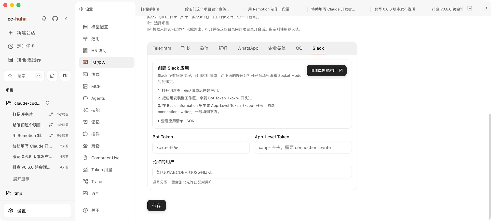

# 手机 App、H5 与 IM 接力

电脑上跑着的任务，想在手机上看进度、追加一句话，可以使用手机 App、浏览器或 IM：

- **手机 App** — iOS、Android 客户端扫码连接电脑，在手机上查看任务和处理审批。
- **H5 访问** — 手机浏览器打开同一套界面，会话、消息、附件、权限按钮都在。
- **IM 接入** — 在微信、钉钉、WhatsApp、Telegram、飞书里直接和 Claude 对话。

这些方式都需要你的电脑开着、应用在跑。任务在电脑上执行；使用公网隧道或 IM 平台时，传输内容会经过相应服务商。手机 App 和 H5 共用下方的公网配对入口。

## H5 访问

### 开启

1. 打开 设置 → H5 访问。
2. 打开「启用 H5 访问」，读一遍风险提示后确认。
3. 点「生成令牌」，页面上会出现二维码和 H5 链接。
4. 用手机扫码，或者点「复制扫码链接」发到自己的设备上。

扫出来的链接里带着服务器地址和令牌。用手机相机扫码后，在你常用的 Safari、Chrome 或系统浏览器中打开，首次验证成功会把连接信息保存在该浏览器的 localStorage 中，并移除地址栏中的令牌。之后再次扫码或打开收藏可直接连接；短暂断网不会删除配对，连接失败时可点击「重试」使用已保存的凭据。令牌被撤销或重新生成后，需要用新二维码更新。

### 令牌是访问凭据

拿到这条链接的人就能访问你桌面上暴露出来的能力。所以：

- 不要把带令牌的链接贴进群聊、公开 Issue、日志截图或任何公开页面。
- 只在可信网络里开。离开局域网后，使用下方的「公网访问」，通过 HTTPS 和逐设备配对连接。
- 怀疑泄露了就点「重新生成令牌」。旧二维码和旧令牌会立刻失效——只是关掉再打开 H5 不会换令牌。

不用的时候关掉。关掉会立即拒绝远程访问，但令牌保留着，下次开还是同一个。

:::warning
H5 默认关闭，它也不是公开服务。开启前先确认你在自己信得过的网络里。
:::

### 访问主机与固定端口

「访问主机 / IP」填电脑当前的局域网 IP，比如 `192.168.1.20`，端口用当前服务端口。换了 Wi-Fi 或插拔网线之后原 IP 可能失效，页面会提示你切到可用的那个。

局域网 H5 也接受完整 URL，并需要配置「允许的来源」。这仍然是原有的 H5 令牌访问方式。要把手机 App 或浏览器接到公网，请使用下方的「已有 HTTPS 隧道」，将隧道接到独立的受限公网网关，不要直接映射桌面主服务端口。

这里的**固定端口**用于保持局域网地址稳定，或配合局域网防火墙和反向代理。端口要在 1024–65535 之间，改完重启应用才生效——页面会告诉你现在还跑在哪个端口上。它与下方公网网关的本机端口相互独立。

### 手机锁屏不会打断任务

「断连保活」解决的是这个问题：手机锁屏、切后台或者短暂断网时，**正在执行的任务不会被停掉**，它会在后台跑完，重连就能看到结果。

只有当任务已经空闲、并且没有任何设备连着时，才会在保活时间到期后停掉对应进程。默认 30 秒，可配范围是 5 秒到 24 小时。出门远程操作可以调大一些，比如 600。

### 手机上能做什么

会话列表和项目切换、发消息、停止、看流式回复、图片和文件附件、权限按钮、AI 提问、`@` 引用文件、复制和 Fork——对话主流程都在。

侧栏底部的「设置」提供「模型供应商」和「通用配置」。手机上可以添加、编辑、删除、排序和切换供应商；已有 API Key 不会回传，编辑时留空表示保持不变。更改主模型或图片模型的请求地址时，需要重新填写对应的 API Key，避免把电脑已保存的密钥自动发送到新地址。通用配置支持界面主题与语言，以及回复语言、输出风格、思考强度、发送方式和工作流关键词等偏好。主题和界面语言只影响当前浏览器；Agent 偏好与电脑共享。

供应商网页登录、配置文件导入和桌面专用管理仍在电脑上完成。桌面工作区、内嵌终端、原生「打开方式」、Computer Use 授权和桌面宠物不在 H5 里。终端暂未开放：它目前由 Electron 管理，远程终端需要单独支持连接恢复、设备授权和撤销，不能直接复用桌面 IPC。

## 公网访问

离开局域网后，打开 **设置 → H5 访问 → 公网访问**。普通用户选择默认的 **ngrok**；已经配置 Cloudflare Tunnel、frp 或其他反向代理的用户，选择 **已有 HTTPS 隧道**。两种方式都使用同一套手机配对和设备撤销，原有局域网设置保持独立。

### 最快连接：ngrok

不需要自己的服务器或域名，也无需安装 ngrok 或运行命令。

1. 点击账户入口，在 ngrok 官方网站注册或登录，复制 **Authtoken**。这里需要的是隧道连接凭据，不是 API Key。
2. 回到桌面，粘贴 Authtoken。阅读访问权限和隐私说明，点击 **同意并开启公网访问**。
3. 连接成功后会自动显示配对二维码。用手机 App 扫码，或用手机相机在浏览器中打开并提交配对请求。
4. 在桌面确认这部手机。App 会保存连接；浏览器用户可以收藏公网地址。需要添加另一部手机时，点击「连接手机」生成新二维码。

ngrok 免费账户提供绑定账户的开发域名（`*.ngrok-free.dev` 或 `*.ngrok-free.app`），桌面会自动记住并复用这类地址。已有付费账户固定域名时，可在 ngrok 的高级选项中填写完整 HTTPS 根地址，不含端口或路径。付费账户未指定固定域名时可能分配临时随机地址，下一次连接可能改变；保存地址本身不会把它变成固定域名。

免费套餐仍有流量和请求额度，浏览器可能先显示 ngrok 提示页。应用不会自动购买套餐。当前限制请查看 [ngrok 免费方案说明](https://ngrok.com/docs/pricing-limits/free-plan-limits)。更换 ngrok 账户或更改域名后，需要使用新地址重新连接手机。

### 已有 HTTPS 隧道

如果你已经会使用内网穿透，只需把自己的隧道接到这里提供的本机目标。cc-haha 不要求安装它自己的中转服务器，也不会替你创建云服务器、DNS 记录或隧道。

1. 选择「已有 HTTPS 隧道」，填写固定的 HTTPS 根地址，例如 `https://home.example.com`。不要附带 `/remote`、其他路径、查询参数或配对码。
2. 保留默认本机端口 `17463`，或指定一个未被占用的端口。阅读权限和隐私说明后开启公网访问。
3. 将自己的隧道转发到界面显示的本机目标，默认是 **`http://127.0.0.1:17463`**。它只在这台电脑上监听，是带设备鉴权和访问范围限制的公网网关；不要改成桌面主服务端口。
4. 用手机的蜂窝网络检查公网地址可达，再扫描配对二维码，并在桌面确认手机。

将公网域名的根路径及子路径原样转发到网关，包括 `/remote` 页面、`/assets/` 静态资源、`/api/` 和 `/ws/`；只转发 `/remote` 页面不足以加载和使用 H5。

「本机网关已就绪」只表示电脑上的接入口已开启，**不表示外部域名、证书和隧道已经验证成功**。隧道需要支持 HTTP 和 WebSocket，保留请求中的 Origin、授权信息及 Cookie，并提供手机系统信任的 HTTPS 证书。App 不接受公开 HTTP、跨地址重定向或跳转到额外登录页面。

Cloudflare Named Tunnel 的 Service URL 可以填写上述本机目标。要长期使用固定域名，使用正式隧道；Quick Tunnel 的临时域名会在重新创建后改变。[Cloudflare 正式隧道配置](https://developers.cloudflare.com/tunnel/get-started/)、[临时隧道限制](https://developers.cloudflare.com/tunnel/get-started/quick-tunnels/)

使用 frp 时，电脑上的 frpc 应连接这个本机目标。云服务器上的 Nginx / Caddy 则转发到你的隧道服务端出口；它不能直接访问个人电脑的 `127.0.0.1`。若要修改公网地址或本机端口，先关闭公网访问，再同步修改应用与隧道配置。端口占用时应用会报错，不会悄悄换一个端口。

**隐私边界：** 自建反向代理或托管隧道的 HTTPS 终止端可能读取传输中的内容和凭据。请只使用自己信任的服务器或服务商；自建中转不等于中转不可读的端到端加密。

### 配对、断线与恢复

二维码中的配对材料 5 分钟有效且只能使用一次；手机访问凭据默认有效 30 天。不要分享二维码。桌面可以单独撤销手机，或关闭公网访问立即断开远程连接；已经运行的任务会继续执行。

网络恢复且公网地址保持不变时，手机 App 会用已保存的凭据重连并同步会话。临时断网或重启接入口不等于授权失效，不需要因此重新扫码。电脑休眠或应用退出期间仍无法连接；恢复运行后才能继续使用。授权到期或被撤销后需要重新配对，当前不会自动延长 30 天有效期。

公网入口也支持上述供应商与通用设置。任意本机目录浏览及路径式文件预览仍需在桌面操作；会话内的文件和审查接口继续可用。

手机 App 把凭据保存在系统安全存储中。浏览器将公网授权保存在安全 Cookie 中，有效期内再次扫码直接进入，不会消耗新二维码；不会把长期公网凭据写入 localStorage。相机扫码可以在系统浏览器中完成配对。不同浏览器、无痕窗口、不同域名之间不会共享授权：如果扫描器先打开内置浏览器，请先选择在常用浏览器中打开，再完成配对。清除浏览器数据、授权到期或被撤销后需重新配对。

**隐私边界：** 标准 ngrok HTTPS 隧道会在 ngrok 服务端解密，再经加密隧道传到电脑。因此 ngrok 在技术上可以接触传输中的会话、指令和文件内容，这不是中转不可读的端到端加密。Authtoken 保存在当前应用数据目录的独立私有文件中，不采用系统钥匙串加密；拥有本机账户或管理员权限的人可能读取它。删除应用内凭据不会注销 ngrok 账户，怀疑泄漏时还应到 ngrok 撤销该凭据。

“随桌面启动恢复公网访问”默认关闭。打开后，应用会在后续启动时恢复 ngrok 连接或自己的本机公网网关；使用已有隧道时，隧道客户端仍需由你负责启动。电脑需要保持运行、联网且未休眠。连接失败时分别检查电脑网络、隧道状态、证书和账户额度；固定域名不代表服务永远在线。

## IM 接入

设置 → IM 接入 支持八个平台，接入方式各不相同。这里先列出常见接法，完整步骤见 [IM 接入总览](../im/index.md)：

| 平台 | 怎么接 |
|---|---|
| 微信 | 在设置页生成二维码，用微信扫码绑定账号 |
| 钉钉 | 扫码一键创建并授权机器人，也可以手动填 Client ID / Secret |
| WhatsApp | 生成二维码，在 WhatsApp 的「已关联设备」里扫码 |
| Telegram | 找 @BotFather 要一个 Bot Token 填进来 |
| 飞书 | 填 App ID 和 App Secret；没有机器人的话可以用页面上的模板一键创建 |
| 企业微信 | 在设置页扫码创建智能机器人 |
| QQ | 扫码授权，回填 App ID 和 App Secret |
| Slack | 用应用清单创建 App，再回填两枚 Token |

### 绑定账号 ≠ 允许对话

这是最容易踩的一步：**扫码只绑定了账号能力，具体哪个人能和 Bot 对话是另一回事。**

在「配对管理」里点「生成配对码」，然后用你自己的 IM 账号私聊 Bot 把这串码发过去，绑定才算完成。也可以在「允许的用户」里直接填用户 ID 列表。两者都为空时默认拒绝所有人——这是有意为之。

已配对的用户会列在下面，可以随时解绑，解绑后需要重新配对。

### 其他设置

- **默认项目** — 新 IM 会话用哪个工作目录。留空则用当前用户工作目录。它只是个起点，不限制机器人能访问哪些项目。
- **允许访问的项目目录** — 机器人的访问边界，`/projects` 只会列出这些目录里的项目。留空则默认为你的主目录（外加主目录之外的「默认项目」）。
- **流式卡片模式** — 实时更新消息内容，读起来更像在看它打字。
- **权限请求** — 钉钉可以配互动卡片模板 ID，用卡片按钮授权；不配的话所有平台都用 `/allow`、`/always`、`/deny` 文本命令。

五个平台各自的申请流程、权限配置和排查步骤，见[IM 接入](../im/index.md)。
