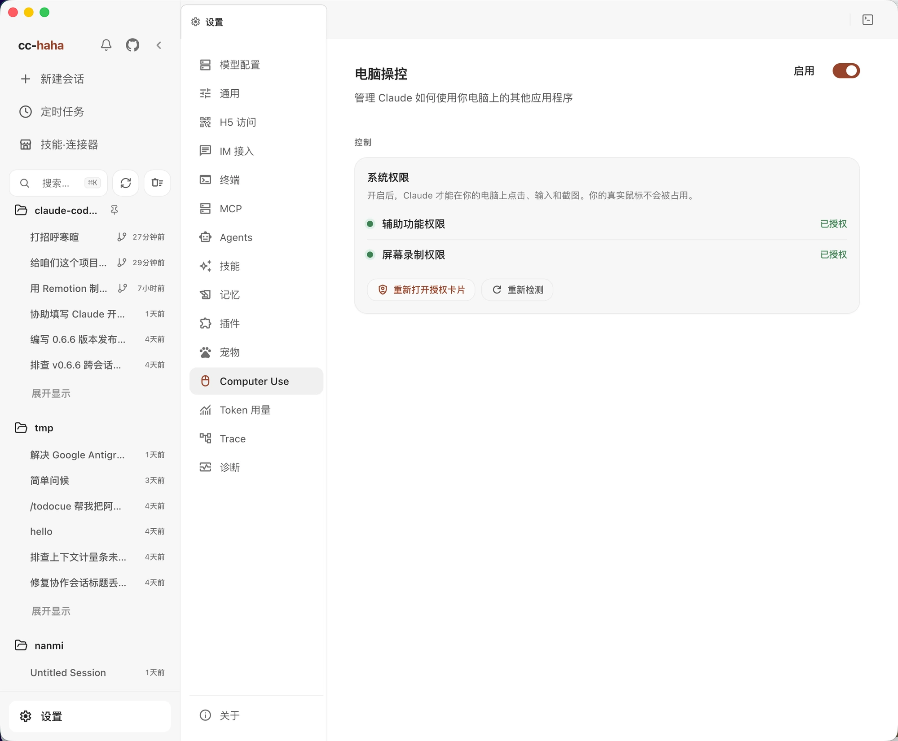

# Computer Use

Computer Use lets Claude read interface elements, take screenshots, click, and type in native notes, file managers, system settings, and other desktop apps. macOS, Windows, and Linux use native runtime components; no Python installation or virtual environment is required.

## Support and background actions

| Platform | Requirements | Background action limits |
|---|---|---|
| macOS | macOS 14.4 or later, Accessibility and Screen Recording permissions | The native engine directs input to the target process without moving the physical pointer; you can keep working in another app |
| Windows | Windows 10 1809 / Windows Server 2019 or later, in the signed-in user's interactive desktop | Controls supporting UI Automation can be read, clicked, or assigned values in the background; physical input uses the real mouse or keyboard |
| Linux | The signed-in user's graphical session and AT-SPI accessibility service; Ubuntu 24.04 or later is recommended | Supported AT-SPI actions work in the background on X11 and Wayland; physical input, capture, and window control depend on the desktop |

**Background actions have limits.** They do not create an isolated virtual desktop for the agent. Target apps still change; window switching, shell UI, shortcuts, and clipboard operations can affect your work. Avoid editing the same app at the same time as the agent.

Background text replacement on Windows requires a control with a writable value; simulated typing needs foreground input. Minimized windows may need to be restored first. Linux physical pointer actions for ordinary apps require X11. Wayland supports semantic actions, while some keyboard operations depend on Mutter RemoteDesktop capabilities. Wayland screenshots may require your response to a system consent dialog, and its clipboard needs `wl-clipboard`; ordinary-app physical pointer input and the visual agent cursor are unavailable.

## Enable Computer Use

Open **Settings → Computer Use**, check the native runtime status, then turn on **Enabled** and read the confirmation dialog.

**One confirmation authorizes Computer Use for all supported apps on this computer; there is no separate approval for each app.** macOS system permissions, the global switch, and target-validity checks still apply. Windows and Linux do not show the macOS permission card or require **Download Python** or **Install Environment**.



The image shows macOS. Windows and Linux display the native runtime status and their platform's input limits.

### macOS system permissions

The native permission card guides you through granting two permissions to the runtime component:

| Permission | Purpose |
|---|---|
| Accessibility | Read app interfaces and deliver actions to the target app |
| Screen Recording | Capture the target window or screen |

Follow the card's system-settings instructions, then choose **Recheck Status**. Use **Reopen authorization card** to revisit it. If a new grant has not taken effect, fully quit and reopen cc-haha, then check again. A failed check does not mean permission was granted.

### Windows and Linux environments

Windows must run in the signed-in user's interactive desktop. Locked screens, the UAC secure desktop, services in Session 0, and another user's desktop are outside the supported environment. Elevated apps may also be restricted by system permission boundaries.

On Linux, launch cc-haha from the graphical session containing the target apps. A plain TTY, SSH without desktop session variables, a container without the session bus, or another user's session does not provide the same app access. If the accessibility bus is unavailable, check the graphical session and AT-SPI service, then recheck.

## Start a task

Create a session and describe the goal, app, and permitted changes in plain language:

```text
Read the file manager's current window and list its files. Do not change anything.
Create an empty note titled "test" in the notes app.
Find the display settings page, but do not change any options.
```

The agent observes the interface, acts, and reads the result. After a UI change, observe again: old coordinates or element references may no longer apply. Interfaces that expose no accessibility controls may not support background semantic actions; another entry point or explicitly allowed foreground input may be needed.

Only one product session can hold the Computer Use control lock at a time. A main agent and subagents can collaborate and display their own cursors, but operations remain queued and share app state and the clipboard. A virtual cursor shows what the agent is doing; it is not another input device. Wayland does not render it.

## Stop and troubleshoot

Use the session's **Stop** button, or **Ctrl+C** in the CLI. Do not rely on pressing Esc in another app as a global stop shortcut. Turn Computer Use off in Settings when finished; new sessions will no longer receive its tools.

| Message or symptom | What to do |
|---|---|
| Native runtime missing | Update or reinstall the complete app, then recheck. Source checkouts must build the native component first; see [architecture and builds](../internals/computer-use.md#build-and-distribution) |
| Linux accessibility bus unavailable | Confirm cc-haha and the app share the same graphical user session and that AT-SPI is available; repeated restarts do not establish permission |
| macOS permission missing or check failed | Reopen the authorization card, follow its instructions, and recheck; fully quit and reopen if needed |
| Windows background typing refused | Use a supported background value-setting action, or allow foreground physical input; restore minimized windows first |
| Wayland pointer or window command unsupported | Use semantic actions, or switch to X11 when physical mouse input is required; retries cannot add a missing platform capability |
| Action result unknown | Read the current interface before deciding what happened; do not repeat clicks, typing, or submission blindly |
| Another session is using Computer Use | Wait for that session to finish or stop it first |

Screenshots and interface text may contain sensitive information. Arrange your windows and define the task's boundaries before starting. A ready runtime does not guarantee automation of every app or control. See [Computer Use architecture](../internals/computer-use.md) for implementation details.
