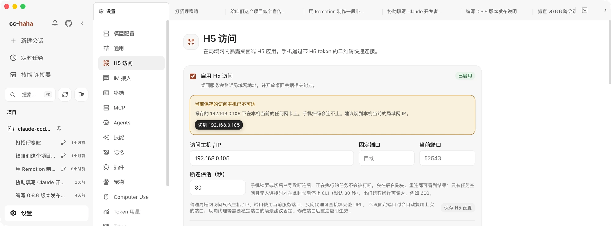

# Mobile App, H5, and IM

A task is running on your computer and you want to check on it, or add one more instruction, from your phone. Use the mobile app, a browser, or IM:

- **Mobile app** — scan to connect the iOS or Android client, check tasks, and respond to approvals.
- **H5 Access** — open the same interface in a mobile browser: sessions, messages, attachments, permission buttons, all of it.
- **IM Adapters** — talk to Claude directly inside WeChat, DingTalk, WhatsApp, Telegram, or Feishu.

All of these require your computer to be on with the app running. Tasks execute on your computer; public tunnels and IM platforms carry content through their respective service providers. The mobile app and H5 share the public pairing entry described below.

## H5 Access

### Turning it on

1. Open **Settings → H5 Access**.
2. Turn on **Enable H5 access** and confirm after reading the warning.
3. Click **Generate token**. A QR code and an H5 link appear.
4. Scan it with your phone, or click **Copy launch URL** and send it to your own device.

The scanned link carries the server address and token. Scan with your phone camera and open it in your usual Safari, Chrome, or system browser. Successful verification stores the connection in that browser's localStorage and removes the token from the address bar. Scanning again or opening a bookmark reconnects automatically. Temporary network failures do not forget pairing; choose **Retry** to use the saved credential. A revoked or regenerated token requires a fresh QR code.

### The token is the credential

Anyone holding that link can reach what your desktop exposes. So:

- Never paste a link containing the token into a group chat, a public issue, a log screenshot, or any public page.
- Only enable it on networks you trust. Outside your LAN, use **Public access** below for HTTPS and individual device pairing.
- If you suspect a leak, click **Regenerate token**. The old QR code and old token stop working immediately. Turning H5 off and on again does *not* rotate the token.

Turn it off when you're not using it. That immediately rejects remote access while keeping the token, so the same one still works next time.

:::warning
H5 is off by default, and it isn't a public service. Confirm you're on a network you trust before enabling it.
:::

### Access host and fixed port

**Access host / IP** takes your computer's current LAN IP, e.g. `192.168.1.20`, on the current service port. After switching Wi-Fi or unplugging Ethernet the old IP may no longer be yours; the page notices and offers the working one.

LAN H5 also accepts a full URL with the corresponding **Allowed origins** configuration. That remains the existing H5 token access mode. To expose the mobile app or browser over the internet, use **Existing HTTPS tunnel** below and forward to its separate, restricted public gateway instead of mapping the desktop's main service port.

A **fixed port** here keeps the LAN address stable or works with a LAN firewall or reverse proxy. The port must be between 1024 and 65535, and the change takes effect after a restart — the page tells you which port is currently live in the meantime. It is independent of the public gateway's local port below.

### Locking your phone won't kill the task

That's what **Disconnect grace** is for: when your phone locks, backgrounds the tab, or drops off the network briefly, **a running task is not stopped**. It finishes in the background and the result is waiting when you reconnect.

Only when a task is idle *and* nothing is connected does the CLI process stop, after the grace period. The default is 30 seconds and the valid range is 5 seconds to 24 hours. Raise it — say to 600 — if you're operating remotely for a while.

### What works on a phone

Session list and project switching, sending messages, stopping, streaming replies, image and file attachments, permission buttons, questions from Claude, `@` file references, copy and fork — the whole conversation flow.

The **Settings** entry at the bottom of the sidebar provides **Model providers** and **General**. Add, edit, delete, reorder, or switch providers on your phone. Existing API keys are never returned; leave a key blank while editing to keep it. Changing a model or image request URL requires entering the corresponding API key again, so saved credentials are not automatically sent to a new address. General settings include theme, interface language, response language, output style, reasoning effort, send behavior, thinking, and workflow keywords. Theme and interface language affect this browser; Agent preferences are shared with the computer.

Provider website login, configuration import, and desktop administration remain on the computer. The desktop workspace, embedded terminal, native "open with", Computer Use authorization, and the desktop pet are not part of H5. Remote terminal execution is deferred: the current terminal is owned by Electron and requires a separate device-authorized transport with reconnect and revocation support.

## Public access

Open **Settings → H5 Access → Public access**. Choose the default **ngrok** option for the quickest setup, or **Existing HTTPS tunnel** if you already run Cloudflare Tunnel, frp, or another reverse proxy. Both use the same phone pairing and device revocation flow. LAN settings remain independent.

### Quick setup with ngrok

You do not need your own server or domain, install ngrok, or run commands.

1. Open the account link, sign up or sign in on ngrok's official website, and copy your **Authtoken**. This is the tunnel credential, not an API Key.
2. Paste it in the desktop app. Read the access and privacy notice, then choose **Agree and enable public access**.
3. A pairing QR code appears automatically when connected. Scan it in the mobile app, or use your phone camera to open it in a browser and submit the pairing request.
4. Approve the phone on the desktop. The app saves the connection; browser users can bookmark the public address. Choose **Connect a phone** to generate another QR code when adding a device.

Free ngrok accounts include a development domain tied to the account (`*.ngrok-free.dev` or `*.ngrok-free.app`). The desktop automatically remembers and reuses these addresses. If your paid account already has a fixed domain, enter its full HTTPS origin in ngrok's advanced options, without a port or path. A paid account without a specified fixed domain may receive a temporary random address that changes on the next connection; saving an address does not reserve it.

Free plans still have transfer and request quotas, and browsers may show ngrok's warning page first. The app never purchases an upgrade. See [ngrok's current free plan limits](https://ngrok.com/docs/pricing-limits/free-plan-limits). Switching ngrok accounts or changing the domain requires connecting your phone with the new address.

### Existing HTTPS tunnel

If you already run a tunnel, forward it to the local target provided here. cc-haha does not require its own relay server and does not create a cloud server, DNS records, or a tunnel for you.

1. Select **Existing HTTPS tunnel** and enter a fixed HTTPS origin, such as `https://home.example.com`. Do not include `/remote`, another path, query parameters, or a pairing code.
2. Keep the default local port, `17463`, or choose an unused port. Read the access and privacy notice, then enable public access.
3. Forward your tunnel to the local target shown in settings, **`http://127.0.0.1:17463`** by default. This gateway listens only on this computer and enforces device authentication and a restricted access scope. Do not substitute the desktop's main service port.
4. Check that the public address works over your phone's cellular connection, then scan the pairing QR code and approve the phone on the desktop.

Forward the public hostname's root and all subpaths unchanged to the gateway, including the `/remote` page, `/assets/` files, `/api/`, and `/ws/`. Forwarding only the `/remote` page is not enough to load and use H5.

**Local gateway ready** only means the entry on your computer has started. **It does not verify the external domain, certificate, or tunnel.** Your tunnel must support HTTP and WebSocket, preserve Origin, authorization information, and cookies, and serve an HTTPS certificate trusted by the phone's operating system. The app rejects public HTTP, redirects to another address, and redirects to an additional login page.

For Cloudflare Named Tunnel, use that local target as the Service URL. Use a named tunnel for a stable hostname; Quick Tunnel assigns a different temporary hostname when recreated. See [Cloudflare tunnel setup](https://developers.cloudflare.com/tunnel/get-started/) and [Quick Tunnel limitations](https://developers.cloudflare.com/tunnel/get-started/quick-tunnels/).

With frp, frpc on the computer connects to this local target. Nginx or Caddy on a cloud server forwards to the server-side tunnel endpoint; it cannot directly access your personal computer's `127.0.0.1`. To change the public address or local port, turn public access off first and update both the app and tunnel configuration. An occupied port produces an error instead of silently switching ports.

**Privacy:** The HTTPS termination point of a reverse proxy or hosted tunnel may read traffic and credentials. Use only servers and providers you trust. Hosting your own relay does not make the traffic end-to-end encrypted against the relay.

### Pairing, disconnections, and recovery

Pairing codes expire after 5 minutes and can only be used once. Phone credentials last 30 days by default. Keep QR codes private. Revoke individual phones or turn off public access to disconnect remote clients immediately; running tasks continue.

When the network recovers and the public address stays the same, the mobile app reconnects using its saved credential and synchronizes the session. A temporary outage or gateway restart does not invalidate authorization or require another scan. Your computer remains unreachable while asleep or while the desktop app is closed; it must resume running before you can reconnect. Expired or revoked authorization requires pairing again. The current implementation does not automatically extend the 30-day lifetime.

The public entry also supports the provider and General settings above. Unrestricted local directory browsing and path-based file previews remain desktop-only; session-scoped file and review APIs remain available.

The mobile app saves credentials in secure system storage. Browsers persist public authorization in a secure cookie. Scanning again while it is valid opens the app without consuming another pairing code. Long-lived public credentials are not stored in localStorage. Camera scanning works in system browsers, but different browsers, private windows, and hostnames do not share authorization. If a scanner opens an embedded browser, switch to your preferred browser before pairing. Clearing browser data, expiration, or revocation requires pairing again.

**Privacy:** Standard ngrok HTTPS tunnels terminate TLS at ngrok, which then forwards traffic through an encrypted tunnel to your computer. ngrok can technically access the conversations, commands, and files being transferred. This is not end-to-end encryption that prevents the relay from reading content. The Authtoken is stored in a separate private file in the active application data directory, without system keychain encryption. Your local account or an administrator may read it. Deleting the saved credential does not close your ngrok account; revoke the credential at ngrok if it may have leaked.

Automatic restoration on desktop startup is off by default. Enable it to restore the ngrok connection or local public gateway on later launches. With an existing tunnel, you remain responsible for starting its client. Your computer must remain running, connected, and awake. When a connection fails, check the computer's network, tunnel, certificate, and account quota separately. A fixed hostname does not guarantee that the service is always online.

## IM Adapters

**Settings → IM Adapters** supports eight platforms, each connected differently. These are the common setup paths; see the [messaging guide](../im/index.md) for full steps:

| Platform | How to connect |
|---|---|
| WeChat | Generate a QR code in settings and scan it with WeChat to bind the account |
| DingTalk | Scan to create and authorize a bot in one step, or fill in Client ID / Secret manually |
| WhatsApp | Generate a QR code and scan it under **Linked devices** in WhatsApp |
| Telegram | Get a bot token from @BotFather and paste it in |
| Feishu | Enter an App ID and App Secret; if you don't have a bot, the page can create one from a template |
| WeCom | Scan in settings to create an intelligent bot |
| QQ | Scan to authorize, then provide the App ID and App Secret |
| Slack | Create an app from the supplied manifest, then enter two tokens |

### Binding an account is not the same as allowing a person

This is the step people miss: **scanning only binds the account's messaging capability. Who is allowed to talk to the bot is a separate question.**

Under **Pairing**, click **Generate pairing code**, then send that code to the bot in a direct message from your own IM account. That completes the binding. Alternatively, list user IDs under **Allowed users**.

When both are empty, everyone is denied — that's deliberate, not a bug.

Paired users are listed below and can be unbound at any time; unbinding requires pairing again.

### Other settings

- **Default project** — the working directory for new IM sessions. Left empty, it uses your current user working directory. It's only a starting point — it doesn't restrict which projects the bot can reach.
- **Allowed project directories** — the boundary for the bot: `/projects` only lists projects inside these directories. Left empty, it defaults to your home directory (plus the default project, if it is outside home).
- **Streaming card mode** — updates the message content live, so it reads more like watching it type.
- **Permission requests** — DingTalk can use an interactive card template ID for button-based approval. Without it, every platform falls back to the `/allow`, `/always`, and `/deny` text commands.

For each platform's application flow, permission configuration, and troubleshooting, see [IM integrations](../im/index.md).
