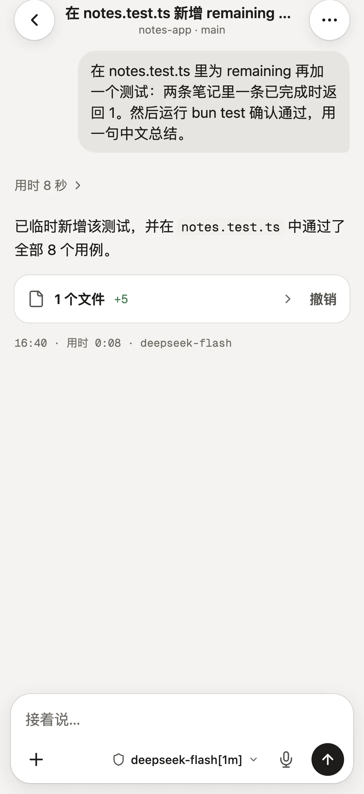

# Mobile App, H5, and IM

A task is running on your computer and you want to check on it, or add one more instruction, from your phone. Open **Phone connection** in the desktop's left sidebar, or go to **Settings → Phone connection**. You can connect with your phone's browser now, while the mobile app is awaiting release.

## cc-haha mobile app availability

| How to open cc-haha on your phone | Availability | How to get started |
|---|---|---|
| cc-haha Android app | Officially signed APK awaiting release | A download will be provided after release |
| cc-haha iPhone / iPad app | TestFlight invitations not yet open | An installation invitation will be provided when testing opens |
| Phone browser (H5) | Available now | Select **Use phone browser**, then enable the connection and scan as described below |

**Use phone browser** selects **Same Wi-Fi**. You still need to read the notice and enable the connection yourself. Connect directly when your phone and computer share a trusted Wi-Fi network. Use **Cloudflare remote connection** below over cellular data or another Wi-Fi network. Neither method needs another VPN app on the phone.

Keep the computer on, awake, and running cc-haha. Tasks always execute on the computer. Cloudflare Tunnel provides connectivity while away; the cc-haha mobile app and browser let you check tasks and respond to approvals.

To chat from WeChat, DingTalk, WhatsApp, Telegram, or Feishu, see **IM Adapters** at the end of this page.

## H5 Access

### Turning it on

1. Open **Phone connection** in the desktop's left sidebar, or go to **Settings → Phone connection**.
2. Select **Use phone browser**, or choose **Same Wi-Fi**.
3. Turn on **Enable local connection** and confirm after reading the warning.
4. Scan the QR code with your phone camera and open it in your usual Safari, Chrome, or system browser. You can also copy the launch URL to your own device.

If an older configuration has no saved token, click **Generate token** to show a new QR code.

The scanned link carries the server address and token. Scan with your phone camera and open it in your usual Safari, Chrome, or system browser. Successful verification stores the connection in that browser's localStorage and removes the token from the address bar. Scanning again or opening a bookmark reconnects automatically. Temporary network failures do not forget pairing; choose **Retry** to use the saved credential. A revoked or regenerated token requires a fresh QR code.

### The token is the credential

Anyone holding that link can reach what your desktop exposes. So:

- Never paste a link containing the token into a group chat, a public issue, a log screenshot, or any public page.
- Only enable it on networks you trust. Outside your LAN, use **Cloudflare remote connection** below for HTTPS and individual device pairing.
- If you suspect a leak, click **Regenerate token**. The old QR code and old token stop working immediately. Turning H5 off and on again does *not* rotate the token.

Turn it off when you're not using it. That immediately rejects remote access while keeping the token, so the same one still works next time.

:::warning
H5 is off by default, and it isn't a public service. Confirm you're on a network you trust before enabling it.
:::

### Access host and fixed port

**Access host / IP** takes your computer's current LAN IP, e.g. `192.168.1.20`, on the current service port. After switching Wi-Fi or unplugging Ethernet the old IP may no longer be yours; the page notices and offers the working one.

LAN H5 also accepts a full URL with the corresponding **Allowed origins** configuration. That remains the existing H5 token access mode. To connect the mobile app or browser from another network, use **Cloudflare remote connection** below and let the desktop connect its separate, restricted gateway instead of mapping the desktop's main service port.

Usually you can turn on the connection and scan without entering an IP or port. Open **Advanced connection settings** only when you need a manual override. A **fixed port** here keeps the LAN address stable or works with a LAN firewall or reverse proxy. The port must be between 1024 and 65535, and the change takes effect after a restart — the page tells you which port is currently live in the meantime. It is independent of the remote entry's local port below.

### Locking your phone won't kill the task

That's what **Disconnect grace** is for: when your phone locks, backgrounds the tab, or drops off the network briefly, **a running task is not stopped**. It finishes in the background and the result is waiting when you reconnect.

Only when a task is idle *and* nothing is connected does the CLI process stop, after the grace period. The default is 30 seconds and the valid range is 5 seconds to 24 hours. Raise it — say to 600 — if you're operating remotely for a while.

### What works on a phone

Session list and project switching, sending messages, stopping, streaming replies, image and file attachments, permission buttons, questions from Claude, `@` file references, copy and fork — the whole conversation flow.

The **Settings** entry at the bottom of the sidebar provides **Model providers** and **General**. Add, edit, delete, reorder, or switch providers on your phone. Existing API keys are never returned; leave a key blank while editing to keep it. Changing a model or image request URL requires entering the corresponding API key again, so saved credentials are not automatically sent to a new address. General settings include theme, interface language, response language, output style, reasoning effort, send behavior, thinking, and workflow keywords. Theme and interface language affect this browser; Agent preferences are shared with the computer.

Provider website login, configuration import, and desktop administration remain on the computer. The desktop workspace, embedded terminal, native "open with", Computer Use authorization, and the desktop pet are not part of H5. Remote terminal execution is deferred: the current terminal is owned by Electron and requires a separate device-authorized transport with reconnect and revocation support.

## Cloudflare remote connection

Away from home or the office, use **Cloudflare** to connect to this computer. The desktop manages the connector automatically; neither the phone app nor the browser needs another VPN app. Requests pass through Cloudflare to cc-haha's separate, restricted gateway. Your computer still handles pairing, access authorization, and task execution.

**Phone connection** opens on **Away from home → Quick connection**. Selecting a method only shows its settings. Access stays off until you enable it and confirm the notice.

### Quick connection: no account or domain

1. Open **Phone connection** in the desktop sidebar and keep **Away from home → Quick connection** selected.
2. Click **Enable connection**. Read and confirm the access notice the first time.
3. Wait for preparation, connection, and the public-entry check. When **Connection ready** appears, a pairing QR code is shown automatically. No terminal command or address entry is needed.
4. Scan with your phone camera or the cc-haha app. Browser users should open the link in their usual Safari, Chrome, or system browser.
5. Check and approve the phone on your computer. After pairing, view tasks and respond to approvals from the phone.

Quick connection assigns a temporary `https://random-name.trycloudflare.com` address. **Each newly created tunnel gets a new address and requires a new scan.** Reconnecting the same tunnel after a brief network interruption does not itself require pairing again. Cloudflare positions Quick Tunnels for temporary development and testing, without an uptime guarantee. See the [official Quick Tunnel guide](https://developers.cloudflare.com/tunnel/get-started/quick-tunnels/). Use the fixed-domain method below to retain the address across restarts.

**Connection ready** means the computer verified the public entry. Your phone's network still needs its own check: turn off Wi-Fi and scan over cellular data.

### Fixed domain: use a tunnel you create

This method requires a Cloudflare account and a domain already added to Cloudflare. cc-haha runs the connector; you create the tunnel and its hostname route in Cloudflare.

1. In **Phone connection → Away from home**, choose **Fixed domain**.
2. Click **Open Cloudflare**. Under **Networking → Tunnels**, create a tunnel. Cloudflare then shows install commands; copy any one of them. **Do not run these commands in a terminal**: cc-haha includes the connector, and `cloudflared service install` would add a system service that starts with the computer.
3. Back in cc-haha, paste the copied command into **Tunnel Token**. The page takes the token out of the command and shows the tunnel ID it found, so you can compare it with the Tunnel ID in Cloudflare. Click **Enable connection**. The status changes to **Waiting for a Cloudflare route**, Cloudflare's Connection Status shows the tunnel as connected, and **Continue** becomes available.
4. In Cloudflare, click **Continue** and add a **Published application**. Choose a hostname such as `phone.example.com`, and enter the local address shown in cc-haha as the **Service URL** exactly as shown, normally `http://127.0.0.1:17463`. Keep `http://`; do not change it to `https://` or add a path.
5. Once it is saved, cc-haha picks up the hostname and checks the entry. When the check succeeds, scan with your phone and approve pairing on the computer.

Cloudflare's setup wizard moves on to the hostname step only after it sees the connector online, so enable the connection in cc-haha first and configure the route in Cloudflare afterwards. You don't enter the hostname in cc-haha: it uses the hostname whose route sends traffic to the local address. If the tunnel has other routes but none of them reach the local address, the page asks you to check the Service URL. See the [official Cloudflare setup guide](https://developers.cloudflare.com/tunnel/get-started/) for the full steps.

cc-haha saves only the token from the command and never runs the command. The token is saved only on this computer and is never returned to the settings field. Leave the field blank to keep a saved token, or paste a new command to replace it. If you have left Cloudflare's creation page, click **Add a replica** on the tunnel's page to copy a command again. With the hostname unchanged and the phone authorization still valid, the phone can reuse its saved connection after the desktop restarts and the tunnel resumes.

### Network proxy and connection failures

Cloudflare connections follow the saved mode in **Settings → General → Network proxy**: Direct, System proxy, or Manual proxy. Connection setup and the public-entry check use the same selection. After changing the proxy, turn the remote connection off and on again.

- **Direct** bypasses system and inherited proxy settings.
- **System proxy** follows the current OS proxy or PAC rules.
- **Manual proxy** uses the HTTP/HTTPS proxy address you enter, including its authentication details when required.

The computer's proxy handles its connection to Cloudflare; it does not enable a VPN on your phone. The phone network must still be able to reach the assigned public hostname. Test Cloudflare with the actual mobile carriers and networks you use in China.

| Symptom | What to check |
|---|---|
| Connection keeps waiting or reports a network error | The computer's network, saved proxy mode, and proxy availability; restart the connection after changing settings |
| Proxy connection failed | Proxy address, port, credentials, and whether it allows Cloudflare connections; provider-specific proxy settings are separate from the global network proxy |
| Cloudflare rejected the Tunnel Token | The token belongs to another tunnel, was rotated, or the tunnel was deleted. Click **Add a replica** on the tunnel's page and paste the new command |
| Stuck on Waiting for a Cloudflare route | Add a Published application in the tunnel's Routes whose Service URL matches the local address in cc-haha. Also check that you pasted the command for the same tunnel |
| Fixed domain fails | Whether DNS for the HTTPS hostname has taken effect, and whether the computer's network and proxy work |
| Computer says ready but phone cannot open the entry | Test the hostname on cellular data, and confirm the computer is running, online, and awake |
| An old quick address stops working after restart | Scan the new code on the desktop, or use a fixed domain to keep a long-lived address |
| No system notification while backgrounded | The tunnel provides connectivity; background push needs separate configuration. Reopen the app to synchronize task state |

The official connector's data connection uses outbound port `7844`. Restricted networks or proxies may block it. Choosing HTTP/2 does not change that data connection to port `443`. See [Cloudflare connection troubleshooting](https://developers.cloudflare.com/tunnel/troubleshooting/).

### Pairing, turning off, and restoring

A QR pairing secret is valid for five minutes and one use. Phone credentials are valid for 30 days by default. Do not share the code. Revoke an individual phone or turn off the connection to disconnect remote access immediately. Tasks that already started continue running.

The phone app stores credentials in system secure storage; browsers use a secure cookie. Authorization is not shared across browsers, private windows, or domains. If a QR scanner opens its own embedded browser, switch to your usual browser before pairing. Expired or revoked authorization requires pairing again; the current implementation does not automatically extend the 30-day lifetime.

**Restore connection when the desktop starts** is off by default. It restores an approved Cloudflare connection. A new quick tunnel gets a new address and needs another scan; a fixed-domain tunnel keeps its address. Keep the computer powered on, online, and awake.

After upgrading an old remote configuration, access will not start automatically. Choose a Cloudflare method, enable it, and pair using a new code. LAN settings, computer conversations, and user data are retained.

Phone pairing and access restrictions still apply. Traffic passes through Cloudflare; HTTPS protects transport but does not provide end-to-end encryption. The remote entry supports the provider and General settings described above, together with conversation files and review APIs. Desktop-only capabilities remain on the computer.

## IM Adapters

**Settings → IM Adapters** supports eight platforms, each connected differently. These are the common setup paths; see the [messaging guide](../im/index.md) for full steps:

| Platform | How to connect |
|---|---|
| WeChat | Generate a QR code in settings and scan it with WeChat to bind the account |
| DingTalk | Scan to create and authorize a bot in one step, or fill in Client ID / Secret manually |
| WhatsApp | Generate a QR code and scan it under **Linked devices** in WhatsApp |
| Telegram | Get a bot token from @BotFather and paste it in |
| Feishu | Enter an App ID and App Secret; if you don't have a bot, the page can create one from a template |
| WeCom | Scan in settings to create an intelligent bot |
| QQ | Scan to authorize, then provide the App ID and App Secret |
| Slack | Create an app from the supplied manifest, then enter two tokens |

### Binding an account is not the same as allowing a person

This is the step people miss: **scanning only binds the account's messaging capability. Who is allowed to talk to the bot is a separate question.**

Under **Pairing**, click **Generate pairing code**, then send that code to the bot in a direct message from your own IM account. That completes the binding. Alternatively, list user IDs under **Allowed users**.

When both are empty, everyone is denied — that's deliberate, not a bug.

Paired users are listed below and can be unbound at any time; unbinding requires pairing again.

### Other settings

- **Default project** — the working directory for new IM sessions. Left empty, it uses your current user working directory. It's only a starting point — it doesn't restrict which projects the bot can reach.
- **Allowed project directories** — the boundary for the bot: `/projects` only lists projects inside these directories. Left empty, it defaults to your home directory (plus the default project, if it is outside home).
- **Streaming card mode** — updates the message content live, so it reads more like watching it type.
- **Permission requests** — DingTalk can use an interactive card template ID for button-based approval. Without it, every platform falls back to the `/allow`, `/always`, and `/deny` text commands.

For each platform's application flow, permission configuration, and troubleshooting, see [IM integrations](../im/index.md).
