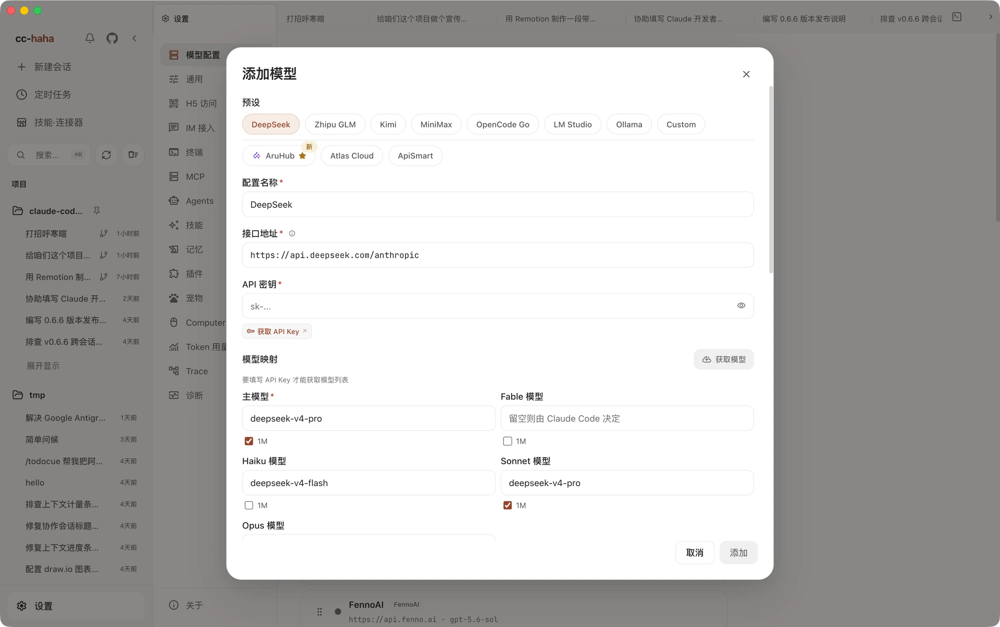

# Connect a model

cc-haha ships without a model. It's the shell that does the work; you have to give it a brain first.

Click "Settings" at the bottom of the sidebar, then pick the first tab, "Providers". From there you have three routes:

- **You have an official account** — Claude, ChatGPT, Grok, and DeepSeek each have a built-in card. One click opens a browser sign-in. No API key to type.
- **You have a third-party API key** — DeepSeek, Kimi, Zhipu GLM and others come as presets. Paste the key and you're done.
- **You want it free** — run LM Studio or Ollama on your own machine. The model runs on your GPU, costs nothing, and works offline.

You can configure all three and switch between them in the provider list.

## Sign in with an official account

Four cards sit at the top of Settings → Providers:

| Card | What you need |
|---|---|
| **Claude Official** | A Claude.ai account (Pro / Max subscription, or an API account with credit) |
| **ChatGPT Official** | A ChatGPT account, via OpenAI OAuth |
| **Grok Official** | An xAI account, via official Grok OAuth |
| **DeepSeek Account** | A DeepSeek platform account, billed to the account balance; no API key |

Click the sign-in button on the card ("Sign in to Claude" / "Sign in with ChatGPT" / "Sign in with Grok" / "Sign in with DeepSeek"). Your system browser opens the provider's authorization page; complete it with the same account and the browser hands you back to the app, where the card now reads as signed in.

Three things to watch for:

- Leave cc-haha running for the whole flow — the callback has to land in the running app.
- If the browser doesn't open by itself, click "Copy authorization link" and paste it in manually.
- Proxies and blocking browser extensions can intercept either the authorization page or the local callback. Turn them off before retrying.

Which models you get afterwards depends on your account tier and entitlements, not on the app. A model name appearing in documentation doesn't mean your account can call it.

## Official API and Agent SDK

For an Anthropic Console API key, choose the custom API preset in Add Model and set **Conversation runtime** to **Official Agent SDK**. Use `https://api.anthropic.com`, API Key authentication, Anthropic Messages format, and a model ID available to your account. Existing provider entries can also be edited to select this runtime.

After saving, start a new standard conversation and select that provider. The official SDK supports file operations, command execution, tool approvals, streaming, and resuming saved conversations. Model mappings and supported `1M` context settings still apply. Existing conversations keep their original runtime. Choose “Copy to Agent SDK” in a message’s action menu, then select an API configuration and model to copy compatible history through that message into a new SDK conversation. The original stays unchanged. Pending tasks, permission grants, previous file-undo history and provider-specific thinking are not transferred; incompatible history is rejected before creating the copy.

This uses the official Agent SDK's normal API-key billing and provides a desktop entry point for users who have claimed their Claude Max API credits. Anthropic's October 2026 [monthly API credit guidance](https://support.claude.com/en/articles/17154008-monthly-api-credits-for-max-and-team-plans) lists $100 per month for eligible Max 5x subscribers and $200 for Max 20x. Link a Console organization in Claude's billing settings, then use an API key from that organization. The guidance includes Agent SDK usage; these credits are separate from interactive Claude Code subscription usage.

Eligibility, balance and expiry follow Anthropic's account billing and current terms. The app does not claim credits or verify deductions, and the Test button only checks API connectivity. When credits run out, requests may continue using purchased balances or auto-reload, so check usage and budgets in the Console.

SDK mode loads user, project and local settings, including `CLAUDE.md`, Skills, MCP, hooks and enabled plugins. Model routing and API identity remain pinned to the selected provider; project environment settings cannot silently change the billing account. The official SDK supplies file tools, command execution, subagents, plan mode and file checkpoints.

cc-hh session branching, temporary side chats, `/btw` questions, reviewed teams and member collaboration, workflows, scheduled tasks, Computer Use and automatic question answers are also connected. Teams still require app review. Computer Use and automatic answers honor their Settings switches. Scheduled tasks use their selected provider and model and do not wait for interactive approval. Lean mode retains its tool restrictions.

Native subagent history and status are available in the activity panel. Give follow-up instructions in the main conversation so the lead agent can continue or resume the relevant subagent; the current official SDK has no working control for direct subagent messages. cc-hh teammates remain reachable through the dedicated message control in the team panel.

Additional MCP forms and browser authorization requests appear in the conversation. Submit the completed form, or open the displayed page, complete the requested step and return to confirm. You can also decline or cancel. Authorization links are not opened or accepted automatically. Unknown or unsupported dialog types are cancelled rather than accepted.

Native dialogs also cover automatic-permission fallback, reads outside the working directory, retrying or editing a prompt after a model refusal, and consent for models that require extra credits. You choose whether to switch to a fallback model or use credits. Editing a refused prompt restores the original text to the composer, and responses retracted by the native runtime are removed from the current history.

Typing `ultracode` yourself in the composer opts that turn into multi-agent workflow orchestration, honoring the configured workflow switch and size guideline. The same word in attachments, tool results, relayed messages or scheduled tasks does not trigger it. You can limit the scope, for example: “ultracode, use just one subagent to review this module.” Workflows support background execution, completion notifications and stopping; children load native configuration and independent read-only application-tool connections.

To keep workflow orchestration enabled for subsequent tasks, turn on **Ultracode** in the reasoning-effort menu, or enter `/effort ultracode on`. Turn it off with the same switch or `/effort ultracode off`; `/effort ultracode` alone also enables it. This uses the native session flag and preserves your selected model and reasoning effort. Simple conversation can still be answered directly. Selecting a different reasoning effort turns the mode off. Switching to an incompatible model pauses it; switching back to a supported model reactivates it. The UI shows the state acknowledged by the native runtime and identifies environment overrides affecting effort.

Standing Ultracode applies to the currently running conversation process: later messages do not need the keyword, but restarting the app or runtime, or relaunching a saved conversation, defaults it to off. This matches the native session flag and does not write a global preference. Dynamic workflows must be enabled in Settings, and the selected model must support the feature.

Proxy and request-timeout changes are applied before the next message in the same SDK conversation, preserving context. Forks do not inherit parent file-undo snapshots, matching the official SDK’s fork behavior; subsequent edits create new checkpoints. The desktop cannot guarantee support for every interactive dialog added by future SDK versions.

## Third-party API providers

With an API key in hand, this is the fastest route. Click "Add Provider", pick something under "Preset", and the base URL and default models are filled in for you — all you supply is the key.

The built-in presets, as they appear in the dialog:

- **DeepSeek** · **Zhipu GLM** · **Kimi** · **MiniMax** — major Chinese model vendors; the base URLs point at each one's Anthropic-compatible endpoint.
- **XuanShu API** · **FennoAI** — routing services that give you access to official Claude models through their own gateways.
- **Qiniu Cloud AI** — an aggregator MaaS platform: one key for DeepSeek, GLM, Kimi, Qwen, and more.
- **LM Studio** · **Ollama** — local models; see the next section.
- **Custom** — anything not listed above.

Which models FennoAI and Qiniu Cloud AI give you depends on the plan you bought, so those two presets fill in the base URL only and pin no models: paste your key, hit "Fetch models", and pick one from the live list.

When a preset has a signup page for API keys, a "Get API Key" button appears under the key field.

## Local models

To spend nothing and stay offline, run a model server on your machine and point the app at it.

**LM Studio**: load a model, start the local server, then choose the `LM Studio` preset in "Add Provider" with base URL `http://localhost:1234`.

**Ollama**: run `ollama serve`, choose the `Ollama` preset, and use base URL `http://localhost:11434`.

Check two things when connecting:

1. **Do not append `/v1` to the base URL.** Both of these expose an Anthropic-compatible protocol and the app uses that path. Adding `/v1` gives you a straight 404.
2. **Configure the context window to match what the model actually supports.** 200K is not a universal minimum. The window needs to hold the system prompt, tool definitions, loaded Skills, and current task. A smaller window may not fit that content, and longer tasks trigger compaction more often. Set the server's actual window in LM Studio or Ollama's model settings; do not declare a value beyond what it supports.

Whether a local model can complete an agent workflow depends on its tool-calling ability, API compatibility, configuration, and task. If it outputs text without calling tools, inspect the requests, responses, and tool configuration rather than inferring the cause from model size alone.

## The Add Provider dialog, field by field

**Name** (required) — how this provider appears in the list. A preset fills it in; rename it to something you'll recognize, like "DeepSeek — work account".

**Notes** — a line for yourself, e.g. "expires end of month". Doesn't affect any request.

**Base URL** (required) — the provider's API root, not its marketing site. Presets get this right. When entering it yourself, watch for duplicated path segments: if the URL already ends in `/anthropic`, don't also append `/v1/messages`.

**Auth Variable** — decides how your key is transmitted. Five options:

| Option | When to use it |
|---|---|
| API Key (`ANTHROPIC_API_KEY`) | Direct Anthropic API access, sends an `x-api-key` header |
| Bearer Token (`ANTHROPIC_AUTH_TOKEN`) | Nearly all third-party Anthropic-compatible services, sends `Authorization: Bearer` |
| Bearer + Empty API_KEY | OpenRouter, Ollama and similar, which must not fall back to an Anthropic key |
| Write token to both variables | Services like Hugging Face Router that check both |
| Write dummy to both variables | Local vLLM-style services that only need placeholder auth |

Presets pick the right one. If you're guessing, start with Bearer Token and switch to API Key if you get a 401.

**Enable Tool Search** (on by default) — loads MCP tools and part of the tool definitions on demand, saving a large chunk of schema tokens on the first turn. It depends on the model supporting `tool_reference`. **Turn it off for weaker models, or for providers that reject this request shape.**

**Disable experimental beta headers** — sets `CLAUDE_CODE_DISABLE_EXPERIMENTAL_BETAS=1` for this provider. Some third-party gateways error out on beta-shaped API requests; checking this stops the headers being sent. **Try this first when you see a 400 or an "unsupported parameter" error.**

**API Key** (required except for local models) — copied from the provider's console. Watch for leading or trailing whitespace when pasting. The key stays on your machine.

**Model Mapping** — four slots, each taking a **model ID**, not a product name:

- **Main Model** (required) — the model used for conversation. It must support tool calling.
- **Haiku Model** — leave blank to follow the main model. This slot handles lightweight work like title generation and file summaries; mapping it to a cheap small model saves real money.
- **Sonnet Model / Opus Model** — leave blank to follow the main model. Fill these in only when you actually want tiering.

Each slot has a `1M` checkbox. Tick it only if that model genuinely supports a one-million-token context window.

**API Format** — this field only appears when you pick the `Custom` preset or edit an existing provider. Three options: Anthropic Messages (native), OpenAI Chat Completions (proxied), and OpenAI Responses API (proxied). The proxied formats are translated by a loopback proxy the app starts locally — you don't deploy anything. Every built-in preset uses Anthropic native, which is why the field is hidden for them.

Click "Add" when you're done.

## After saving

Back in the provider list, on the entry you just created:

1. Click "Test". Anthropic-native providers run one step, "① Connectivity"; OpenAI formats add "② Proxy pipeline". Both must pass.
2. Click "Set default" so new sessions use it.
3. Multiple providers can be dragged to reorder. Order only affects how the list is displayed.

Then start a new session and **pick the specific model from the model selector at the bottom right of the composer** — that list reflects what the active provider actually offers. The control next to it sets reasoning effort; leave it at the default if you're unsure.

:::tip
A passing test isn't a guarantee. It proves the endpoint is reachable and the credentials work — not that the model can sustain tool calls and long context. The real check is asking for a task that edits a file, and seeing whether it actually does.
:::

Getting a 401, a connection failure, or an empty model list? See the model section of [Won't install, won't open, won't connect](./troubleshooting.md).

With a model connected, go [run your first session](./first-session.md).
