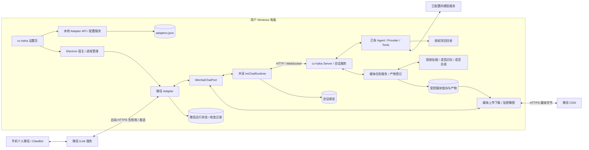

# cc-haha 个人微信接入架构设计

日期：2026-11-04。修订：v4，补充连接状态、持久投递与媒体体验。代码基线：`56805c1d`。状态：设计蓝图及历史记录保留；当前交付、验证及剩余边界以第 14 节为准。手机四类媒体验收暂由用户延后。

本文保留基于 `56805c1d` 和用户提供的「即时通讯适配器 → 微信」截图制定的设计蓝图，并在第 12、13 节记录此次实现和验证结果。按照仓库文档约定，设计提案放在仓库根目录；用户操作说明见 [docs/im/wechat.md](docs/im/wechat.md)。

第 1～11 节是完整蓝图，第 12～13 节是首版及故障修复历史；其中“未执行”“未实现”等时间相关描述不覆盖第 14 节的后续进展。

## 1. 结论与目标

**采用个人微信 ClawBot / iLink 通道，直接连接 cc-haha 现有微信 adapter，再复用 cc-haha 的本地会话、模型和工具运行时。** 不需要另部署 OpenClaw，也不需要企业微信账号、公网回调服务器或内网穿透。

截图中的入口已经有完整后端实现：扫码、凭据保存、adapter 启动、长轮询收消息、配对授权、会话创建与恢复、工具权限审批、回复发送均已存在。因此工作应定位为「验证已有接入并补齐可靠性」，而非重新开发微信机器人。

预期体验：用户在手机的微信 ClawBot 对话中发送“看看 cc-haha 项目当前状态”，本机 cc-haha 在选定项目中执行任务，微信收到结果；需要权限时，用户在微信回复审批指令。后续消息继续使用同一条 cc-haha 会话。

本设计默认单台 Windows 电脑、一个微信绑定账号、用户本人私聊。电脑必须开机、联网，cc-haha 的 server 和 adapter 必须运行；手机不必与电脑处在同一局域网。桌面窗口关闭后的驻留行为沿用现有宿主设置，不能把“窗口关了”直接等同于服务仍在线。

基础接入范围：文本、现有语音转文字输入、图片/文件输入、项目切换、会话恢复、停止任务、文本审批。本次修订将**图片回传、文件回传、视频收发与分析、语音合成后以音频文件回复**纳入明确实施范围；原生微信语音气泡作为需验证的增强能力，未验证前不承诺可用。

群聊、联系人自动回复、朋友圈操作、多账号并行、无人值守主动推送不在本次范围内。允许用户列表只是 cc-haha 的权限配置，不意味着微信平台允许其他联系人加入同一 ClawBot。媒体传输、内容理解、内容生成是三项独立能力：支持发视频并不等于内置视频生成模型。

### 1.1 设计时基线能力与目标矩阵

| 类型 | 基线接收 / 处理 | 基线回传 | 本轮设计目标 |
| --- | --- | --- | --- |
| 文字 | 已实现 | 已实现 | 保持兼容，补齐可靠性 |
| 图片 | 已接收；理解依赖视觉模型 | 未实现 | 原生图片消息回传，复用已有图片输出边界 |
| 文件 | 已接收，交给工具处理 | 未实现 | 报告、代码包等以文件附件回传，可在手机保存 |
| 视频 | 未实现处理 | 未实现 | 下载解密、元数据探测、关键帧/音轨分析、原生视频消息回传 |
| 语音 | 读取微信提供的转写文字 | 未实现 | 文字转语音后发送音频文件；无转写时按能力进行本地转写 |
| 原生语音气泡 | 不适用 | 未验证 | 独立协议验证，通过后启用；不以音频文件冒充原生语音支持 |

上表记录实施前状态；本次完成的部分见第 12 节。视频分析依赖可用的视觉/音频处理能力，TTS（文字转语音）依赖可用的合成引擎；缺少能力时仍可收发文件并解释处理限制。

## 2. 已有实现与实际缺口

下表及本节缺口是设计时对基线 `56805c1d` 的静态核对结果，不代表修改后的状态。“已有”表示存在实现，不代表已在当前账号和网络环境下验证成功；下载限额、入队后授权复核和接收日志等已在此次媒体实现中补充，见第 12 节。

| 层次 | 当前代码入口 | 已有能力 / 需要补齐的部分 |
| --- | --- | --- |
| 设置界面 | [AdapterSettings.tsx](desktop/src/pages/AdapterSettings.tsx) | 微信 Tab、二维码、重新扫码、解绑、允许用户；绿色状态依据 `accountId`，尚不能证明在线 |
| UI 状态与 API | [adapterStore.ts](desktop/src/stores/adapterStore.ts)、[adapters.ts](desktop/src/api/adapters.ts) | 扫码轮询、成功后更新配置并请求宿主重启；重启失败记录 warning，但绑定成功与运行就绪仍混在一起 |
| 本地绑定 API | [adapters.ts](src/server/api/adapters.ts)，`handleWechatAdaptersApi` | `login/start`、`login/poll`、`unbind`；换绑会清空 `pairedUsers`，当前保留 `allowedUsers` |
| 配置持久化 | [adapterService.ts](src/server/services/adapterService.ts) | 脱敏返回、进程内串行更新、临时文件 rename；不能据此推断跨进程写入互斥 |
| 宿主与进程 | [serverRuntime.ts](desktop/electron/services/serverRuntime.ts)、[sidecarManager.ts](desktop/electron/services/sidecarManager.ts)、[claude-sidecar.ts](desktop/sidecars/claude-sidecar.ts) | 已包含 `--wechat`，为平台创建 adapter 子进程，注入动态 `ADAPTER_SERVER_URL`；当前重启入口重启全部 adapter |
| 微信协议 | [protocol.ts](adapters/wechat/protocol.ts) | iLink 扫码、收发文本、typing；默认 `https://ilinkai.weixin.qq.com`，代码声明协议版本 `2.1.7` |
| 微信消息循环 | [index.ts](adapters/wechat/index.ts) | 长轮询、文本分片、项目/会话、审批、消息队列；仍维护独立编排，没有接入共享 `ImChatRuntime` |
| 媒体输入 | [media.ts](adapters/wechat/media.ts) | 下载、AES 解密、图片/文件落地；下载完整内容后才检查大小，缺少下载阶段字节上限和超时 |
| 公共编排 | [chat-runtime.ts](adapters/common/chat-runtime.ts) | `ChatPort`、`InboundChatMessage`、会话/命令/权限统一处理；微信应逐步复用 |
| 授权与会话 | [pairing.ts](adapters/common/pairing.ts)、[session-store.ts](adapters/common/session-store.ts)、[ws-bridge.ts](adapters/common/ws-bridge.ts) | 配对码、默认拒绝、会话存储、WS 桥接；会话存储键当前直接使用 `chatId`，需补平台/账号命名空间 |

已确认的改进点：

1. **绑定不等于在线。** UI 以账号字段判断状态；无法区分凭据失效、微信断线、server 断线、用户未配对。
2. **入站确认时机过早。** `routeUserMessage` 在处理前记录 dedup；`pollLoop` 在检查响应错误和路由完成前更新游标。路由内部又异步入队，因此 `await routeUserMessage()` 不代表消息已处理完成。
3. **发送异常分类不足。** 带 `context_token` 发送遇到任意异常后，会无 context 重试；若第一次已送达但响应丢失，可能重复回复。公共 `MessageBuffer` 还存在清空缓冲后发送、失败仅记录日志的路径，可能丢失回复片段。不能把所有网络异常视为 context 失效。
4. **绑定并发缺少版本约束。** 登录会话存于内存 Map，缺少明确取消 API 和绑定代次；旧扫码结果可能晚于重新扫码或解绑返回。`pollQrStatus` 还将所有异常归为等待，掩盖持续错误。
5. **撤权与换绑边界不完整。** 微信入站只在入队前检查用户；排队期间撤权仍需再次检查。换绑需要处理允许用户、旧 session、context、未完成发送和审批的归属。
6. **多进程配置写入存在竞争窗口。** server 的 `AdapterService` 和 adapter 的 `tryPair` 都读改写 `adapters.json`；原子 rename 防止半文件，不能防止相互覆盖。
7. **日志含正文。** 微信接收日志会输出前 80 个字符，可能包含配对码、用户代码或指令。默认日志应改为消息类型、长度和脱敏标识。

## 3. 总体架构



`WechatChatPort`、运行状态与持久收发记录属于拟新增或改造部分；图中 Agent、Server、配置、现有 adapter 入口均复用。微信层只做消息协议与展示，不拥有独立模型配置，不执行第二套 Agent，也不直接运行来自消息的 shell 文本。

职责约束：

- `protocol.ts`：协议请求、字段校验、错误分类、超时；不负责项目和模型。
- `WechatChatPort`：会话到微信接收者映射、context 生命周期、文本分片、typing、回复投递。
- 媒体任务服务：视频探测/抽帧/音轨转写、TTS、任务取消与产物登记；不直接发送微信消息。
- 媒体传输模块：授权产物的上传下载、微信媒体加解密与消息引用构造；与模型服务解耦。
- `ImChatRuntime`：配对门禁、命令、项目与 session、权限关联、服务器事件转译。
- 本地 server：模型选择、工具执行、权限最终裁决、session 真相；保留已有本地认证和 CORS 边界。
- 宿主：进程启停和退出原因。adapter 自报心跳和通道健康，不能仅凭进程存活显示“可用”。

不同平台不共用微信 context；相同平台不同绑定代次也不得共用 context。消息里的文件或引用文本作为用户输入交给既有运行时，不赋予额外系统权限。

## 4. 用户流程与状态设计

### 4.1 首次接入

1. 在手机微信确认 ClawBot 可用；入口通常为「我 → 设置 → 插件 → ClawBot」。手机版本、账号开放情况以实际客户端为准。
2. 在 cc-haha 的 IM 设置中选定默认项目和允许访问目录。默认项目选本机实际仓库目录（例如 `C:\Projects\cc-haha`），并让允许目录覆盖它。
3. 点击「扫码绑定」，手机扫描并确认；本地 server 保存凭据，宿主启动或重启微信 adapter。
4. 显示“账号已绑定，等待通道连接”，收到 adapter 健康报告后显示“通道在线，待配对”。
5. 使用现有「生成配对码」，在微信 ClawBot 对话中发送。保留现有 6 位一次性码和 60 分钟有效期；不自动把扫码账号转换成工具执行授权。
6. 配对后先发 `/status`、`/help`，再发一条项目只读任务。首条回复完成后才显示“已验证收发”。

不新增“登录 OpenClaw”步骤。用户在 cc-haha 扫码即可；微信端显示名称可能由平台控制，不能承诺改成 cc-haha。

### 4.2 两组独立状态

绑定流程：`unbound → qr_waiting → qr_scanned → credential_saved`，另有 `expired / cancelled / failed`。重新扫码生成新 `loginGeneration`，解绑使旧代次失效；过期响应不得提交凭据。

运行状态：`stopped / starting / online / reconnecting / auth_expired / error`。此外单独显示 `paired`、`serverReachable`、`lastReceiveAt`、`lastSendAt`。无消息的长轮询成功可以证明通道请求正常，不能证明往返消息已验证。

UI 保留现有 Tab，增加连接详情与“重新连接”；“重新扫码”只用于重新认证，“重新连接”复用有效凭据。绑定凭据已保存但进程重启失败时保留绑定结果，显示明确错误与重试入口。

建议将微信面板独立放入 `desktop/src/pages/settings/WechatAdapterPanel.tsx` 并在现有页面直接引用，复用已有设置组件与二维码交互，避免继续扩大 `AdapterSettings.tsx`。产品文案使用“账号已绑定 / 消息通道在线 / 等待配对”，不展示内部 token 或协议字段。

## 5. 控制面 API 与配置

### 5.1 保留与新增接口

下表中“新增”均为设计，当前代码尚无这些接口。

| 接口 | 状态 | 行为 |
| --- | --- | --- |
| `GET /api/adapters` | 已有 | 返回脱敏配置，不能用作健康检查 |
| `PUT /api/adapters` | 已有 | 修改默认项目、目录与允许用户；不接受普通表单直接提交微信 token |
| `POST /api/adapters/wechat/login/start` | 已有，扩展 | 返回 `sessionKey`、二维码内容、`expiresAt`、`loginGeneration` |
| `POST /api/adapters/wechat/login/poll` | 已有，扩展 | 校验会话与代次；重复确认幂等；过期旧结果不落盘 |
| `POST /api/adapters/wechat/login/cancel` | 新增 | 取消当前登录尝试；保留之前有效绑定 |
| `POST /api/adapters/wechat/unbind` | 已有，扩展 | 撤销本地绑定代次、授权及运行状态，并停止对应 worker |
| `GET /api/adapters/wechat/status` | 新增 | 返回绑定、运行、配对、server 连通性和脱敏最近错误 |
| `POST /api/adapters/wechat/runtime/report` | 新增，内部 | adapter 使用继承的本地服务认证上报心跳、接收/发送结果；携带绑定代次与进程实例 ID |
| `POST /api/adapters/pairing/consume` | 新增，内部 | server 串行校验并消费一次性码，合并授权配置，消除 adapter 直接写共享配置的竞争 |

新增内部接口仅接受受信的本机 adapter 身份；不得复用公开 webhook。通用 API 鉴权还不等于 adapter 身份校验，实施时应绑定宿主注册的 worker 实例及 capability。绑定管理也应保持桌面本地管理权限，不扩大现有 H5 或其他 token 的权限。

健康报告字段建议：

```ts
type WechatRuntimeReport = {
  instanceId: string
  bindingGeneration: number
  state: 'starting' | 'online' | 'reconnecting' | 'auth_expired' | 'error'
  serverReachable: boolean
  lastPollOkAt?: number
  lastReceiveAt?: number
  lastSendAt?: number
  errorCode?: string
}
```

建议每 15 秒报告一次，45 秒未更新视为 stale；这些是本地设计参数，不是微信平台约束。server 不可达时 UI 显示未知/断线，不能保留过期绿灯。宿主确认进程退出时可立即标记停止。

现有 UI 成功轮询返回“配置对象或未连接对象”的联合类型可暂时保留；扩展时增加判别字段并兼容旧客户端，避免将“有配置对象”继续解释为“通道已连接”。

### 5.2 持久化与写入归属

`CLAUDE_CONFIG_DIR` 决定配置根；未设置时才使用现有 `~/.claude`。设计和测试不得硬编码或读取开发者真实目录。

| 数据 | 保存位置 / 写入方 | 生命周期 |
| --- | --- | --- |
| 微信账号凭据、授权用户、默认项目 | 现有 `adapters.json` / server 配置服务 | 解绑清除微信凭据和授权；保留其他平台及未知字段 |
| `bindingGeneration` | 拟新增 `wechat` 子字段 / server | 每次凭据提交、解绑推进；隔离旧进程与迟到事件 |
| 登录 QR / 暂存凭据 | server 内存 / 登录协调器 | 有效期内，提交或取消后清除；不写日志 |
| 会话绑定 | 现有 `adapter-sessions.json` / 公共 session store | 改为有命名空间的 key，保留历史会话正文 |
| cursor、去重、inbox/outbox | 拟新增 `wechat-runtime.sqlite` / 单个微信 worker | M2 引入，按绑定代次隔离；有容量与保留期 |
| UI 健康快照 | server 内存 | 重启后重新报告，不从历史“在线”状态恢复 |

配置仍先复用当前凭据存储，API 仅返回脱敏值；Windows 下需验证配置文件访问权限，不能把 POSIX `0600` 当作 Windows ACL 或加密保证。是否迁入系统凭据库是后续独立改造，不阻塞首期。

所有新字段、session key 和存储演进必须提供前向迁移、旧 fixture 测试与未知字段保留。schema version 只属于本功能存储，不写入用户共享 `settings.json`。迁移前备份；回滚程序前停止 worker 并恢复匹配的备份，禁止让不识别新状态的旧程序自动重放任务。

## 6. 消息与会话设计

### 6.1 接入共享运行时

将微信 `index.ts` 收敛为启动、轮询、标准化和关闭逻辑，新增 `chat-port.ts` 实现 `ChatPort`。保留 `protocol.ts`、`media.ts`、`typing.ts` 的平台职责。迁移时先用入口回归测试锁住既有行为，再替换重复编排。

标准化映射：`userId = from_user_id`；微信原始接收者 ID 仅用于协议发送；运行时 `chatId` 使用编码后的 `wechat + accountId + bindingGeneration + peerId`，避免分隔符碰撞。`ChatPort` 保留 runtime key 到 peer 的映射，发送时不能把命名空间 key 当作微信用户 ID。

`dedupKey` 至少包含平台、绑定代次、发送者和协议消息 ID。缺少稳定消息 ID 时，以 seq、时间和规范化内容摘要作为降级键并记录诊断，禁止所有缺字段消息都落入相同的空 key。摘要只是去重辅助，不能当身份认证。

图片/文件使用 `loadAttachments` 延迟下载，确保授权后、按会话顺序进入；typing 和 context 由 port 管理；`permission_request` 发出前完成已有文本流，避免审批与回答顺序混乱。既有 `/help`、`/status`、`/projects`、`/new`、`/clear`、`/stop` 与 session 选择功能保持一致。

共享运行时目前仍只有内存去重与连接级发送结果。迁移完成不等于具备持久接收确认，M2 需要显式补齐 ACK 契约。

### 6.2 绑定、撤权与恢复

- 默认拒绝未授权用户，保留配对与显式允许列表；授权在入站和实际出队前各校验一次。输出投递也检查当前授权与绑定代次；单用户撤权时取消其排队输入、待发输出并解除会话订阅。配对成功/失败提示是受限的控制消息，不能因尚未配对而全部禁止。
- 同账号重新认证可以提供受控 session 重新关联；首期默认重新配对。换成不同账号必须清除 `allowedUsers` 与 `pairedUsers`，不沿用旧账号授权。
- 解绑先使代次失效，阻断旧 worker 的新入站和回发，再停止 worker、清理该代次的 context、cursor、去重、待发消息和 session 映射。迟到扫码响应也必须被拒绝。
- 既有 Agent 已提交的任务不因删除配置而自动停止。解绑流程应通过 server 对此微信绑定独占、正在运行的 session 发送停止，拒绝其待决审批并报告停止结果；不删除桌面历史，不停止其他平台/桌面独立任务。无法确认停止时明确提示，不能报告全部完成。
- 旧版裸 `chatId` 映射无法可靠判断平台和账号归属，不自动归给新微信身份。保留历史，配对后让用户显式选回旧 session；恢复时仍执行项目目录和 session 可访问性校验。
- 多 adapter 进程写共享 session 文件的更新应通过公共存储边界串行化或采用进程间锁，锁内重读并合并。仅增加命名空间不足以解决并发丢写。

### 6.3 M1 的错误处理

长轮询必须可取消，并确保一个绑定只有一个 active poller。无新消息超时视为正常；网络错误指数退避并加 jitter，建议 1～30 秒；尊重服务端实际返回的限流信号。只有已确认的认证失效响应才进入 `auth_expired`，停止自动重试并提示重新扫码，错误码以实际协议 fixture 为准。

修正响应校验与游标推进顺序，并让入队操作返回真实处理 Promise，避免把“已排队”当“已完成”。在 M2 之前明确其进程重启恢复仍是 best effort，不承诺无丢失。

发送按同一 chat 串行，保留现有 3500 字符分片策略作为本地策略，通过 fixture 检查 Unicode 和编码长度，不将它宣传为已验证的微信官方上限。仅在确认属于 context 失效、且协议支持替代发送方式时进行降级；超时或断线记为“送达未知”，不盲目生成新消息 ID 重试。文本缓冲交给投递队列持有后才能清空，失败必须保留可诊断状态；M1 先提供有上限的内存队列与失败提示，M2 再持久化。

长轮询接收与执行队列分离，执行队列只串行消息接收和路由，不占住整个模型生成周期；`/stop` 与审批不能被长任务或媒体下载无限阻塞。控制消息走同一身份/权限校验下的优先通路，`/new` 等改变 session 的命令仍按既有 busy 语义处理。每 chat 队列设容量上限，超限显式拒绝而非静默丢弃。

### 6.4 M2 的持久收发与保证边界

采用本地 SQLite 的事务性 inbox/outbox；Bun 运行环境优先评估内置 `bun:sqlite`，打包前验证目标 sidecar 的支持情况，不引入 Redis 或云消息队列。

建议表：`account_state(bindingKey, cursor)`、`inbound(bindingKey, messageKey, state, payload, sessionId, submissionId)`、`outbound(bindingKey, replyId, chunkIndex, state, clientId, payload)`。消息唯一键含绑定身份；正文和 context 仅在需要恢复投递时保存，限制访问权限，成功记录默认 24 小时清理、异常记录最多 7 天，设总容量上限。上述期限为初始设计值。

接收事务：校验响应 → 对消息 `INSERT OR IGNORE` → 同一事务提交新的 cursor → worker 消费 inbox。未授权内容不持久保存正文，记录最少去重结果；所有真正执行动作仍要在出队时校验授权与当前代次。数据库写入失败时不提交游标、不继续提交新任务。

任务投递状态：`received → dispatching → accepted → completed`，另有 `rejected / failed / uncertain`。应在公共 WS 消息协议增加 `submissionId`：server 持久接受消息后返回 ACK；相同 session 的相同 `submissionId` 只追加一次用户输入，adapter 可查询接收状态。ACK 代表已接受，不代表工具或任务完成。

若 server 尚无幂等提交和查询能力，进程在 `dispatching` 阶段崩溃后只能标记 `uncertain` 并向用户提示核对，不能自动再执行一次写文件或命令。该能力应覆盖 runtime 恢复测试，不能仅靠 adapter inbox 声称任务恰好执行一次。

回复状态：`pending → sending → sent / failed / unknown`。生成分片时固定 `clientId`；微信是否按该字段幂等去重必须单独验证，不能假定支持。已明确送达的分片不重发；网络超时造成未知状态时保留记录，让用户查看桌面结果或显式补发，不能重跑 Agent 来补一条回复。

M2 目标是持久接收、可恢复状态和避免重复提交，**不承诺端到端 exactly-once**，也不承诺微信离线消息永久保留或任意时刻主动推送。长任务完成但 context 不再可用时，结果仍留在 cc-haha，用户下一次主动消息可获取摘要。

## 7. 工具权限与多媒体架构

权限继续由 cc-haha 的 Agent/server 决定。微信仅承载 `/allow <requestId>`、`/deny <requestId>`、`/always <requestId>` 等既有决策；requestId 必须匹配当前绑定、用户、session 的待决请求，旧 session 和重放审批不得放行。`/always` 沿用已有规则语义，不扩成全部工具永久授权。

项目访问复用 `defaultProjectDir / allowedProjectRoots` 与既有路径解析，确认 Windows 路径、符号链接和真实路径边界。Computer Use 继续遵循项目已有总开关、统一同意、OS 权限及目标有效性检查，不为微信另加逐应用审批体系。

附件维持项目当前的图片 10 MiB、文件 30 MiB 限制，这是 cc-haha 的应用策略：下载前检查可用长度元数据，流式读取时执行硬上限，解密后再次检查；增加超时、总附件数量/总字节预算和临时文件清理。未知文件名经过现有 AttachmentStore 路径处理，拒绝穿越目录。

微信返回的媒体 URL、登录 redirect host 和 base URL 需要按核对后的官方服务主机集合校验 HTTPS、重定向目的地与地址范围，拒绝 localhost/内网目标；不能直接信任返回字符串再携带凭据请求。测试的 loopback 传输通过注入 mock 完成，不能因此放宽生产 URL 校验。当前 CDN fallback 是否与最新服务一致列入联调项，本文不凭其他项目的地址直接改写它。

目前代码能接收图片/文件，但只实现文本回复。以下多媒体功能现已纳入 M3～M5 的实施范围；所有新增接口和模块均为提案，不能把 Windows 本地路径直接发给手机并称为“可下载”。

### 7.1 统一媒体产物与能力契约

复用 [attachment-types.ts](adapters/common/attachment/attachment-types.ts)、[outbound-image.ts](adapters/common/attachment/outbound-image.ts) 的附件类型与受控文件读取边界。现有 `ChatPort.sendImage` 和图片输出识别继续兼容，新增可选 `sendMedia` 与能力查询，避免要求其他平台同步实现视频和语音。

以下类型是边界示意，实施时应与现有 WS 事件、会话产物类型合并，避免形成重复模型：

```ts
type MediaKind = 'image' | 'file' | 'video' | 'audio'

type SessionMediaArtifact = {
  artifactId: string
  sessionId: string
  turnId: string
  kind: MediaKind
  fileName: string
  mimeType: string
  sizeBytes: number
  sha256: string
  durationMs?: number
}

type MediaDeliveryRequest = {
  deliveryId: string
  artifactId: string
  chatId: string
  bindingGeneration: number
  presentation: 'image' | 'file' | 'video' | 'voice'
}
```

`audio` 表示音频内容，`voice` 表示微信原生语音展示；音频可用 `presentation: 'file'` 投递。能力集合分别声明图片、文件、视频、音频文件和原生语音，不以单一 `supportsMedia` 开关混淆。限制取应用策略、已验证平台限制和处理引擎限制中的最小值。

server 登记文件并签发会话范围的 `artifactId`；本地路径由受信服务内部解析，不允许微信消息、模型输出或任意客户端用一个路径字符串直接要求发送。产物限定为当前 session 可访问的项目文件或登记的临时产物，读取时验证真实路径、普通文件类型、大小和归属，并暂存不可变快照与摘要，防止排队期间原文件变化。

任务生成产物后，通过拟新增的结构化 `media_ready` 事件提供产物描述和回传意图。适配器按当前聊天订阅、授权与绑定代次提交 outbox。首期只在用户要求回传、工具返回明确可交付产物或已启用语音回复时发送，不把所有工具产生的文件自动上传。图片 watcher 与结构化事件统一归一到 `artifactId + turnId + delivery intent` 去重，避免同一张图片发送两次。

### 7.2 图片、文件和视频回传

采用腾讯官方客户端已有媒体发送流程，抽为微信专用 `media-upload.ts` 和消息构造函数：受控读取 → 获取上传地址 → 加密上传 CDN → 构造媒体引用 → 使用 `sendmessage` 发送。具体字段、密钥编码、上传响应校验以锁定版本的官方实现和协议 fixture 为准；不能直接把现有下载逻辑反过来拼接地址。

图片以图片消息展示；报告和代码包以文件消息展示；符合已验证格式的视频以视频消息展示。不兼容的视频可在用户知情下转码，或明确作为文件发送，不能把降级成功记为原生视频成功。文件名、真实 MIME、大小需一致，文本说明与媒体保持同一回复顺序。

投递记录扩展为 `staged → uploading → uploaded → sending → sent`，另有 `failed / cancelled / unknown`。持久保存产物摘要、上传引用、稳定 clientId、绑定代次和阶段；上传成功不等于消息送达。明确未发送的失败可重试对应阶段；消息送达未知时沿用第 6.4 节策略，不重新执行生成任务或盲目重发。CDN 引用不可用时只能在确认可重新投递后重新上传。

媒体快照在 outbox 完成或明确取消之前不能被 GC。解绑或撤权先取消待发任务并销毁本地媒体密钥/引用；已上传或已发送内容不能声称已从微信远端撤回。日志不记录密钥、签名 URL、context 或文件内容。

### 7.3 视频接收与分析

在 `media.ts` 增加 `video_item` 解析与解密。初期保持视频作为文件传入现有附件链路，同时附上受控的媒体元数据；只有 provider 已声明并验证原生视频输入时才构造相应模型请求，不能将 MP4 的 base64 填进图片字段。

默认采用可解释的抽帧方案：

1. 下载后用受控媒体进程探测格式、时长、尺寸和音轨；异常或不支持格式直接给出提示。
2. 对短视频均匀抽帧并保留时间戳，按视觉模型限制缩放；有音轨时转成识别引擎支持的格式并转写。
3. 将关键帧、带时间戳转写和用户问题交给现有会话，要求回答说明覆盖的视频片段和采样限制。
4. 长视频先提示限制或按用户选择分析时间段；不静默丢弃后半段后宣称已看完整视频。没有视觉模型时可提供音轨摘要，没有识别能力时可仅分析画面，并说明实际使用的信息。

初始应用预算建议为视频 30 MiB、分析时长 120 秒、最多 12 帧，每个用户最多一个视频分析任务；这些是可配置的起点，不是微信官方限制。传输文件大小与内容分析时长分别判断：超出分析时长不代表不能作为文件接收。帧数、分辨率、音轨时长和模型输入量都要计入预算。

建议通过 `ffprobe/ffmpeg` 子进程完成探测、抽帧和音轨提取，使用独立参数数组、超时、资源和输出文件上限；取消任务时结束子进程并清理临时文件。实施前核对 Windows 打包体积、依赖许可和已有媒体工具，不默认系统已安装，也不在首次接收时静默下载可执行程序。依赖不可用时保留视频附件，明确提示分析不可用。

### 7.4 语音输入与合成回复

输入继续优先使用微信的 `voice_item.text`；缺少转写时，可下载音频、转换为受支持格式，再通过已有 [voiceService.ts](src/server/services/voice/voiceService.ts) 的能力边界接入识别。实施前验证其输入格式、生命周期和非 UI 调用契约；现有语音识别服务不能直接等同于 TTS。无法识别时提示重新发送文字，不把空内容当成功输入。

新增独立 `SpeechSynthesisService`，通过 provider 接口接入至少一种实际可用的合成引擎，并复用产品既有模型服务/凭据管理方式。具体引擎选型在实施阶段依据可用配置确定；没有合成引擎时显示“未配置”，不得把桩实现标为支持。模型服务密钥只留在 server，微信 adapter 不保存一份。

建议产品设置为 `replyMode: text | text_and_audio`，默认 `text`，并配置合成 provider、音色与文本长度上限。用户明确说“用语音回复”时可为本轮启用；仅对完成后的自然语言答案合成，不逐 token 合成，不朗读代码块、大量日志或权限审批。长回答先提供完整文字，再合成标明为摘要的音频；TTS 失败保留文字回复，不重跑 Agent。

音频登记为会话产物后，经统一文件上传链路回传 MP3/WAV 等已验证格式，提示“音频文件，可下载播放”。手机是否支持直接预览单独实测，不承诺与微信语音气泡相同体验。建议初始预算为单次合成最多 2000 字、音频最多 10 MiB；引擎限制更低时采用更低值。

原生语音气泡是独立能力门槛：腾讯文档有语音字段和上传类型，但当前参考发送流程没有实现相应分支。应先完成编码、时长、请求字段、账号能力及手机播放的验证，再开放 `nativeVoice` 能力。未验证时只提供音频文件；已明确被拒绝可解释后降级，送达未知时不再追加文件造成重复。若最终平台不支持，保留受限状态和原因，不把这一项写成完成。

### 7.5 媒体任务状态、接口和清理

在现有会话服务边界增加媒体任务，不开独立公网服务。建议内部契约为：`createMediaJob(sessionId, sourceArtifactId, operation)`、`getMediaJob(jobId)`、`cancelMediaJob(jobId)`、`resolveArtifact(artifactId, sessionScope)`；具体是否需要 HTTP 路由由进程边界决定。`operation` 限定为 `video_analyze / audio_transcribe / speech_synthesize / transcode` 等已注册操作，不接受任意可执行命令。

任务状态为 `queued / running / completed / failed / cancelled`，与微信投递状态分开。`/status` 可显示“正在分析视频 / 正在生成音频 / 等待发送”；`/stop` 取消本轮媒体处理和尚未发送的输出，并取消关联模型任务。正在提交到微信的请求结果可能未知，应按投递状态报告，不能假装可以撤销已送达消息。

保留当前图片 10 MiB、文件 30 MiB 策略，新增视频和音频预算；下载、解密、转码、上传各阶段均限制资源，不能只检查最初的压缩文件大小。临时帧/音轨完成后释放；最终产物按会话产物保留策略管理，重试引用的文件使用引用计数或租约保护。磁盘满、依赖缺失或排队超限均返回具体错误，不能无提示地忽略用户附件。

建议模块职责：微信 `media-upload.ts` 负责协议上传；公共 `attachment/outbound-media.ts` 负责受控读取和产物转换；server 的 `mediaJobService.ts` 负责调度；`videoProcessingService.ts` 和 `speechSynthesisService.ts` 负责内容处理。文件名是拟新增位置，实施时优先复用已存在的同职责服务。新增能力的 UI、配置校验、五种语言文案和旧配置默认值必须一起交付。

## 8. 分阶段实施与验收

| 阶段 | 交付 | 主要文件 / 验收 |
| --- | --- | --- |
| M0：验证现有链路 | 不改协议，完成安装包或源码环境的闭环定位 | 检查微信入口、模型配置、默认项目、扫码、配对、`/status`、一条只读任务和一次重启；输出运行日志摘要，不含凭据 |
| M1a：连接体验 | 绑定与运行分离、扫码取消/过期/代次、健康状态、可靠重新连接 | `protocol.ts`、server adapter API、store/API、微信设置模块、宿主 lifecycle；旧轮询不能覆盖新绑定，重启失败不显示在线 |
| M1b：消息与权限 | 微信迁移共享 runtime、入队后二次授权、正确错误分类、媒体下载限制、日志脱敏 | `index.ts`、新 `chat-port.ts`、`media.ts`、公共 runtime；保持现有命令、会话与审批行为 |
| M1c：持久身份与配置 | session 命名空间、换绑隔离、server 单写配置、解绑停止链路 | 配置/API、pairing、session store、宿主；旧配置前向迁移，其他平台不受影响 |
| M2：恢复能力 | SQLite inbox/outbox、server 幂等接收/ACK、崩溃恢复、未知投递可见 | 新 `delivery-store.ts` 与 worker、公共 WS 协议和 session 接收边界；断电/超时不自动重复执行有副作用任务 |
| M3：图片与文件回传 | 产物登记、受控读取、CDN 上传、媒体 outbox、ChatPort 扩展 | `media-upload.ts`、公共附件边界、server 产物事件；手机实际收到并打开图片、下载文件，正文与媒体不重复 |
| M4：视频收发与分析 | 视频解密/上传、媒体依赖管理、抽帧和音轨转写、取消与预算 | 视频处理服务、媒体任务调度、provider 能力适配；正确说明分析覆盖范围，失败不影响普通聊天 |
| M5：语音回复 | 合成引擎接入、回复偏好、音频文件回传；原生语音独立验证 | TTS 服务、配置/UI、统一媒体队列；音频文件可用，原生语音按实测标为支持或受限 |

M1 不等待 M2 才能使用，但必须说明断电恢复边界。已有宿主重启全部 adapter 的行为可先保留并在 UI 提示其他 IM 短暂重连；后续再增加定向重启，不另起第二套进程管理器。

M3 正式交付依赖 M1 的身份与授权边界、M2 的媒体可恢复投递基础；协议上传的离线原型可以提前验证。M4、M5 复用 M3 的传输与产物契约，不各自再做上传系统。原生语音验证可提前进行，不阻塞图片/文件/视频及音频文件交付；若受平台限制，最终验收必须保留该限制。定向重启、长期驻留和视频生成模型接入仍为后续独立范围。

建议新增文件保持少量且各有独立责任：`adapters/wechat/chat-port.ts`、`worker.ts`、M2 的 `delivery-store.ts`；绑定协调器可放 `src/server/services/wechatBindingService.ts`，健康状态放 `adapterRuntimeService.ts`。公共逻辑继续进入既有 common 边界，避免为微信复制配置、配对、审批、session 系统。

## 9. 测试方案

已有覆盖入口：微信 [protocol.test.ts](adapters/wechat/__tests__/protocol.test.ts)、[typing.test.ts](adapters/wechat/__tests__/typing.test.ts)，server [adapters.test.ts](src/server/__tests__/adapters.test.ts)，UI [AdapterSettings.test.tsx](desktop/src/pages/AdapterSettings.test.tsx) 与 [adapterStore.test.ts](desktop/src/stores/adapterStore.test.ts)。还需保留跨平台 [legacy-session-selection-entrypoint.test.ts](adapters/feishu/__tests__/legacy-session-selection-entrypoint.test.ts) 中的微信入口回归，不能只看 `wechat/__tests__` 判断覆盖。

| 场景 | 必须验证的结果 |
| --- | --- |
| 扫码正常、过期、取消、缺凭据、重定向失败 | 终态准确；无完整凭据不保存；用户能重试 |
| 扫码 A 后开始 B，A 迟到；扫码中解绑 | A 不覆盖 B；解绑后不被旧结果重新绑定 |
| 配置已保存但宿主重启失败 | 保留账号，运行状态错误，可复用凭据重连 |
| 两平台同时消费配对码，UI 同时保存配置 | 码只消费一次；其他平台和未知字段不丢失 |
| 未配对、队列等待期间撤权、跨会话审批 | 不创建越权任务、不下载未授权附件、不错误放行 |
| 同消息重复、相同 seq 不同用户、缺 ID | 正确去重和身份隔离；不将不同消息合并 |
| 入站落盘/游标提交/任务 ACK 各边界崩溃 | 状态可解释；未知投递不自动重复执行任务 |
| 微信发送超时、429/认证错误、context 错误 | 分类处理，不把所有失败变成无 context 重试 |
| 重启、换账号、旧裸 session key | 无跨账号串会话；历史保留；恢复前验证项目 |
| 超大媒体、慢下载、恶意 URL、文件名穿越 | 下载被及时中断；不访问非法地址、不越界写盘 |
| 文本流后出现审批、/stop、/clear | 顺序明确、session 语义不回退、待决权限可恢复 |
| M2 回复分片部分成功 | 已发分片不自动重复；失败状态可见，不重跑 Agent |
| 图片/文件上传与发送、下载校验 | 手机能查看图片和保存文件；普通文件下载摘要一致；图片若被平台压缩则按展示/内容验收，不要求字节一致 |
| 上传成功后发送失败、发送响应丢失 | 区分 uploaded 与 sent；复用可用上传引用；unknown 不盲目重发 |
| 非当前会话产物、文件排队期间变动、重复事件 | 拒绝越权文件；发送登记快照；watcher 与结构化事件不重复发送 |
| 入站视频正常/损坏/超长/无音轨/无依赖 | 有界处理，带时间戳输出；明确实际覆盖和缺失能力 |
| 出站视频格式不兼容 | 明确转码或作为文件回传；不虚报原生视频成功 |
| 语音无转写、识别引擎不可用 | 可用时回退识别；不可用时提示，不产生空任务 |
| TTS 正常/未配置/超长/失败/取消 | 正常得到音频文件；失败保留文本；不朗读审批；不重复调用 Agent |
| 原生语音协议和手机播放验证 | 未通过不启用 nativeVoice；音频文件成功不计为原生语音成功 |
| 媒体处理期间 /stop、撤权、解绑、磁盘满、GC | 子进程和未发任务正确取消；无越权回发；待重试产物不被提前清理 |

全部自动化测试使用临时 `CLAUDE_CONFIG_DIR`、假凭据、mock 微信/模型和 loopback server，禁止使用真实账号配置。按最终代码 diff 执行 `bun run check:impact` 选择的 gates；通常涉及 adapters/server/desktop，宿主改动涉及 native，持久化改动必须运行 persistence-upgrade，WS/session 改动按影响选择 chat-contract/agent-flow。

微信真实扫码和模型任务为独立人工联调证据，不在本次文档工作中执行。后续联调先验证绑定和不调用模型的 `/help`，再在明确授权的环境执行真实模型任务。mock 通过不能替代真实微信兼容性结果。

媒体测试使用微型图片/文件/视频/音频 fixture 与假上传服务，校验请求字段、加解密往返和文件内容；视频进程用受控 runner 测试超时与取消，并增加一次真实本地处理 fixture 检查，不能只 mock 命令成功。TTS 用假 provider 验证契约，实际引擎合成和微信手机展示另记联调证据。公共 ChatPort、WS 事件及 provider 请求形状变化还需覆盖其他已支持 IM 的兼容回归。

## 10. 外部依据与待核实事项

截至 2026-11-04，腾讯的 [CodeBuddy Channels 官方文档](https://intl.cloud.tencent.com/zh/document/product/1316/84459) 说明可通过微信 ClawBot 扫码建立双向消息通道，入口位于微信插件页。这证明 ClawBot 可承载第三方运行时的聊天桥；其中 CodeBuddy 的 MCP channel 机制不是 cc-haha 必须采用的架构。

腾讯的 [云桌面通道配置文档](https://cloud.tencent.com.cn/document/product/1291/129132) 展示微信扫码后在 ClawBot 对话中交互的操作流程。另可参考 [AstrBot 个人微信适配器文档](https://github.com/AstrBotDevs/AstrBot/blob/master/docs/zh/platform/weixin_oc.md) 对官方 `openclaw-weixin` 接口、扫码与长轮询的集成说明；它是项目自身实现文档，不是腾讯协议稳定性承诺。

外部文档只用于核对接入路径。本文对 cc-haha 的能力和缺口以当前本地源码为依据，未将其他产品支持的上传、群聊或消息类型自动等同于本项目支持。

本次多媒体修订补充 [腾讯 openclaw-weixin 官方协议文档](https://github.com/Tencent/openclaw-weixin/blob/main/docs/protocol.md)：参考客户端已实现图片、视频和文件的上传发送；文档明确指出语音上传类型存在，但当前文件发送流程未实现该分支。参考文档描述客户端行为，不等同于完整服务端契约。链接指向可变的 main，实施时必须锁定审阅 commit、许可证与脱敏协议 fixture，不能只把本地版本号从 `2.1.7` 改成文档示例版本便认为兼容。

实施前需核实：当前微信账号的 ClawBot 可用性；仓库声明的 `2.1.7` 协议与服务兼容性；返回 host/CDN、认证失效错误、context 有效期、分片编码上限、`client_id` 去重语义和离线消息保留行为。无法验证的能力保持显式限制，不靠猜测补进协议。

多媒体另需核实：各类型大小/格式/时长限制、CDN 引用有效期、视频手机播放与缩略图需求、音频文件预览、原生语音编码及实际可发送性、TTS 引擎和视频处理依赖的部署方式。原生视频输入和音轨识别根据 provider 能力单独判定，不由微信传输能力推导。

以上为 v2 的完整设计蓝图。用户随后授权先实现三项多媒体能力，首版实际范围与设计差异见第 12 节；不能由蓝图推断所有基础设施已完成。原生语音仅通过验证后才标为支持。

## 11. 文档检查记录

初版检查：

- 通过：所有本地 Markdown 链接均能定位到仓库文件；新增文件的 `git diff --no-index --check` 未发现空白错误。
- 通过：`bun run check:impact --files wechat-personal-integration-design.md --no-dependency-graph`，结果无阻塞、无额外检查项。
- 已中止：默认开启依赖图的同一 impact 命令长时间未返回报告，手动中止；没有宣称该次检查通过。纯 Markdown 不改变模块导入，本次改用显式关闭依赖图的路径检查。
- 未运行：业务单元测试、完整站点构建、桌面 smoke、真实微信及模型联调；本次只新增根目录设计文档，不新增业务测试。

v2 修订检查（2026-11-04）：

- 通过：重新验证全部本地链接、Markdown 代码围栏配对、`git diff --no-index --check` 与 `git diff --check`；检查阶段表和范围描述，移除“图片/文件仅按需扩展”的旧结论。
- 通过：重新运行 `bun run check:impact --files wechat-personal-integration-design.md --no-dependency-graph`，无阻塞、无额外检查项；未重跑初版曾中止的完整依赖图扫描。
- 未运行：业务测试、媒体上传/转码/TTS 实测及真实微信联调；本次仅更新设计，不新增业务代码或测试。

## 12. 首版实现状态与使用方式

本节记录 v3 实现，优先交付用户指定的三项媒体功能；没有把所有 M1/M2 基础设施重构混入此次改动。

| 能力 | 首版实现 | 使用条件 / 限制 |
| --- | --- | --- |
| 图片、文件回传 | `media-upload.ts`、`outbound-media.ts`，上传加密和原生消息构造 | `/send <当前项目内路径>`；图片 10 MiB、文件 30 MiB |
| 自动回传产物 | `media-actions.ts` 从完成的回复提取本地 Markdown 图片和显式 `file:` 链接 | 普通代码引用和网页链接不上传；每轮最多 5 项、合计 30 MiB |
| 视频接收和发送 | `media.ts` 解析视频，上传模块支持视频消息 | 已识别 MP4 使用视频消息，其余格式按文件发送，无自动转码 |
| 视频分析 | `video-processing.ts` 探测、抽帧、提取标准 PCM WAV；调用既有 `/api/voice/transcribe` | 需要 ffmpeg/ffprobe；120 秒、最多 12 帧；识别不可用时明确为画面分析 |
| 语音合成 | `speech-synthesis.ts` 使用 Windows WinRT / System.Speech | 中文与英文均完成本机真实 WAV 合成验证；最多 2000 字、10 MiB，无云 TTS 调用 |
| 音频回复 | `/voice on|off`、`/speak <文字>`，完成答案后合成并上传文件 | WAV 文件，不是原生语音气泡；非 Windows 提示不支持 |
| 取消与身份检查 | `/stop` 优先取消下载/分析/合成；出队及媒体提交前检查授权和 session | 已提交微信的消息不能撤回；未知送达不自动重发 |

语音开关仅存在当前 adapter 内存中，重启、清空或切换 session 后恢复默认；本次没有新增持久配置或设置 UI。`/voice on` 需要先建立会话，`/voice off` 可直接关闭。完整说明见 [中文使用指南](docs/im/wechat.md) 与 [English guide](docs/en/im/wechat.md)。

视频可通过 PATH 或 `WECHAT_FFMPEG_PATH`、`WECHAT_FFPROBE_PATH` 指定工具。本机发现的第三方软件内附 FFmpeg 仅用于临时验证，没有将机器专有路径写入产品配置，也未安装软件；完整 ffprobe 探测仍需用户提供可用依赖。视觉模型用于画面理解，桌面已准备的识别模型用于音轨；只抽帧或只提取声音不能记为完成理解。

与完整蓝图的差异：本次沿用现有微信消息编排，通过独立 `WechatMediaActions` 接入；未迁移整个共享 runtime。产物发送通过受控文件快照和明确的下载链接完成，尚未引入 server 产物注册表、结构化 `media_ready` 事件、SQLite inbox/outbox 或跨重启投递恢复。TTS 先使用已安装的 Windows 引擎，尚无通用云端合成 provider。视频无转码、语音原始音频 fallback 和原生语音气泡未在此次实现；原有微信语音转写输入继续可用。

因此本版是可调用的媒体功能首版，不声明 M0～M5 全部完成、恰好一次投递或所有平台已联调。实现验证记录以最终测试日志与交付说明为准；真实微信扫码和账号收发未执行。

### 12.1 协议实现依据

本次核对腾讯参考实现的固定 commit `7c04adc3e95775efd661ab9fba0626d86d237713`（版本 2.4.9-beta.0，2026-09-08），不将其称为最新 HEAD，也不修改 cc-haha 现有协议版本声明。字段依据为 [上传参数与 AES/MD5](https://github.com/Tencent/openclaw-weixin/blob/7c04adc3e95775efd661ab9fba0626d86d237713/src/cdn/upload.ts)、[图片、视频和文件消息](https://github.com/Tencent/openclaw-weixin/blob/7c04adc3e95775efd661ab9fba0626d86d237713/src/messaging/send.ts)、[CDN 上传与返回头](https://github.com/Tencent/openclaw-weixin/blob/7c04adc3e95775efd661ab9fba0626d86d237713/src/cdn/cdn-upload.ts)。该版本 [LICENSE 为 MIT](https://github.com/Tencent/openclaw-weixin/blob/7c04adc3e95775efd661ab9fba0626d86d237713/LICENSE)，版权声明 Tencent © 2026。

新增协议测试使用合成字节、假凭据和 mock 请求核对线格式、加解密和错误分支；没有保存真实微信数据。参考代码与 mock 结果不能替代账号级兼容性验证。

## 13. v3 实现验证记录（2026-11-04）

最终 `check:impact` 使用完整依赖图，覆盖 21 个变更文件和 94 个外部导入影响文件；无阻塞或明显缺测信号，选择的 8 项门禁全部已尝试执行。结果如下，未通过项不计为成功：

| 检查 | 结果 | 证据与限制 |
| --- | --- | --- |
| 微信媒体专项及公共 HTTP 测试 | 89 pass、1 skip、0 fail | 包括上传线格式、下载限额、文件越界、取消、TTS、视频和音轨识别；缺 ffprobe 的完整真实视频链路跳过 |
| 实际 adapter 入口集成测试 | 62 pass、0 fail | 包含文件回传、首次开启语音、视频画面/转写进入会话、处理期间及排队/恢复期间取消；新增 3 个取消用例修复前均失败 |
| 本机视频 fixture | 通过有界抽帧、真实音轨提取及 WAV 校验 | 使用本机已有 FFmpeg；探测元数据由 fixture 注入，不能称为 ffprobe 全链路验证 |
| 本机语音合成 | 中文、英文均生成有效 WAV | 中文 WinRT、英文 System.Speech；未播放或发送真实微信 |
| `check:agent-flow` | 通过，8/8 | 使用隔离配置和 loopback；沙箱回环限制解除后通过 |
| `check:docs` | 通过 | 初次依赖下载 DNS 失败；允许联网安装锁定依赖后构建及 36 项站点测试通过 |
| `check:adapters` | 961 pass、2 skip、2 fail | 失败为 Feishu proxy 状态断言及既有 outbound-image 文件 symlink 的 EPERM；Feishu 独立重跑仍为 20 pass、1 fail。该全量结果早于最后取消修复，之后已重跑受影响专项和入口集成 |
| `check:policy` | 失败 | 478 pass、1 skip、71 fail、1 error；包含 Windows fixture 路径、换行、bash 和 symlink 问题 |
| `check:chat-contract` | 未完成，进程失败 | handler 阶段 128/128；后续路径差异、超时和 Bun segmentation fault 阻止余下阶段 |
| `check:server` | 中止，未通过 | 335 个文件返回结果：187 passed、148 failed/incomplete；大量 rename EPERM、symlink、CLI ENOENT 和平台路径断言，停止剩余全量运行 |
| `check:agent-e2e` | 失败 | 前 5 个场景通过；随后 3 个 lean Skill provenance 场景临时目录清理 EBUSY，后续 replay 未执行 |
| `check:coverage` | 阻塞 | Windows `Bun.spawn ENAMETOOLONG`，未生成有效覆盖率 |
| 补充 strict TypeScript 检查 | 整体失败 | 没有 adapters 文件诊断；传递导入的 src 报 SDK exports、MACRO 等错误，不能记为类型检查通过 |

没有在干净旧基线完整重跑，故上述失败仅记录观察到的位置和原因，不能证明全部在此次改动前已存在，也不声明可直接发布。日志位于本地忽略目录 `artifacts/wechat-*.log`，最终专项为 `wechat-media-final.log`、入口回归为 `wechat-cancel-after-fix.log`，门禁选择为 `wechat-impact-final.log`。

未执行：真实微信扫码和媒体收发、手机预览/播放、真实模型调用、完整桌面 sidecar 打包与 smoke、原生语音协议联调。视频部署还需提供 ffmpeg 和 ffprobe；本次未安装它们、未修改真实账号配置。

### 13.1 用户手工联调后的附件诊断补充

用户随后在桌面开发版完成扫码与配对，文字通信成功；用户截图和 adapter 接收日志证明图片消息已到达，但附件获取失败。旧实现吞掉具体异常，只显示统一的“附件下载失败”，无法据此判定网络、地址校验、解密还是本机缓存写入问题。

此次补充将下载、解密、保存错误分开，提示可识别的 HTTP 状态、超时、地址校验或缓存写入原因；日志仅输出媒体类型、主机名及固定错误描述，不记录签名 URL、凭据、密钥或附件内容。失败提示说明已收到消息但未读取内容，不建议用电脑图片目录搜索来替代微信传输。尚未据此确认或宣称修复实际下载故障，需要用户重发图片观察新诊断。

诊断改动验证：微信专项 65 pass、3 skip、0 fail；实际入口集成 63 pass、0 fail；完整依赖图 impact 无阻塞，所选门禁与第 13 节一致。未重复执行已经记录环境阻塞的全仓门禁。已重新构建并启动包含诊断的本地 sidecar；扫码和配对数据保留。

### 13.2 Windows 图片附件保存失败修复

用户重发后，诊断明确失败在保存阶段。只读检查缓存元数据发现零字节主文件 `wechat-image-v1`，其下存在有内容的 NTFS 备用数据流。这说明图片已下载解密，但微信 `msg_id` 中的冒号进入文件名，被 Windows 当作数据流分隔符，导致原子落盘的 rename 失败；不是扫码、配对或模型视觉能力问题。

修复公共 `AttachmentStore` 的文件组件清理：替换 Windows 禁用字符（包括冒号），处理尾随点/空格及保留设备名，防止 session ID 或附件名落入 NTFS 数据流。新增两个缓存回归先得到 2 fail，修复后通过；另增加带 `v1:fixture:image` 消息 ID、图片 hex AES 密钥的下载→解密→普通文件保存测试。没有读取图片内容或修改用户授权配置，也没有清理旧失败缓存。

验证：公共附件缓存及微信专项修复后 76 pass、3 skip、0 fail（随后新增的完整图片保存用例也在全量测试中通过）；最新 `check:adapters` 为 972 pass、2 skip、2 fail，失败仍为上文记录的 Feishu proxy 断言和 outbound-image 文件 symlink 权限。最新 impact 覆盖 23 个文件，无阻塞，门禁选择不变；未重复其余已经记录阻塞或失败的门禁。已重建、校验可执行文件摘要并重启本地开发版，等待用户再次发送图片进行最终真实收图验证。

后续真实验证：用户于 13:02 再次发送图片，日志显示接收一个附件、恢复会话并发送回复；只读缓存元数据确认生成了一个 86,418 字节的普通 JPEG 文件，没有再次记录保存失败。此次确认的是用户主动测试的图片接收与正常文件保存，不代替图片内容理解质量、视频或其他出站媒体的联调验收。

### 13.3 微信审批提示精简

按用户要求，单个待审批请求的底部只显示“回复 1 允许一次，2 永久允许，3 拒绝。”；多个请求时显示带 ID 的 `/allow`、`/always`、`/deny` 命令。多个请求期间回复数字会得到歧义提示，不会批准任意请求，也不转成普通模型输入。其他 IM 默认提示保持原样；原有带 ID 命令仍可使用，已发送到微信的历史消息不做修改。

公共提示函数新增测试、微信真实入口新增单请求三种数字选择和并发请求测试，均通过。最新 `check:adapters` 为 975 pass、2 skip、2 fail（仍为 Feishu proxy 断言及 outbound-image 文件 symlink 权限），`check:docs` 构建、链接检查和 36 项站点测试通过；impact 无阻塞，所选门禁未变，其余门禁沿用前文结果，未重复运行。已重新构建并重启开发版以启用新格式；未主动触发真实模型审批。

## 14. v4：连接状态、持久投递与媒体体验（2026-11-04）

用户要求依次推进四类媒体验收、真实连接与重连、持久队列恢复，以及语音/视频体验。四种验收文件已准备，用户明确表示暂不方便手机测试、先继续开发；因此手机能否打开、播放仍是待验收项，不能用本机测试代替。

### 14.1 本轮实际交付

| 能力 | 当前实现 | 边界 |
| --- | --- | --- |
| 连接状态 | 本地认证的注册/心跳/查询 API、独立设置面板、45 秒过期、最近收发时间 | 绑定不再代表在线；长轮询成功仍不代表手机往返已验证 |
| 微信单独重连 | 复用凭据，只重启微信，等待旧 worker 退出后启动 | 飞书及主服务不重启；全 adapter 重启也补上等待旧进程退出的屏障 |
| 旧实例隔离 | 健康租约、稳定启动时间、拒绝旧注册/报告，失效 worker 停止轮询和回传并退出 | 不替代完整扫码登录代次和跨账号 session 迁移 |
| 持久输入 | SQLite inbox 与 cursor 同事务提交、去重、未开始消息恢复、绑定凭据指纹隔离 | 未授权正文和配对码不入恢复队列；排队时仍可撤权和取消 |
| 持久输出 | 文字分片原子入库、稳定 clientId、失败/未知状态、显式 `/retry` | 不推断微信支持幂等发送；未知结果不自动重发 |
| 恢复诊断 | `/delivery` 和 `/status` 可见待处理、失败、执行/送达待核对 | 不自动重新执行已提交但结果不确定的 Agent 任务 |
| 媒体投递记录 | 保存附件类型/名称/大小及投递状态，取消和失败可查 | 未持久保存上传字节/CDN 引用，不能跨重启续传，需重新 `/send` |
| 文本缓冲 | 先同步入库再释放文本，保存失败保留有限内存缓冲并停止生成 | 进程断电仍可能丢失尚未入库的流式片段，桌面结果是核对入口 |
| 视频转码 | `/transcode <项目内视频路径>`，H.264/AAC MP4，输入/输出预算与完整时长/音轨校验 | 显式操作，最多 30 MiB/120 秒；不是自动处理任意长视频 |
| 音色与偏好 | `/voice list`、`/voice select <编号或 auto>`，语音开关/音色按绑定及用户持久保存 | 使用已安装 Windows 音色；仍为 WAV 文件，未开放原生语音气泡 |

消息发送不再在任意异常后自动去掉 context 重发。协议响应异常、HTTP 错误与结果未知分开记录；错误日志不保留平台响应正文。HTTP 401 及已核对的 iLink `-14` 进入账号认证异常状态并停止普通重试，等待用户重连/重新认证。`-14` 的依据为 [腾讯协议文档的 Return values and errors](https://github.com/Tencent/openclaw-weixin/blob/main/docs/protocol.md#return-values-and-errors)，这是参考客户端行为而非完整服务端契约。

同一账号绑定只有一个持久 worker：SQLite 事务中的 PID/nonce 锁不因超时而偷取，只在旧进程被确认不存在时接管。健康服务状态只在内存，不从历史数据库恢复绿灯。授权后同批收到的消息可以从仅去重记录提升为待执行输入；旧配对码不会回放。

当前没有新增 server `submissionId`/持久 ACK。单一活动输入可由完成事件结束记录；并发提交无法可靠关联完成事件时保留待核对状态。收到错误后再收到完成事件不会错误地把下一条任务标为完成。完整 M2 的 server 幂等接受与查询契约仍未交付，不能宣称任务恰好执行一次。

### 14.2 存储与资源限制

- 配置根下新增 `wechat-runtime.sqlite`，schema v2；v1 fixture 升级保留游标、任务和未知表。数据库未来版本拒绝降级覆盖。
- 新增 `wechat-media-preferences.json`，版本 1；旧布尔偏好向前兼容，v0 写迁移前备份，未知字段及其他绑定保留。凭据不写入该文件。
- 初始记录上限 5000 条、有效载荷 16 MiB、单条 1 MiB。已完成/拒绝入站通常保留 24 小时，失败/未知最多 7 天；已发送回执可在容量不足时优先清理。不会为接收新消息提前删除入站去重记录或活动/未知任务。
- 容量不足时事务回滚，游标不推进，健康状态显示 `JOURNAL_FULL`。受限的 `/delivery`、`/stop` 控制通路仍可用于查询或停止，不提交模型任务、不自动重试、不推进游标。
- 视频工具按显式环境路径或 PATH 查找。此次便携 FFmpeg/ffprobe 存在 `artifacts/media-tools/ffmpeg/ffmpeg-9.0.2-essentials_build/bin/`，下载摘要与发布者一致，仅用于本地开发启动与验证，未修改系统 PATH、未作为正式安装包依赖发布。

### 14.3 四类媒体验收材料

本地忽略目录 `artifacts/wechat-acceptance/` 包含 `acceptance.png`、`acceptance.pdf`、`acceptance.mp4`、`acceptance.wav` 和 SHA256 manifest。内容为合成验收素材，不包含用户私人文件。

- PNG 26,326 字节；PDF 33,124 字节，已经渲染并目视检查。
- MP4 894,018 字节，H.264/AAC、640×360、约 12.125 秒，动态画面和中文语音。
- WAV 357,966 字节；已真实枚举并选择 Windows 中文音色完成合成。
- 已在本机完成视频探测、抽帧、标准 WAV 音轨提取，以及 AVI→H.264/AAC→完整解码测试。

当前会话项目须包含仓库根目录。微信发送 `/new <仓库根目录>` 后，分别发送 `/send artifacts/wechat-acceptance/acceptance.png` 等命令。文件即使使用绝对路径也必须位于当前项目范围，不能通过路径写法绕过边界。用户已延后手机确认；日志中接收到发送请求不等于手机已经成功打开附件。

### 14.4 验证与实际运行

- 持久存储及恢复调度专项最终 30 pass、0 fail；涵盖同批配对、排队中断恢复、并发完成不误关联、取消与迟到完成、容量回滚、迁移与独占锁。
- 文本缓冲、恢复控制通路、协议和健康报告相关组合专项 31 pass、0 fail；随后新增恢复调度用例也通过。
- 微信媒体专项 42 pass、0 fail，包含真实本地视频处理/转码；没有调用真实模型或发送自动化测试微信消息。
- 最终真实模块 IM 入口回归 65 pass、0 fail。
- 连接 API/service 6/6、设置面板与主设置页 41/41、host 重启 36/36、IPC 13/13、额外 store/host bridge 43/43 通过。
- Electron TypeScript、Electron 构建、sidecar 构建通过；桌面 TypeScript 与 Vite 构建通过，后续 H5 导出因缺 mobile 依赖阻塞。
- 实际开发版已启动。电脑界面确认“消息通道在线”；点击“重新连接”先显示正在连接、随后恢复在线。微信 PID 由 39872 改为 37672，主服务 36500、飞书 26524 未变化，证明定向重连路径已走通。未更改用户绑定或配对数据。

全仓门禁不能记为全部通过：`check:adapters` 当次为 1027 pass、2 fail，失败为此前同位置的 Feishu proxy 状态断言和 outbound-image symlink EPERM（该结果早于最后缓冲/容量修复，受影响专项已随后重跑）；`check:desktop` 为 10447 pass、198 fail、7 skip，包含 Windows 路径、EPERM、扫描和超时；`check:policy` 为 439 pass、110 fail、1 skip；`check:persistence-upgrade` 有 7 组失败，新微信迁移专项通过。`check:native` 缺 cargo，`check:mobile` 缺 tsc，`check:coverage` 为 ENAMETOOLONG。`check:docs` 在联网安装锁定依赖后构建、链接和 36 项测试通过；`check:agent-flow` 在允许本机回环后 8/8 通过。其他选中门禁的最新结果另附本节后续记录。

### 14.5 仍未完成

1. 手机实际打开四种附件、MP4/WAV 播放和声音检查。
2. 原生微信语音气泡的编码、协议发送和手机播放验证；当前只提供音频文件，不能宣称平台永久不支持。
3. server 持久幂等 ACK、查询提交状态；媒体产物注册表与结构化事件；媒体上传断点/跨重启续传。
4. 完整扫码取消与登录代次、跨平台 session 命名空间和配置单写迁移；本轮不是整个共享 runtime 的重构。
5. 正式安装包内媒体依赖分发、跨平台 TTS、全部发布门禁通过。

后续门禁结果：`check:server` 在反复 Windows 环境故障下中止，92 个文件返回结果，其中 67 通过、25 失败或未完成；不是全量通过。`check:chat-contract` 缩短临时目录后 handler 128 通过，conversation 131 通过、4 失败（mock 启动超时、路径转义断言及 EBUSY），desktop 阶段未运行；首次尝试还出现 Bun 崩溃。`check:agent-e2e` 前 5 个顶层场景通过，随后 lean-profile 的系统提示大小 6404 bytes 超过 3600 budget，剩余场景和 replay 未运行。

最终全部微信专项为 128 pass、0 fail（包含完整本地视频样本与转码）；随后补充固定存储 I/O 错误分类，相关恢复专项 10/10 通过。SQLite 磁盘满/只读/I/O 故障显示存储错误而非网络重连。取消边界进一步按同批输入顺序处理：`/stop`、`/new` 只取消先前消息，不会拒绝同一轮取回的后续新消息。最终 sidecar 已重新构建。

已知保留边界：旧绑定的未处理记录不会自动归属新账号，也不会被静默执行或删除；多次换绑遗留的活动记录可能占用全局日志容量。完整 retired-binding 生命周期及人工恢复管理仍属于后续持久身份改造。该边界不影响当前单账号的已验证连接与重连，但不能据此承诺无限次换绑后的自动队列清理。

最终运行补充：修复启动器与窗口激活的先后顺序后，已等待开发服务就绪再通过单实例机制显示窗口。最终开发版窗口正常出现，微信与飞书后台均已启动；本次没有主动向真实聊天发送测试内容。四类手机验收继续保留为待完成。

## 15. 微信范围提交前验收（2026-11-04）

按用户明确要求，本轮只检查微信功能及其直接依赖，不重跑飞书、移动端或全仓发布门禁。第 14 节保留全仓检查历史，但不将不相关失败列为本次微信验收失败；本节也不将专项通过等同于整个架构蓝图完成。

本轮已执行：

| 检查 | 结果 | 说明 |
| --- | --- | --- |
| 微信核心、媒体、恢复、语音偏好及改动的共享缓存/审批/音轨 API | 148 pass、1 skip、0 fail | 18 个测试文件；包含真实本地视频抽帧、音轨、转码 |
| 微信文件目录边界补跑 | 8 pass、0 fail | 包含上项因沙箱权限跳过的 junction 越界用例，跳过项已补齐 |
| 微信健康 API 与服务 | 6 pass、0 fail | 心跳过期、迟到实例、租约及输入校验 |
| 微信设置界面与直接依赖的重连/IPC | 90 pass、0 fail | 4 个测试文件；包含通用重启等待旧微信进程退出的必要回归 |
| 微信绑定与 QR 请求 API | 3 pass、0 fail | 其余 38 项按范围过滤，不属于失败或跳过 |
| 微信真实模块入口 | 23 pass、0 fail | 只选择名字含 WeChat/wechat 的用例，其余 42 项按范围过滤 |

日志为本地忽略目录 `artifacts/wechat-submit-{core,paths,api,ui,binding,entry}.log`。所有自动化测试使用隔离目录、假凭据及本机模拟服务；没有向真实微信发送测试内容。

只读复核发现一个需要在提交前修复的微信问题：`/stop` 未清理尚未刷出的文字缓冲，迟到文字或完成事件可能继续发送已取消内容。已经新增真实入口回归并在修复前得到 1 fail，复现日志为 `artifacts/wechat-stop-output-before.log`；修复后的最终结果另记如下。

提交范围不应仅包含 `adapters/wechat/`：共享附件缓存、语音识别 HTTP 边界、审批提示、server 健康 API、desktop 设置/IPC/进程管理、五种语言文案和相应测试均为微信实现的直接依赖。`adapters/feishu/__tests__/legacy-session-selection-entrypoint.test.ts` 内有微信入口测试，其目录名不代表本次新增了飞书业务功能。验收素材、便携媒体工具及测试日志在忽略的 `artifacts/`，不属于源码提交。

完整功能仍有第 14.5 节列出的未实现/待验证项；尤其手机四类附件打开与播放未收到用户验收结论。不能把本轮代码专项结果写成“全部微信功能已完成”。

提交前修复结果：`/stop` 现在同时清理文字缓冲、取消媒体任务、使已经排队但尚未发送的旧文字失效，并抑制旧轮次迟到事件。上一轮尚未确认结束时，新模型输入会得到明确提示；收到结束状态或切换新会话后可继续。修复后微信入口过滤测试为 26 pass、0 fail（42 个非微信用例按范围过滤）；新增回归覆盖停止后缓冲/迟到文字不发送、不合成音频，以及下一轮恢复和排队分片取消。

本轮微信范围最终按独立用例去重：核心及共享依赖 149 项（原 1 项跳过已补跑通过）+ 健康 API 6 项 + 绑定 API 3 项 + 界面/重连 90 项 + 微信入口 26 项 = **274 项通过，0 项失败，未补齐的跳过项为 0**。这不是全仓测试结果。`git diff --check` 通过；生成的 preview-agent.js 没有实际内容 diff，仅有换行/索引状态提示。

结论：当前已实现范围的微信自动化验收通过，可以作为明确限定范围的阶段性源码提交；没有依据将整个微信架构蓝图标为全部完成。手机四类附件验收仍未确认；原生语音气泡、媒体跨重启续传、server 持久幂等确认仍未实现。未替用户执行 git add、commit 或 push。

修复后 sidecar 构建通过，已校验产物摘要并更新开发版。最终微信入口复测仍为 26 pass、0 fail。未执行提交或推送。

### 15.1 手机视频连续消息暴露的验收缺口

2026-11-04 21:54 手机先发送视频、随后发送“将这个视频的音频提取出来”。诊断确认原视频已下载到当前会话的 `im-downloads/wechat` 目录；模型 transcript 却只有后续文字，没有原视频附件。此前 274 项自动化通过不能覆盖或否定本次真实故障，因此不能将媒体闭环标记完成。

根因在服务端 WebSocket 入站：两条 `user_message` 并发执行，后来的请求覆盖尚在启动 CLI / 准备附件的前一条请求 token，导致前一条静默退出。修复要求是按会话顺序完成提交，不能仅给附件下载增加延迟；停止操作仍须能取消未提交输入。

此外，适配器使用配置的便携 FFmpeg，终端 PATH 中却没有该程序。视频分析上下文现明确携带原视频路径、实际工具路径、临时分析文件会清理的说明，以及把提取结果保存到当前项目并用 `file:` 链接回传的约定。仓库验收视频不是用户附件，不能作为替代输入。

本次修复已实现按 session 串行 admission（只等提交 CLI，不等待模型整轮回答）；Stop、清空、迁移和会话清理会取消未提交队列。新增 4 项服务端回归覆盖冷启动、附件准备、Stop 和跨会话隔离，前两个关键用例在修复前明确失败。最终相关验收为：服务端 handler 132 pass、微信入口 26 pass、媒体 actions 10 pass，合计 168 pass、0 fail；其中微信入口首次被沙箱回环网络阻断，允许本地模拟服务后已全部通过。sidecar 构建、摘要校验和 `git diff --check` 通过。没有重跑全仓门禁，也没有提交或推送。手机再次发送视频并实际收到提取音频仍待用户复测。

### 15.2 MP3 产物只有路径、未回传附件

22:26 用户复测已成功使用手机上传的视频提取 MP3，产物存在当前项目中。但模型输出的是 `[file:C:\…\wechat-video-audio.mp3]`，原回传解析只识别标准 Markdown `file:` 链接，因此没有启动上传。已通过局部 Markdown inline token 兼容 `[file:本地路径]`，保留 Windows 反斜杠、空格和字面百分号；代码块、行内代码及普通链接标签不会触发该标记上传。仍由原有真实路径检查限制到当前项目，并保留取消、大小限制和不盲目重试语义。

提示词补充标准格式 `[下载音频](file:///绝对路径)`；现有产物可直接用 `/send artifacts/media-tools/output/wechat-video-audio.mp3` 获取，无需再次提取。新增回归先复现解析为空和零上传，再验证修复；媒体与文件边界 20 项、微信入口 27 项全部通过（47 pass、0 fail，包含 junction 边界）。此结果为模拟上传自动化证据，手机收到并打开 MP3 仍待确认。

### 15.3 后续交互设计：产物跟随任务（已确认设计，未实现）

手机用户不应输入或了解电脑目录。明确的产物任务（如“提取这个视频的音频”）应在任务完成时自动交付附件；引用消息优先关联其源任务或产物。“发给我／重发”仅在当前任务存在唯一候选时直接执行，有多个候选时按名称或编号澄清，不能按全局最近文件猜测。产物失效应明确说明，不能替换成其他文件或自动重新执行原任务。

该交互需要任务与产物标识、来源消息引用、有效期及发送状态的结构化记录。本次提交已有基于显式产物链接的自动上传和 `/send` 手动入口，但没有实现上述任务产物注册表或自然语言重发路由，不将此设计计入已完成能力。

提交前最终微信核心回归：152 pass、0 fail、无跳过，包含真实本地视频处理；未改变用户限定的微信测试范围。新 PR 基于尚未合并的 #1815，会注明依赖关系及完整门禁未通过的历史记录。
