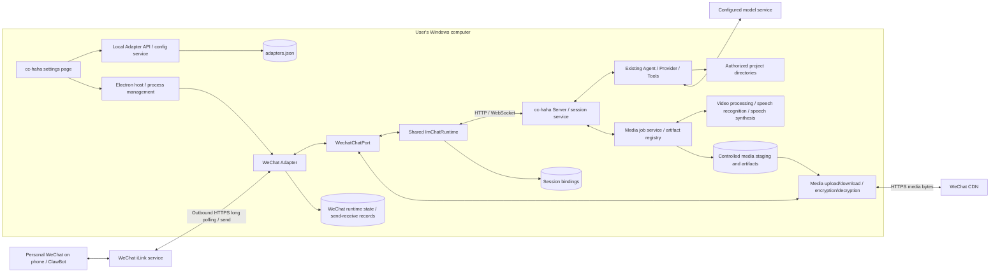

# cc-haha Personal WeChat Integration Architecture Design

Date: 2026-11-04. Revision: v4, adding connection status, durable delivery, and media experience. Code baseline: `56805c1d`. Status: the design blueprint and history are kept; current delivery, verification, and remaining boundaries are governed by section 14. On-phone acceptance of the four media types is deferred by the user for now.

This document keeps the design blueprint based on `56805c1d` and the user-provided screenshot of "IM Adapters → WeChat", and records this implementation and its verification results in sections 12 and 13. Per the repository's documentation conventions, design proposals live at the repository root; see [docs/im/wechat.md](docs/im/wechat.md) for user instructions.

Sections 1–11 are the full blueprint, and sections 12–13 are the history of the first version and fault fixes; time-sensitive statements there such as "not executed" or "not implemented" don't override the later progress in section 14.

## 1. Conclusion and goals

**Use the personal WeChat ClawBot / iLink channel, connect directly to cc-haha's existing WeChat adapter, and reuse cc-haha's local sessions, models, and tool runtime.** There's no need to deploy OpenClaw separately, nor a WeCom account, public callback server, or NAT traversal.

The entry point in the screenshot already has a complete backend implementation: QR scanning, credential storage, adapter startup, long-polling for messages, pairing authorization, session creation and restore, tool permission approval, and reply sending all exist. So the work should be framed as "verify the existing integration and fill in reliability", not redeveloping a WeChat bot.

Expected experience: in the WeChat ClawBot conversation on their phone, the user sends "check the current status of the cc-haha project"; the local cc-haha runs the task in the selected project, and the result arrives in WeChat; when permission is needed, the user replies with an approval command in WeChat. Subsequent messages continue in the same cc-haha session.

This design assumes by default a single Windows computer, one bound WeChat account, and the user's own direct chat. The computer must be on and online, and cc-haha's server and adapter must be running; the phone doesn't need to be on the same LAN as the computer. Behavior after the desktop window is closed follows the existing host settings; "window closed" can't be equated directly with the service still being online.

Base integration scope: text, existing voice-to-text input, image/file input, project switching, session restore, stopping tasks, and text-based approval. This revision explicitly adds **sending back images, sending back files, sending/receiving and analyzing video, and replying with synthesized speech as audio files** to the implementation scope; native WeChat voice bubbles are an enhancement requiring verification and aren't promised until verified.

Group chats, contact auto-replies, Moments operations, multiple accounts in parallel, and unattended proactive push are out of scope. The allowed-users list is only cc-haha's permission configuration and doesn't mean the WeChat platform allows other contacts to join the same ClawBot. Media transport, content understanding, and content generation are three independent capabilities: supporting sending video doesn't mean a built-in video generation model.

### 1.1 Baseline capabilities at design time and target matrix

| Type | Baseline receive / process | Baseline send back | Design target this round |
| --- | --- | --- | --- |
| Text | Implemented | Implemented | Keep compatible, fill in reliability |
| Images | Received; understanding depends on a vision model | Not implemented | Native image message replies, reusing the existing image output boundary |
| Files | Received, handed to tools | Not implemented | Reports, code bundles, etc. sent back as file attachments that can be saved on the phone |
| Video | Processing not implemented | Not implemented | Download and decrypt, metadata probing, keyframe/audio track analysis, native video message replies |
| Voice | Reads the transcription text WeChat provides | Not implemented | Send audio files after text-to-speech; transcribe locally per capability when no transcription is provided |
| Native voice bubble | N/A | Not verified | Separate protocol verification, enabled once passed; audio files are not passed off as native voice support |

The table records the pre-implementation state; what was completed this time is in section 12. Video analysis depends on available vision/audio processing capabilities, and TTS (text-to-speech) depends on an available synthesis engine; when capabilities are missing, files can still be sent and received with an explanation of the processing limits.

## 2. Existing implementation and actual gaps

The table and gaps in this section are the result of a static check against baseline `56805c1d` at design time and don't represent the post-change state. "Existing" means an implementation exists, not that it has been verified to work with the current account and network environment; download limits, post-enqueue authorization re-checks, and receive logs have been added in this media implementation; see section 12.

| Layer | Current code entry | Existing capabilities / what needs filling in |
| --- | --- | --- |
| Settings UI | [AdapterSettings.tsx](desktop/src/pages/AdapterSettings.tsx) | WeChat tab, QR code, re-scan, unbind, allowed users; the green status is based on `accountId` and can't yet prove online |
| UI state and API | [adapterStore.ts](desktop/src/stores/adapterStore.ts), [adapters.ts](desktop/src/api/adapters.ts) | QR polling, updating config on success and requesting a host restart; restart failures record a warning, but binding success and runtime readiness are still conflated |
| Local binding API | [adapters.ts](src/server/api/adapters.ts), `handleWechatAdaptersApi` | `login/start`, `login/poll`, `unbind`; rebinding clears `pairedUsers`, while `allowedUsers` is currently kept |
| Config persistence | [adapterService.ts](src/server/services/adapterService.ts) | Redacted responses, in-process serialized updates, temp-file rename; cross-process write mutual exclusion can't be inferred from this |
| Host and processes | [serverRuntime.ts](desktop/electron/services/serverRuntime.ts), [sidecarManager.ts](desktop/electron/services/sidecarManager.ts), [claude-sidecar.ts](desktop/sidecars/claude-sidecar.ts) | Already includes `--wechat`, creates adapter child processes per platform, injects a dynamic `ADAPTER_SERVER_URL`; the current restart entry restarts all adapters |
| WeChat protocol | [protocol.ts](adapters/wechat/protocol.ts) | iLink QR scanning, sending/receiving text, typing; default `https://ilinkai.weixin.qq.com`, code declares protocol version `2.1.7` |
| WeChat message loop | [index.ts](adapters/wechat/index.ts) | Long polling, text chunking, projects/sessions, approvals, message queue; still maintains its own orchestration and isn't hooked into the shared `ImChatRuntime` |
| Media input | [media.ts](adapters/wechat/media.ts) | Download, AES decryption, saving images/files; size is only checked after downloading the full content, lacking a download-stage byte cap and timeout |
| Shared orchestration | [chat-runtime.ts](adapters/common/chat-runtime.ts) | Unified handling of `ChatPort`, `InboundChatMessage`, sessions/commands/permissions; WeChat should gradually reuse it |
| Authorization and sessions | [pairing.ts](adapters/common/pairing.ts), [session-store.ts](adapters/common/session-store.ts), [ws-bridge.ts](adapters/common/ws-bridge.ts) | Pairing codes, deny by default, session storage, WS bridge; the session store key currently uses `chatId` directly and needs a platform/account namespace |

Confirmed improvement points:

1. **Bound doesn't mean online.** The UI judges status by the account field; it can't distinguish expired credentials, WeChat disconnection, server disconnection, or the user not being paired.
2. **Inbound acknowledgment happens too early.** `routeUserMessage` records dedup before processing; `pollLoop` updates the cursor before checking response errors and before routing completes. Routing also enqueues asynchronously, so `await routeUserMessage()` doesn't mean the message has finished processing.
3. **Insufficient classification of send errors.** When sending with a `context_token` hits any exception, it retries without context; if the first attempt was delivered but the response was lost, the reply may be duplicated. The shared `MessageBuffer` also has a path that clears the buffer before sending and only logs on failure, which can lose reply fragments. Not all network exceptions can be treated as context invalidation.
4. **Binding concurrency lacks version constraints.** Login sessions live in an in-memory Map, without an explicit cancel API or binding generation; an old QR result may return after a re-scan or unbind. `pollQrStatus` also treats all exceptions as waiting, masking persistent errors.
5. **Incomplete boundaries for revocation and rebinding.** WeChat inbound only checks the user before enqueuing; revocation during queuing needs a second check. Rebinding must handle ownership of allowed users, old sessions, context, pending sends, and approvals.
6. **Multi-process config writes have a race window.** The server's `AdapterService` and the adapter's `tryPair` both read-modify-write `adapters.json`; atomic rename prevents half-written files but not mutual overwrites.
7. **Logs contain message bodies.** The WeChat receive log outputs the first 80 characters, which may include pairing codes, user code, or commands. Default logging should switch to message type, length, and redacted identifiers.

## 3. Overall architecture



`WechatChatPort`, runtime state, and durable send/receive records are the proposed new or reworked parts; the Agent, Server, configuration, and existing adapter entry in the diagram are all reused. The WeChat layer only handles message protocol and presentation; it owns no separate model configuration, runs no second Agent, and never directly runs shell text from messages.

Responsibility constraints:

- `protocol.ts`: protocol requests, field validation, error classification, timeouts; not responsible for projects or models.
- `WechatChatPort`: mapping sessions to WeChat recipients, context lifecycle, text chunking, typing, reply delivery.
- Media job service: video probing/frame extraction/audio track transcription, TTS, job cancellation, and artifact registration; doesn't send WeChat messages directly.
- Media transport module: upload/download of authorized artifacts, WeChat media encryption/decryption, and message reference construction; decoupled from model services.
- `ImChatRuntime`: pairing gate, commands, projects and sessions, permission correlation, translation of server events.
- Local server: model selection, tool execution, final permission decisions, session source of truth; keeps the existing local auth and CORS boundaries.
- Host: process start/stop and exit reasons. The adapter self-reports heartbeats and channel health; "available" can't be shown just because the process is alive.

Different platforms don't share WeChat context; different binding generations on the same platform must not share context either. Files or quoted text in messages are handed to the existing runtime as user input and grant no extra system permissions.

## 4. User flows and state design

### 4.1 First-time setup

1. Confirm ClawBot is available in WeChat on the phone; the entry is usually "Me → Settings → Plugins → ClawBot". Phone version and account availability depend on the actual client.
2. In cc-haha's IM settings, choose the default project and allowed directories. Choose an actual local repository directory as the default project (e.g. `C:\Projects\cc-haha`), and make sure the allowed directories cover it.
3. Click "Scan to bind", scan and confirm on the phone; the local server saves the credentials, and the host starts or restarts the WeChat adapter.
4. Show "Account bound, waiting for channel connection"; after receiving the adapter's health report, show "Channel online, awaiting pairing".
5. Use the existing "Generate pairing code" and send it in the WeChat ClawBot conversation. Keep the existing 6-digit one-time code and 60-minute validity; don't automatically convert the scanning account into tool execution authorization.
6. After pairing, first send `/status` and `/help`, then a read-only project task. Only after the first reply completes is "Send/receive verified" shown.

No new "log in to OpenClaw" step. Scanning in cc-haha is enough; the display name on the WeChat side may be controlled by the platform, and we can't promise to change it to cc-haha.

### 4.2 Two independent sets of state

Binding flow: `unbound → qr_waiting → qr_scanned → credential_saved`, plus `expired / cancelled / failed`. A re-scan generates a new `loginGeneration`, and unbinding invalidates the old generation; stale responses must not commit credentials.

Runtime state: `stopped / starting / online / reconnecting / auth_expired / error`. Additionally, `paired`, `serverReachable`, `lastReceiveAt`, and `lastSendAt` are shown separately. A successful long poll with no messages proves the channel request works, but doesn't prove round-trip messaging is verified.

The UI keeps the existing tab and adds connection details and "Reconnect"; "Re-scan" is only for re-authentication, while "Reconnect" reuses valid credentials. When binding credentials are saved but the process restart fails, keep the binding result and show a clear error with a retry entry.

Recommend putting the WeChat panel in its own `desktop/src/pages/settings/WechatAdapterPanel.tsx`, referenced directly from the existing page, reusing existing settings components and the QR interaction, to avoid further growing `AdapterSettings.tsx`. Product copy uses "Account bound / Message channel online / Awaiting pairing", without exposing internal tokens or protocol fields.

## 5. Control plane API and configuration

### 5.1 Kept and new endpoints

Everything marked "New" in the table below is design; the current code has no such endpoints.

| Endpoint | Status | Behavior |
| --- | --- | --- |
| `GET /api/adapters` | Existing | Returns redacted config; can't be used as a health check |
| `PUT /api/adapters` | Existing | Changes the default project, directories, and allowed users; doesn't accept WeChat tokens submitted directly via ordinary forms |
| `POST /api/adapters/wechat/login/start` | Existing, extended | Returns `sessionKey`, QR content, `expiresAt`, `loginGeneration` |
| `POST /api/adapters/wechat/login/poll` | Existing, extended | Validates session and generation; repeated confirmation is idempotent; stale old results aren't persisted |
| `POST /api/adapters/wechat/login/cancel` | New | Cancels the current login attempt; keeps the previously valid binding |
| `POST /api/adapters/wechat/unbind` | Existing, extended | Revokes the local binding generation, authorization, and runtime state, and stops the corresponding worker |
| `GET /api/adapters/wechat/status` | New | Returns binding, runtime, pairing, server connectivity, and redacted recent errors |
| `POST /api/adapters/wechat/runtime/report` | New, internal | The adapter reports heartbeats and receive/send results using inherited local service auth, carrying the binding generation and process instance ID |
| `POST /api/adapters/pairing/consume` | New, internal | The server validates and consumes one-time codes serially and merges authorization config, eliminating the race of adapters writing shared config directly |

New internal endpoints only accept trusted local adapter identities and must not reuse public webhooks. General API auth isn't the same as adapter identity verification; implementation should bind to the worker instance and capability registered by the host. Binding management should also keep desktop-local admin permissions and not expand the permissions of existing H5 or other tokens.

Suggested health report fields:

```ts
type WechatRuntimeReport = {
  instanceId: string
  bindingGeneration: number
  state: 'starting' | 'online' | 'reconnecting' | 'auth_expired' | 'error'
  serverReachable: boolean
  lastPollOkAt?: number
  lastReceiveAt?: number
  lastSendAt?: number
  errorCode?: string
}
```

Recommend reporting every 15 seconds and treating no update for 45 seconds as stale; these are local design parameters, not WeChat platform constraints. When the server is unreachable, the UI shows unknown/disconnected rather than keeping a stale green light. When the host confirms the process exited, it can be marked stopped immediately.

The current UI's union type of "config object or not-connected object" returned on successful polling can be kept for now; when extending it, add a discriminant field and stay compatible with old clients, to avoid continuing to interpret "has a config object" as "channel connected".

### 5.2 Persistence and write ownership

`CLAUDE_CONFIG_DIR` determines the config root; the existing `~/.claude` is used only when it isn't set. Design and tests must not hard-code or read the developer's real directory.

| Data | Location / writer | Lifecycle |
| --- | --- | --- |
| WeChat account credentials, authorized users, default project | Existing `adapters.json` / server config service | Unbinding clears WeChat credentials and authorization; other platforms and unknown fields are kept |
| `bindingGeneration` | Proposed new `wechat` subfield / server | Advanced on every credential commit and unbind; isolates old processes and late events |
| Login QR / staged credentials | Server memory / login coordinator | During validity, cleared after commit or cancel; never logged |
| Session bindings | Existing `adapter-sessions.json` / shared session store | Switched to namespaced keys, keeping historical session content |
| cursor, dedup, inbox/outbox | Proposed new `wechat-runtime.sqlite` / single WeChat worker | Introduced in M2, isolated by binding generation; with capacity and retention limits |
| UI health snapshot | Server memory | Re-reported after restart, never restored from a historical "online" state |

Config keeps reusing the current credential storage first, and the API only returns redacted values; on Windows, config file access permissions need verification, and POSIX `0600` can't be treated as a Windows ACL or an encryption guarantee. Whether to move into the system credential store is a separate later change and doesn't block the first phase.

All new fields, session keys, and storage evolution must provide forward migrations, old-fixture tests, and preservation of unknown fields. The schema version belongs only to this feature's storage and isn't written into the user's shared `settings.json`. Back up before migrating; before rolling back the program, stop the worker and restore the matching backup, and never let an old program that doesn't recognize the new state auto-replay tasks.

## 6. Message and session design

### 6.1 Hooking into the shared runtime

Shrink WeChat's `index.ts` down to startup, polling, normalization, and shutdown logic, and add `chat-port.ts` implementing `ChatPort`. Keep the platform responsibilities of `protocol.ts`, `media.ts`, and `typing.ts`. During migration, first lock in existing behavior with entry-point regression tests, then replace the duplicated orchestration.

Normalization mapping: `userId = from_user_id`; the raw WeChat recipient ID is used only for protocol sending; the runtime `chatId` uses an encoded `wechat + accountId + bindingGeneration + peerId`, avoiding separator collisions. `ChatPort` keeps a mapping from runtime key to peer, and when sending must not treat the namespaced key as a WeChat user ID.

`dedupKey` includes at least the platform, binding generation, sender, and protocol message ID. When a stable message ID is missing, fall back to seq, time, and a normalized content digest as the key and record a diagnostic; never let all messages with missing fields fall into the same empty key. The digest is only a dedup aid, not identity authentication.

Images/files use `loadAttachments` for lazy download, ensuring they enter in session order after authorization; typing and context are managed by the port; finish the existing text stream before sending `permission_request`, to avoid mixing up the order of approvals and answers. Existing `/help`, `/status`, `/projects`, `/new`, `/clear`, `/stop`, and session selection stay consistent.

The shared runtime currently still has only in-memory dedup and connection-level send results. Completing the migration doesn't mean having durable receive acknowledgment; M2 needs to explicitly add an ACK contract.

### 6.2 Binding, revocation, and recovery

- Deny unauthorized users by default, keeping pairing and the explicit allowed list; authorization is checked both on inbound and on actual dequeue. Output delivery also checks current authorization and binding generation; revoking a single user cancels their queued input and pending output and unsubscribes their sessions. Pairing success/failure prompts are restricted control messages and can't all be blocked just because pairing hasn't happened yet.
- Re-authentication of the same account can offer controlled session re-association; the first phase defaults to re-pairing. Switching to a different account must clear `allowedUsers` and `pairedUsers`, and must not carry over the old account's authorization.
- Unbinding first invalidates the generation, blocking new inbound and replies from the old worker, then stops the worker and clears that generation's context, cursor, dedup, pending messages, and session mappings. Late QR responses must also be rejected.
- Tasks already submitted by the Agent don't stop automatically because the config was deleted. The unbind flow should send a stop through the server to sessions exclusive to this WeChat binding that are running, reject their pending approvals, and report the stop results; it doesn't delete desktop history or stop independent tasks on other platforms/the desktop. When stopping can't be confirmed, say so clearly rather than reporting everything as complete.
- Old bare `chatId` mappings can't reliably determine platform and account ownership, so they aren't automatically assigned to the new WeChat identity. Keep history, and after pairing let the user explicitly select the old session again; restoring still validates project directories and session accessibility.
- Updates to shared session files written by multiple adapter processes should be serialized through the shared storage boundary or use an inter-process lock, re-reading and merging inside the lock. Adding namespaces alone doesn't solve lost writes from concurrency.

### 6.3 Error handling in M1

Long polling must be cancellable, and each binding must have only one active poller. A timeout with no new messages is normal; network errors use exponential backoff with jitter, suggested 1–30 seconds; respect rate-limit signals actually returned by the server. Only confirmed auth-invalid responses enter `auth_expired`, stop automatic retries, and prompt a re-scan, with error codes based on actual protocol fixtures.

Fix the order of response validation and cursor advancement, and make enqueue return a real processing Promise, so "queued" isn't treated as "done". Before M2, be explicit that recovery across process restarts is still best effort, with no promise of no loss.

Sending is serialized per chat, keeping the existing 3500-character chunking strategy as a local policy, checked via fixtures for Unicode and encoded length, and not advertised as a verified official WeChat limit. Only downgrade when it's confirmed to be a context invalidation and the protocol supports an alternative send method; timeouts or disconnects are recorded as "delivery unknown" without blindly generating a new message ID and retrying. Text buffers can only be cleared once handed to the delivery queue, and failures must keep a diagnosable state; M1 first provides a bounded in-memory queue with failure prompts, and M2 then makes it durable.

Long-poll receiving is separated from the execution queue; the execution queue only serializes message receipt and routing and doesn't hold the whole model generation cycle; `/stop` and approvals must not be blocked indefinitely by long tasks or media downloads. Control messages use a priority path under the same identity/permission checks, while commands like `/new` that change the session still follow the existing busy semantics. Each chat queue has a capacity limit, and exceeding it is explicitly rejected rather than silently dropped.

### 6.4 Durable send/receive and guarantee boundaries in M2

Use transactional inbox/outbox in local SQLite; in the Bun runtime, first evaluate the built-in `bun:sqlite` and verify support in the target sidecar before packaging; don't introduce Redis or a cloud message queue.

Suggested tables: `account_state(bindingKey, cursor)`, `inbound(bindingKey, messageKey, state, payload, sessionId, submissionId)`, `outbound(bindingKey, replyId, chunkIndex, state, clientId, payload)`. Message unique keys include the binding identity; bodies and context are only stored when needed to recover delivery, with restricted access; successful records are cleaned up after 24 hours by default, abnormal records after at most 7 days, with a total capacity limit. These periods are initial design values.

Receive transaction: validate response → `INSERT OR IGNORE` the message → commit the new cursor in the same transaction → worker consumes the inbox. Unauthorized content doesn't have its body persisted; only the minimal dedup result is recorded; every real execution action still checks authorization and current generation on dequeue. When the database write fails, the cursor isn't committed and no new tasks are submitted.

Task delivery states: `received → dispatching → accepted → completed`, plus `rejected / failed / uncertain`. Add `submissionId` to the shared WS message protocol: the server returns an ACK after durably accepting the message; the same `submissionId` for the same session appends user input only once, and the adapter can query receipt status. An ACK means accepted, not that the tool or task is complete.

If the server doesn't yet have idempotent submission and query capability, a process crash during `dispatching` can only be marked `uncertain` with a prompt for the user to check, and must not automatically re-execute file writes or commands. This capability should be covered by runtime recovery tests; exactly-once task execution can't be claimed from the adapter inbox alone.

Reply states: `pending → sending → sent / failed / unknown`. Fix the `clientId` when generating chunks; whether WeChat dedups idempotently by that field must be verified separately and can't be assumed. Chunks confirmed delivered aren't resent; when a network timeout causes an unknown state, keep the record and let the user check the desktop result or explicitly resend, rather than rerunning the Agent to fill in a reply.

M2's goal is durable receipt, recoverable state, and avoiding duplicate submission; it **doesn't promise end-to-end exactly-once**, nor permanent retention of WeChat offline messages or proactive push at any time. When a long task finishes but the context is no longer usable, the result stays in cc-haha, and the user's next message can retrieve a summary.

## 7. Tool permissions and multimedia architecture

Permissions remain decided by cc-haha's Agent/server. WeChat only carries existing decisions such as `/allow <requestId>`, `/deny <requestId>`, and `/always <requestId>`; the requestId must match a pending request for the current binding, user, and session, and old sessions and replayed approvals must not be let through. `/always` follows the existing rule semantics and isn't expanded into permanent authorization for all tools.

Project access reuses `defaultProjectDir / allowedProjectRoots` and existing path resolution, verifying Windows paths, symlinks, and real-path boundaries. Computer Use continues to follow the project's existing master switch, unified consent, OS permissions, and target validity checks, without adding a separate per-app approval system for WeChat.

Attachments keep the project's current 10 MiB image and 30 MiB file limits, which are cc-haha application policy: check available length metadata before downloading, enforce a hard cap while streaming, and check again after decryption; add timeouts, total attachment count/total byte budgets, and temp file cleanup. Unknown file names go through the existing AttachmentStore path handling, rejecting directory traversal.

Media URLs, login redirect hosts, and base URLs returned by WeChat need validation against the verified set of official service hosts for HTTPS, redirect destinations, and address ranges, rejecting localhost/private network targets; returned strings can't be trusted directly and requested with credentials attached. Tests' loopback transport is done via injected mocks, and production URL validation can't be relaxed because of it. Whether the current CDN fallback matches the latest service is listed as an integration item; this document doesn't rewrite it based on addresses from other projects.

The code can currently receive images/files but only implements text replies. The following multimedia features are now in the implementation scope of M3–M5; all new interfaces and modules are proposals, and Windows local paths can't be sent directly to the phone and called "downloadable".

### 7.1 Unified media artifacts and capability contract

Reuse the attachment types and controlled file-reading boundary of [attachment-types.ts](adapters/common/attachment/attachment-types.ts) and [outbound-image.ts](adapters/common/attachment/outbound-image.ts). The existing `ChatPort.sendImage` and image output detection stay compatible, with a new optional `sendMedia` and capability query, to avoid requiring other platforms to implement video and voice at the same time.

The types below illustrate boundaries; at implementation time they should be merged with existing WS events and session artifact types to avoid duplicate models:

```ts
type MediaKind = 'image' | 'file' | 'video' | 'audio'

type SessionMediaArtifact = {
  artifactId: string
  sessionId: string
  turnId: string
  kind: MediaKind
  fileName: string
  mimeType: string
  sizeBytes: number
  sha256: string
  durationMs?: number
}

type MediaDeliveryRequest = {
  deliveryId: string
  artifactId: string
  chatId: string
  bindingGeneration: number
  presentation: 'image' | 'file' | 'video' | 'voice'
}
```

`audio` means audio content, and `voice` means WeChat's native voice presentation; audio can be delivered with `presentation: 'file'`. The capability set declares images, files, video, audio files, and native voice separately, not conflated into a single `supportsMedia` switch. Limits take the minimum of application policy, verified platform limits, and processing engine limits.

The server registers files and issues session-scoped `artifactId`s; local paths are resolved internally by trusted services, and WeChat messages, model output, or arbitrary clients can't request sending with a path string directly. Artifacts are limited to project files accessible to the current session or registered temporary artifacts; reading verifies the real path, regular file type, size, and ownership, and stages an immutable snapshot and digest to prevent the original file changing while queued.

After a task produces an artifact, it provides the artifact description and send-back intent via a proposed new structured `media_ready` event. The adapter submits to the outbox according to the current chat subscription, authorization, and binding generation. The first phase only sends when the user asks for it, when a tool returns an explicit deliverable artifact, or when voice replies are enabled; it doesn't automatically upload every file produced by tools. The image watcher and structured events are normalized into `artifactId + turnId + delivery intent` for dedup, avoiding sending the same image twice.

### 7.2 Sending back images, files, and video

Adopt the media sending flow from Tencent's official client, extracted into a WeChat-specific `media-upload.ts` and message builder functions: controlled read → get upload URL → encrypted upload to CDN → build media reference → send with `sendmessage`. Specific fields, key encoding, and upload response validation are based on the official implementation at a pinned version and protocol fixtures; you can't just reverse the existing download logic to assemble URLs.

Images are shown as image messages; reports and code bundles as file messages; video in verified formats as video messages. Incompatible video can be transcoded with the user's knowledge, or explicitly sent as a file; a downgraded success can't be recorded as native video success. File name, real MIME type, and size must be consistent, and text descriptions stay in the same reply order as the media.

Delivery records extend to `staged → uploading → uploaded → sending → sent`, plus `failed / cancelled / unknown`. Persist the artifact digest, upload reference, stable clientId, binding generation, and stage; upload success doesn't mean the message was delivered. Failures clearly not sent can retry the corresponding stage; when message delivery is unknown, follow the section 6.4 strategy, without re-running the generation task or blindly resending. When a CDN reference is unusable, only re-upload after confirming it can be re-delivered.

Media snapshots can't be GC'd until the outbox completes or is explicitly cancelled. Unbinding or revocation first cancels pending tasks and destroys local media keys/references; content already uploaded or sent can't be claimed to be recalled from WeChat's servers. Logs never record keys, signed URLs, context, or file contents.

### 7.3 Receiving and analyzing video

Add `video_item` parsing and decryption in `media.ts`. Initially keep video entering the existing attachment pipeline as a file, along with controlled media metadata; only build a corresponding model request when the provider has declared and verified native video input; MP4 base64 must not be stuffed into image fields.

Use an explainable frame-extraction approach by default:

1. After downloading, probe format, duration, dimensions, and audio tracks with a controlled media process; abnormal or unsupported formats get an immediate notice.
2. For short videos, extract frames evenly with timestamps, scaled per vision model limits; when there's an audio track, convert it to a format the recognition engine supports and transcribe it.
3. Hand the keyframes, timestamped transcription, and user question to the existing session, asking the answer to state which video segments were covered and the sampling limits.
4. For long videos, first notify of the limits or analyze a time range chosen by the user; never silently drop the latter half and then claim to have watched the whole video. Without a vision model, provide an audio-track summary; without recognition capability, analyze only the frames, and state what information was actually used.

Suggested initial application budgets are 30 MiB per video, 120 seconds of analysis, at most 12 frames, and at most one video analysis task per user; these are configurable starting points, not official WeChat limits. Transfer file size and content analysis duration are judged separately: exceeding the analysis duration doesn't mean the file can't be received. Frame count, resolution, audio track duration, and model input volume all count against the budget.

Recommend doing probing, frame extraction, and audio track extraction via `ffprobe/ffmpeg` subprocesses, using separate argument arrays, timeouts, and resource and output file limits; cancelling a task ends the subprocess and cleans up temp files. Before implementation, check Windows package size, dependency licenses, and existing media tools; don't assume the system already has them installed, and don't silently download executables on first receipt. When dependencies are unavailable, keep the video attachment and clearly state that analysis is unavailable.

### 7.4 Voice input and synthesized replies

Input continues to prefer WeChat's `voice_item.text`; when transcription is missing, the audio can be downloaded, converted to a supported format, and then recognized via the capability boundary of the existing [voiceService.ts](src/server/services/voice/voiceService.ts). Before implementation, verify its input format, lifecycle, and non-UI call contract; the existing speech recognition service can't be equated with TTS. When recognition isn't possible, prompt to resend as text rather than treating empty content as successful input.

Add a separate `SpeechSynthesisService` that hooks into at least one actually available synthesis engine through a provider interface, reusing the product's existing model service/credential management approach. The specific engine is chosen at implementation time based on available configuration; with no synthesis engine, show "Not configured", and a stub implementation must not be labeled as supported. Model service keys stay only on the server; the WeChat adapter doesn't keep a copy.

Suggested product setting: `replyMode: text | text_and_audio`, default `text`, with configuration for the synthesis provider, voice, and text length limit. When the user explicitly says "reply by voice", it can be enabled for this turn; only synthesize the completed natural-language answer, not token by token, and don't read code blocks, large logs, or permission approvals aloud. For long answers, provide the full text first, then synthesize audio labeled as a summary; when TTS fails, keep the text reply and don't rerun the Agent.

Audio is registered as a session artifact and sent back via the unified file upload pipeline in verified formats such as MP3/WAV, labeled "Audio file, can be downloaded and played". Whether the phone supports direct preview is tested separately, with no promise of the same experience as WeChat voice bubbles. Suggested initial budget: at most 2000 characters per synthesis and at most 10 MiB of audio; when the engine's limits are lower, use the lower values.

Native voice bubbles are a separate capability gate: Tencent's docs have voice fields and an upload type, but the current reference send flow doesn't implement that branch. First complete verification of encoding, duration, request fields, account capability, and phone playback, then open the `nativeVoice` capability. Until verified, only audio files are provided; if explicitly rejected it can be explained and downgraded, and when delivery is unknown no extra file is appended to avoid duplicates. If the platform ultimately doesn't support it, keep the restricted state and reason rather than writing this item up as complete.

### 7.5 Media job state, interfaces, and cleanup

Add media jobs within the existing session service boundary, without a separate public service. Suggested internal contract: `createMediaJob(sessionId, sourceArtifactId, operation)`, `getMediaJob(jobId)`, `cancelMediaJob(jobId)`, `resolveArtifact(artifactId, sessionScope)`; whether HTTP routes are needed depends on process boundaries. `operation` is limited to registered operations such as `video_analyze / audio_transcribe / speech_synthesize / transcode`, and doesn't accept arbitrary executable commands.

Job states are `queued / running / completed / failed / cancelled`, separate from WeChat delivery states. `/status` can show "Analyzing video / Generating audio / Waiting to send"; `/stop` cancels this turn's media processing and output not yet sent, and cancels the associated model task. A request being submitted to WeChat may have an unknown result, which should be reported per delivery state rather than pretending already-delivered messages can be recalled.

Keep the current 10 MiB image and 30 MiB file policy and add video and audio budgets; limit resources at each stage — download, decryption, transcoding, upload — rather than only checking the initial compressed file size. Temporary frames/audio tracks are released when done; final artifacts are managed by the session artifact retention policy, and files referenced by retries are protected with reference counts or leases. Disk full, missing dependencies, or queue overflow all return specific errors; user attachments can't be silently ignored.

Suggested module responsibilities: WeChat `media-upload.ts` handles protocol upload; shared `attachment/outbound-media.ts` handles controlled reading and artifact conversion; the server's `mediaJobService.ts` handles scheduling; `videoProcessingService.ts` and `speechSynthesisService.ts` handle content processing. File names are proposed new locations; at implementation time prefer reusing existing services with the same responsibility. New capabilities' UI, config validation, copy in all supported languages, and defaults for old configs must ship together.

## 8. Phased implementation and acceptance

| Phase | Deliverable | Main files / acceptance |
| --- | --- | --- |
| M0: verify the existing pipeline | No protocol changes; complete closed-loop diagnosis in the installed package or source environment | Check the WeChat entry, model config, default project, QR scanning, pairing, `/status`, one read-only task, and one restart; output a run log summary without credentials |
| M1a: connection experience | Separate binding from runtime, QR cancel/expiry/generation, health status, reliable reconnect | `protocol.ts`, server adapter API, store/API, WeChat settings module, host lifecycle; old polling can't overwrite a new binding, and restart failure doesn't show online |
| M1b: messages and permissions | Migrate WeChat to the shared runtime, post-enqueue re-authorization, correct error classification, media download limits, log redaction | `index.ts`, new `chat-port.ts`, `media.ts`, shared runtime; keep existing commands, sessions, and approval behavior |
| M1c: durable identity and config | Session namespaces, rebinding isolation, single-writer server config, unbind stop chain | Config/API, pairing, session store, host; forward migration of old config, other platforms unaffected |
| M2: recovery | SQLite inbox/outbox, server idempotent receipt/ACK, crash recovery, visible unknown deliveries | New `delivery-store.ts` and worker, shared WS protocol and session receive boundary; power loss/timeouts don't automatically re-execute tasks with side effects |
| M3: sending back images and files | Artifact registration, controlled reading, CDN upload, media outbox, ChatPort extension | `media-upload.ts`, shared attachment boundary, server artifact events; the phone actually receives and opens images and downloads files, with no duplicate body or media |
| M4: video send/receive and analysis | Video decrypt/upload, media dependency management, frame extraction and audio transcription, cancellation and budgets | Video processing service, media job scheduling, provider capability adaptation; correctly states analysis coverage, and failure doesn't affect ordinary chat |
| M5: voice replies | Synthesis engine integration, reply preference, audio file send-back; native voice verified separately | TTS service, config/UI, unified media queue; audio files work, native voice marked supported or restricted per actual testing |

M1 doesn't have to wait for M2 to be usable, but must state the power-loss recovery boundary. The existing behavior of the host restarting all adapters can be kept for now, with a UI note that other IMs briefly reconnect; targeted restart is added later, without starting a second process manager.

Formal M3 delivery depends on M1's identity and authorization boundaries and M2's recoverable media delivery foundation; an offline prototype of protocol upload can be verified earlier. M4 and M5 reuse M3's transport and artifact contract rather than each building their own upload system. Native voice verification can happen earlier and doesn't block delivery of images/files/video and audio files; if restricted by the platform, final acceptance must keep that limitation. Targeted restart, long-term residency, and video generation model integration remain separate later scope.

Recommend keeping new files few, each with a distinct responsibility: `adapters/wechat/chat-port.ts`, `worker.ts`, and M2's `delivery-store.ts`; the binding coordinator can go in `src/server/services/wechatBindingService.ts`, and health status in `adapterRuntimeService.ts`. Shared logic keeps going into the existing common boundary, avoiding duplicating config, pairing, approval, and session systems for WeChat.

## 9. Test plan

Existing coverage entry points: WeChat [protocol.test.ts](adapters/wechat/__tests__/protocol.test.ts), [typing.test.ts](adapters/wechat/__tests__/typing.test.ts), server [adapters.test.ts](src/server/__tests__/adapters.test.ts), UI [AdapterSettings.test.tsx](desktop/src/pages/AdapterSettings.test.tsx) and [adapterStore.test.ts](desktop/src/stores/adapterStore.test.ts). The WeChat entry regression in the cross-platform [legacy-session-selection-entrypoint.test.ts](adapters/feishu/__tests__/legacy-session-selection-entrypoint.test.ts) must also be kept; coverage can't be judged by looking at `wechat/__tests__` alone.

| Scenario | Results that must be verified |
| --- | --- |
| QR scan normal, expired, cancelled, missing credentials, redirect failure | Accurate terminal state; nothing saved without complete credentials; user can retry |
| Start B after scanning A, A arrives late; unbind during scanning | A doesn't overwrite B; after unbinding, not rebound by an old result |
| Config saved but host restart fails | Account kept, runtime state shows error, can reconnect reusing credentials |
| Two platforms consume pairing codes at once, UI saves config at the same time | Code consumed only once; other platforms and unknown fields not lost |
| Not paired, revoked while queued, cross-session approval | No unauthorized tasks created, no unauthorized attachments downloaded, nothing wrongly approved |
| Same message repeated, same seq different users, missing ID | Correct dedup and identity isolation; different messages not merged |
| Crashes at each boundary: inbound persistence/cursor commit/task ACK | State is explainable; unknown deliveries don't automatically re-execute tasks |
| WeChat send timeout, 429/auth errors, context errors | Handled by class; not all failures turned into context-less retries |
| Restart, account change, old bare session keys | No cross-account session mixing; history kept; project validated before restore |
| Oversized media, slow download, malicious URL, file name traversal | Downloads interrupted promptly; no access to illegal addresses, no out-of-bounds disk writes |
| Approval after a text stream, /stop, /clear | Clear ordering, session semantics don't regress, pending permissions recoverable |
| M2 reply chunks partially succeed | Sent chunks not automatically repeated; failure state visible, Agent not rerun |
| Image/file upload and send, download verification | The phone can view images and save files; ordinary file download digests match; if images are compressed by the platform, accept by display/content rather than requiring byte equality |
| Send fails after upload succeeds, send response lost | Distinguish uploaded from sent; reuse usable upload references; unknown not blindly resent |
| Artifacts not from the current session, file changes while queued, duplicate events | Unauthorized files rejected; sends register a snapshot; watcher and structured events don't send twice |
| Inbound video normal/corrupt/overlong/no audio track/no dependencies | Bounded processing, timestamped output; actual coverage and missing capabilities clearly stated |
| Outbound video format incompatible | Explicitly transcode or send back as a file; native video success not falsely reported |
| Voice without transcription, recognition engine unavailable | Fall back to recognition when available; prompt when not, without creating empty tasks |
| TTS normal/not configured/overlong/failed/cancelled | Audio file produced normally; text kept on failure; approvals not read aloud; Agent not called twice |
| Native voice protocol and phone playback verification | nativeVoice not enabled until passed; audio file success not counted as native voice success |
| /stop, revocation, unbind, disk full, GC during media processing | Subprocesses and unsent tasks correctly cancelled; no unauthorized replies; artifacts pending retry not cleaned up early |

All automated tests use a temporary `CLAUDE_CONFIG_DIR`, fake credentials, mock WeChat/models, and a loopback server; using real account configuration is forbidden. Run the gates selected by `bun run check:impact` for the final code diff; usually adapters/server/desktop are involved, host changes involve native, persistence changes must run persistence-upgrade, and WS/session changes select chat-contract/agent-flow per impact.

Real WeChat scanning and model tasks are separate manual integration evidence and aren't executed as part of this documentation work. Later integration first verifies binding and the model-free `/help`, then runs real model tasks in an explicitly authorized environment. Mock passes can't replace real WeChat compatibility results.

Media tests use tiny image/file/video/audio fixtures and a fake upload service, verifying request fields, encrypt/decrypt round trips, and file contents; the video process is tested for timeout and cancellation with a controlled runner, plus one real local processing fixture check, rather than only mocking command success. TTS uses a fake provider to verify the contract, with actual engine synthesis and WeChat phone display recorded as separate integration evidence. Changes to the shared ChatPort, WS events, and provider request shapes also need compatibility regressions for other supported IMs.

## 10. External references and items to verify

As of 2026-11-04, Tencent's [official CodeBuddy Channels documentation](https://intl.cloud.tencent.com/zh/document/product/1316/84459) states that a two-way message channel can be established by scanning with WeChat ClawBot, with the entry in WeChat's plugins page. This proves ClawBot can host a chat bridge to a third-party runtime; CodeBuddy's MCP channel mechanism there isn't an architecture cc-haha must adopt.

Tencent's [cloud desktop channel configuration doc](https://cloud.tencent.com.cn/document/product/1291/129132) shows the flow of interacting in the ClawBot conversation after scanning with WeChat. See also the [AstrBot personal WeChat adapter docs](https://github.com/AstrBotDevs/AstrBot/blob/master/docs/zh/platform/weixin_oc.md) for integration notes on the official `openclaw-weixin` interface, scanning, and long polling; that's the project's own implementation doc, not a Tencent protocol stability commitment.

External docs are only used to check the integration path. This document's account of cc-haha's capabilities and gaps is based on current local source; other products' support for uploads, group chats, or message types isn't automatically equated with this project's support.

This multimedia revision adds the [official Tencent openclaw-weixin protocol docs](https://github.com/Tencent/openclaw-weixin/blob/main/docs/protocol.md): the reference client implements upload and sending of images, video, and files; the docs explicitly note that a voice upload type exists but the current file sending flow doesn't implement that branch. The reference docs describe client behavior and aren't a complete server contract. The link points to a mutable main; at implementation time, the reviewed commit, license, and redacted protocol fixtures must be pinned, and simply changing the local version number from `2.1.7` to the doc's example version can't be considered compatible.

To verify before implementation: ClawBot availability for the current WeChat account; compatibility of the repository's declared `2.1.7` protocol with the service; returned hosts/CDN, auth-invalid errors, context validity period, chunk encoding limits, `client_id` dedup semantics, and offline message retention behavior. Capabilities that can't be verified stay as explicit limitations rather than being guessed into the protocol.

Multimedia additionally needs verification of: size/format/duration limits per type, CDN reference validity period, phone video playback and thumbnail requirements, audio file preview, native voice encoding and actual sendability, and the deployment approach for the TTS engine and video processing dependencies. Native video input and audio track recognition are judged separately per provider capability and aren't inferred from WeChat's transport capability.

The above is the full v2 design blueprint. The user then authorized implementing three multimedia capabilities first; the first version's actual scope and differences from the design are in section 12; it can't be inferred from the blueprint that all infrastructure is complete. Native voice is only marked supported after verification.

## 11. Documentation check record

Initial check:

- Passed: all local Markdown links resolve to repository files; `git diff --no-index --check` on the new file found no whitespace errors.
- Passed: `bun run check:impact --files wechat-personal-integration-design.md --no-dependency-graph`, with no blockers and no extra checks.
- Aborted: the same impact command with the dependency graph on by default didn't return a report for a long time and was aborted manually; that check isn't claimed as passed. Pure Markdown doesn't change module imports, so this time a path check with the dependency graph explicitly disabled was used instead.
- Not run: business unit tests, full site build, desktop smoke, real WeChat and model integration; this time only a root-level design doc was added, with no new business tests.

v2 revision check (2026-11-04):

- Passed: re-verified all local links, Markdown code fence pairing, `git diff --no-index --check`, and `git diff --check`; checked the phase table and scope descriptions, removing the old conclusion that "images/files are only extended on demand".
- Passed: reran `bun run check:impact --files wechat-personal-integration-design.md --no-dependency-graph`, with no blockers and no extra checks; the full dependency-graph scan that was aborted in the initial check wasn't rerun.
- Not run: business tests, real media upload/transcode/TTS testing, and real WeChat integration; this time only the design was updated, with no new business code or tests.

## 12. First version implementation status and usage

This section records the v3 implementation, prioritizing the three media features the user specified; not all the M1/M2 infrastructure refactoring was mixed into this change.

| Capability | First version implementation | Requirements / limits |
| --- | --- | --- |
| Sending back images and files | `media-upload.ts`, `outbound-media.ts`, upload encryption and native message construction | `/send <path within the current project>`; images 10 MiB, files 30 MiB |
| Automatic artifact send-back | `media-actions.ts` extracts local Markdown images and explicit `file:` links from completed replies | Ordinary code references and web links aren't uploaded; at most 5 items and 30 MiB total per turn |
| Receiving and sending video | `media.ts` parses video; the upload module supports video messages | Recognized MP4 uses video messages, other formats are sent as files, with no automatic transcoding |
| Video analysis | `video-processing.ts` probes, extracts frames, extracts standard PCM WAV; calls the existing `/api/voice/transcribe` | Requires ffmpeg/ffprobe; 120 seconds, at most 12 frames; when recognition is unavailable, explicitly frame-only analysis |
| Speech synthesis | `speech-synthesis.ts` uses Windows WinRT / System.Speech | Both Chinese and English completed real local WAV synthesis verification; at most 2000 characters, 10 MiB, no cloud TTS calls |
| Audio replies | `/voice on|off`, `/speak <text>`, synthesize after the answer completes and upload the file | WAV file, not a native voice bubble; non-Windows reports unsupported |
| Cancellation and identity checks | `/stop` cancels downloads/analysis/synthesis first; authorization and session checked on dequeue and before media submission | Messages already submitted to WeChat can't be recalled; unknown deliveries aren't resent automatically |

The voice switch exists only in the current adapter's memory and resets to default after restart, clear, or switching sessions; this time no new persistent config or settings UI was added. `/voice on` requires a session to exist first; `/voice off` can be turned off directly. For full instructions see the [user guide](docs/im/wechat.md).

Video tools can be specified via PATH or `WECHAT_FFMPEG_PATH`, `WECHAT_FFPROBE_PATH`. FFmpeg bundled with third-party software found on this machine was only used for temporary verification; no machine-specific paths were written into product config, and no software was installed; full ffprobe probing still requires the user to provide a usable dependency. The vision model is used for frame understanding, and the recognition model prepared by the desktop for audio tracks; only extracting frames or only extracting audio can't be counted as complete understanding.

Differences from the full blueprint: this version keeps the existing WeChat message orchestration, hooking in through a separate `WechatMediaActions`; the whole shared runtime wasn't migrated. Artifact sending is done through controlled file snapshots and explicit download links; no server artifact registry, structured `media_ready` event, SQLite inbox/outbox, or cross-restart delivery recovery was introduced yet. TTS first uses the installed Windows engine, with no general cloud synthesis provider yet. Video transcoding, raw audio fallback for voice, and native voice bubbles weren't implemented this time; the existing WeChat voice transcription input continues to work.

So this version is a first, usable version of the media features; it doesn't claim M0–M5 are all complete, exactly-once delivery, or that all platforms have been integration-tested. Implementation verification is recorded in the final test logs and delivery notes; real WeChat scanning and account send/receive weren't executed.

### 12.1 Protocol implementation basis

This time the Tencent reference implementation was checked at the pinned commit `7c04adc3e95775efd661ab9fba0626d86d237713` (version 2.4.9-beta.0, 2026-09-08), not called the latest HEAD, and cc-haha's existing protocol version declaration wasn't changed. The field basis is [upload parameters and AES/MD5](https://github.com/Tencent/openclaw-weixin/blob/7c04adc3e95775efd661ab9fba0626d86d237713/src/cdn/upload.ts), [image, video, and file messages](https://github.com/Tencent/openclaw-weixin/blob/7c04adc3e95775efd661ab9fba0626d86d237713/src/messaging/send.ts), and [CDN upload and response headers](https://github.com/Tencent/openclaw-weixin/blob/7c04adc3e95775efd661ab9fba0626d86d237713/src/cdn/cdn-upload.ts). That version's [LICENSE is MIT](https://github.com/Tencent/openclaw-weixin/blob/7c04adc3e95775efd661ab9fba0626d86d237713/LICENSE), with copyright notice Tencent © 2026.

New protocol tests use synthetic bytes, fake credentials, and mock requests to check wire format, encryption/decryption, and error branches; no real WeChat data was saved. Reference code and mock results can't replace account-level compatibility verification.

## 13. v3 implementation verification record (2026-11-04)

The final `check:impact` used the full dependency graph, covering 21 changed files and 94 files affected via external imports; no blockers or obvious missing-test signals, and all 8 selected gates were attempted. Results below; items that didn't pass aren't counted as successes:

| Check | Result | Evidence and limits |
| --- | --- | --- |
| WeChat media-specific and shared HTTP tests | 89 pass, 1 skip, 0 fail | Includes upload wire format, download limits, file out-of-bounds, cancellation, TTS, video, and audio track recognition; the full real video pipeline without ffprobe was skipped |
| Real adapter entry integration tests | 62 pass, 0 fail | Includes file send-back, first-time voice enable, video frames/transcription entering the session, cancellation during processing and during queuing/recovery; the 3 new cancellation cases all failed before the fix |
| Local video fixture | Passed bounded frame extraction, real audio track extraction, and WAV validation | Used FFmpeg already on this machine; probe metadata was injected by the fixture, so it can't be called full ffprobe pipeline verification |
| Local speech synthesis | Valid WAV produced for both Chinese and English | Chinese via WinRT, English via System.Speech; not played or sent via real WeChat |
| `check:agent-flow` | Passed, 8/8 | Used isolated config and loopback; passed after the sandbox loopback restriction was lifted |
| `check:docs` | Passed | Initial dependency download failed on DNS; after allowing network installation of locked dependencies, the build and 36 site tests passed |
| `check:adapters` | 961 pass, 2 skip, 2 fail | Failures were a Feishu proxy state assertion and EPERM on an existing outbound-image file symlink; Feishu rerun on its own was still 20 pass, 1 fail. This full result predates the final cancellation fix; affected specific tests and entry integration were rerun afterwards |
| `check:policy` | Failed | 478 pass, 1 skip, 71 fail, 1 error; includes Windows fixture paths, line endings, bash, and symlink issues |
| `check:chat-contract` | Not completed, process failed | Handler stage 128/128; subsequent path differences, timeouts, and a Bun segmentation fault blocked the remaining stages |
| `check:server` | Aborted, not passed | 335 files returned results: 187 passed, 148 failed/incomplete; many rename EPERM, symlink, CLI ENOENT, and platform path assertions; the remaining full run was stopped |
| `check:agent-e2e` | Failed | First 5 scenarios passed; then 3 lean Skill provenance scenarios hit EBUSY during temp directory cleanup, and the subsequent replay didn't run |
| `check:coverage` | Blocked | Windows `Bun.spawn ENAMETOOLONG`; no valid coverage produced |
| Supplementary strict TypeScript check | Failed overall | No diagnostics in adapters files; transitively imported src reported SDK exports, MACRO, and similar errors, so it can't be recorded as a type-check pass |

There was no full rerun on a clean old baseline, so the failures above only record the observed locations and causes; they can't prove all of them existed before this change, and no claim is made that it can be released directly. Logs are in the locally ignored `artifacts/wechat-*.log`; the final specific test log is `wechat-media-final.log`, the entry regression is `wechat-cancel-after-fix.log`, and gate selection is `wechat-impact-final.log`.

Not executed: real WeChat scanning and media send/receive, phone preview/playback, real model calls, full desktop sidecar packaging and smoke, native voice protocol integration. Video deployment still requires providing ffmpeg and ffprobe; this time they weren't installed, and real account config wasn't modified.

### 13.1 Attachment diagnostics added after the user's manual integration testing

The user then completed scanning and pairing in the desktop development build, and text messaging worked; the user's screenshots and the adapter receive log proved an image message arrived, but fetching the attachment failed. The old implementation swallowed the specific exception and only showed a generic "attachment download failed", making it impossible to determine whether it was the network, address validation, decryption, or a local cache write problem.

This addition separates download, decryption, and save errors, reporting identifiable HTTP statuses, timeouts, address validation, or cache write causes; logs only output media type, hostname, and fixed error descriptions, without signed URLs, credentials, keys, or attachment content. The failure notice says the message was received but its content couldn't be read, and doesn't suggest searching the computer's image directory as a substitute for WeChat transfer. The actual download fault was not yet confirmed or claimed fixed based on this; the user needs to resend the image to observe the new diagnostics.

Diagnostic change verification: WeChat-specific tests 65 pass, 3 skip, 0 fail; real entry integration 63 pass, 0 fail; full dependency-graph impact had no blockers, with gate selection the same as section 13. Repo-wide gates already recorded as environment-blocked weren't rerun. A local sidecar including the diagnostics was rebuilt and started; scanning and pairing data were kept.

### 13.2 Fix for Windows image attachment save failure

After the user resent, the diagnostics clearly showed failure at the save stage. A read-only check of the cache metadata found a zero-byte main file `wechat-image-v1` with an NTFS alternate data stream containing content. This shows the image was downloaded and decrypted, but the colon in the WeChat `msg_id` went into the file name and was treated by Windows as a data stream separator, causing the atomic persistence rename to fail; it wasn't a scanning, pairing, or model vision problem.

Fixed the file component sanitization in the shared `AttachmentStore`: replace Windows-forbidden characters (including colons), handle trailing dots/spaces and reserved device names, preventing session IDs or attachment names from landing in NTFS data streams. Two new cache regressions first got 2 fail, then passed after the fix; also added a download → decrypt → regular file save test with a `v1:fixture:image` message ID and a hex AES image key. Image content wasn't read, user authorization config wasn't modified, and old failed cache entries weren't cleaned up.

Verification: shared attachment cache and WeChat-specific tests after the fix 76 pass, 3 skip, 0 fail (the full image save case added afterwards also passed in the full run); the latest `check:adapters` was 972 pass, 2 skip, 2 fail, with the failures still the Feishu proxy assertion and outbound-image file symlink permission recorded above. The latest impact covered 23 files with no blockers and unchanged gate selection; the other gates already recorded as blocked or failed weren't repeated. Rebuilt, verified the executable digest, and restarted the local development build, waiting for the user to send an image again for final real receive verification.

Subsequent real verification: the user sent an image again at 13:02; the log showed one attachment received, the session restored, and a reply sent; read-only cache metadata confirmed an 86,418-byte regular JPEG file was produced, with no further save failure recorded. What this confirms is the image receipt and normal file save from the user's active test; it doesn't substitute for integration acceptance of image content understanding quality, video, or other outbound media.

### 13.3 Simplified WeChat approval prompt

At the user's request, the footer for a single pending approval request now only shows "Reply 1 to allow once, 2 to always allow, 3 to deny."; with multiple requests, the `/allow`, `/always`, `/deny` commands with IDs are shown. Replying with a number while multiple requests are pending gets an ambiguity notice; it won't approve an arbitrary request, nor be turned into ordinary model input. Other IMs' default prompts are unchanged; the original commands with IDs still work, and historical messages already sent to WeChat aren't modified.

New tests for the shared prompt function and new real WeChat entry tests for the three numeric choices on a single request and concurrent requests all passed. The latest `check:adapters` was 975 pass, 2 skip, 2 fail (still the Feishu proxy assertion and outbound-image file symlink permission); `check:docs` build, link check, and 36 site tests passed; impact had no blockers and gate selection didn't change; other gates keep their earlier results and weren't rerun. Rebuilt and restarted the development build to enable the new format; a real model approval wasn't triggered deliberately.

## 14. v4: connection status, durable delivery, and media experience (2026-11-04)

The user asked to proceed in order with four-type media acceptance, real connection and reconnection, durable queue recovery, and the voice/video experience. Four acceptance files were prepared; the user explicitly said phone testing wasn't convenient right now and to continue development first; so whether the phone can open and play them remains pending acceptance and can't be substituted by local testing.

### 14.1 What was actually delivered this round

| Capability | Current implementation | Boundary |
| --- | --- | --- |
| Connection status | Locally authenticated register/heartbeat/query API, a separate settings panel, 45-second expiry, latest send/receive times | Bound no longer means online; long-poll success still doesn't mean phone round-trip is verified |
| WeChat-only reconnect | Reuses credentials, restarts only WeChat, starts after waiting for the old worker to exit | Feishu and the main service aren't restarted; the full-adapter restart also gained a barrier waiting for old processes to exit |
| Old instance isolation | Health lease, stable start time, rejects old registrations/reports; invalidated workers stop polling and replying, then exit | Doesn't replace full QR login generations and cross-account session migration |
| Durable input | SQLite inbox and cursor committed in the same transaction, dedup, recovery of not-yet-started messages, binding credential fingerprint isolation | Unauthorized bodies and pairing codes don't enter the recovery queue; revocation and cancellation still possible while queued |
| Durable output | Text chunks stored atomically, stable clientId, failed/unknown states, explicit `/retry` | Doesn't assume WeChat supports idempotent sends; unknown results aren't automatically resent |
| Recovery diagnostics | `/delivery` and `/status` show pending, failed, and execution/delivery awaiting verification | Doesn't automatically re-execute Agent tasks that were submitted but have uncertain results |
| Media delivery records | Stores attachment type/name/size and delivery state; cancellations and failures are queryable | Upload bytes/CDN references aren't persisted, so no resumable upload across restarts; `/send` again is needed |
| Text buffering | Synchronously stored before releasing text; on save failure, keeps a bounded in-memory buffer and stops generation | Power loss can still lose streaming fragments not yet stored; the desktop result is the place to check |
| Video transcoding | `/transcode <video path within the project>`, H.264/AAC MP4, input/output budgets with full duration/audio track validation | Explicit operation, at most 30 MiB/120 seconds; not automatic processing of arbitrarily long video |
| Voice and preferences | `/voice list`, `/voice select <number or auto>`; voice switch/voice persisted per binding and user | Uses installed Windows voices; still WAV files, native voice bubbles not enabled |

Message sending no longer automatically drops context and resends after any exception. Protocol response exceptions, HTTP errors, and unknown results are recorded separately; error logs don't keep platform response bodies. HTTP 401 and the verified iLink `-14` enter the account auth error state and stop ordinary retries, waiting for the user to reconnect/re-authenticate. The basis for `-14` is the [Return values and errors section of Tencent's protocol docs](https://github.com/Tencent/openclaw-weixin/blob/main/docs/protocol.md#return-values-and-errors), which is reference client behavior rather than a complete server contract.

Each account binding has only one durable worker: the PID/nonce lock in a SQLite transaction isn't stolen on timeout, and is only taken over once the old process is confirmed gone. Health service state lives only in memory and never restores a green light from the historical database. Messages received in the same batch after authorization can be promoted from dedup-only records to pending input; old pairing codes aren't replayed.

No server `submissionId`/durable ACK has been added yet. A single active input can have its record closed by a completion event; when concurrent submissions can't be reliably correlated with completion events, they stay in an awaiting-verification state. A completion event received after an error doesn't wrongly mark the next task as complete. The full M2 server idempotent acceptance and query contract hasn't been delivered, so exactly-once task execution can't be claimed.

### 14.2 Storage and resource limits

- New `wechat-runtime.sqlite` under the config root, schema v2; upgrading a v1 fixture keeps the cursor, tasks, and unknown tables. Future database versions refuse to be overwritten by a downgrade.
- New `wechat-media-preferences.json`, version 1; old boolean preferences are forward-compatible, v0 is backed up before the migration write, and unknown fields and other bindings are kept. Credentials aren't written to this file.
- Initial limits: 5000 records, 16 MiB of payload, 1 MiB per record. Completed/rejected inbound records are usually kept 24 hours, failed/unknown at most 7 days; sent receipts can be cleaned first when capacity runs short. Inbound dedup records or active/unknown tasks are never deleted early to make room for new messages.
- When capacity runs out, the transaction rolls back, the cursor doesn't advance, and health status shows `JOURNAL_FULL`. The restricted `/delivery` and `/stop` control path still works for querying or stopping, without submitting model tasks, auto-retrying, or advancing the cursor.
- Video tools are found via explicit environment paths or PATH. This time a portable FFmpeg/ffprobe exists at `artifacts/media-tools/ffmpeg/ffmpeg-9.0.2-essentials_build/bin/`, with the download digest matching the publisher's; it's only for local development startup and verification, the system PATH wasn't modified, and it isn't shipped as an installer dependency.

### 14.3 Four-type media acceptance materials

The locally ignored directory `artifacts/wechat-acceptance/` contains `acceptance.png`, `acceptance.pdf`, `acceptance.mp4`, `acceptance.wav`, and a SHA256 manifest. The content is synthetic acceptance material with no private user files.

- PNG 26,326 bytes; PDF 33,124 bytes, rendered and visually checked.
- MP4 894,018 bytes, H.264/AAC, 640×360, about 12.125 seconds, with moving video and Chinese speech.
- WAV 357,966 bytes; synthesized after actually enumerating and selecting a Windows Chinese voice.
- Video probing, frame extraction, standard WAV audio track extraction, and an AVI → H.264/AAC → full decode test were completed locally.

The current session's project must include the repository root. After sending `/new <repository root>` in WeChat, send commands such as `/send artifacts/wechat-acceptance/acceptance.png` one at a time. Even with absolute paths, files must be within the current project scope; the boundary can't be bypassed by how the path is written. The user has deferred phone confirmation; receiving a send request in the log doesn't mean the phone successfully opened the attachment.

### 14.4 Verification and actual runs

- Durable storage and recovery scheduling specific tests: final 30 pass, 0 fail; covering same-batch pairing, recovery after interruption while queued, no misattribution of concurrent completions, cancellation and late completions, capacity rollback, migration, and the exclusive lock.
- Combined specific tests for text buffering, the recovery control path, protocol, and health reports: 31 pass, 0 fail; the recovery scheduling cases added afterwards also passed.
- WeChat media-specific tests 42 pass, 0 fail, including real local video processing/transcoding; no real model was called and no automated test WeChat messages were sent.
- Final real-module IM entry regression 65 pass, 0 fail.
- Connection API/service 6/6, settings panel and main settings page 41/41, host restart 36/36, IPC 13/13, additional store/host bridge 43/43 passed.
- Electron TypeScript, Electron build, and sidecar build passed; desktop TypeScript and Vite build passed; the subsequent H5 export was blocked by missing mobile dependencies.
- The actual development build was started. The desktop UI confirmed "Message channel online"; clicking "Reconnect" first showed connecting, then returned to online. The WeChat PID changed from 39872 to 37672, while the main service 36500 and Feishu 26524 didn't change, proving the targeted reconnect path works. User binding and pairing data weren't changed.

Repo-wide gates can't be recorded as all passed: `check:adapters` at the time was 1027 pass, 2 fail, with failures at the same earlier locations, the Feishu proxy state assertion and outbound-image symlink EPERM (this result predates the final buffering/capacity fixes, and affected specific tests were rerun afterwards); `check:desktop` was 10447 pass, 198 fail, 7 skip, including Windows paths, EPERM, scanning, and timeouts; `check:policy` was 439 pass, 110 fail, 1 skip; `check:persistence-upgrade` had 7 groups failing, while the new WeChat migration tests passed. `check:native` lacked cargo, `check:mobile` lacked tsc, and `check:coverage` hit ENAMETOOLONG. `check:docs` passed build, links, and 36 tests after network installation of locked dependencies; `check:agent-flow` passed 8/8 after allowing local loopback. Latest results for the other selected gates are in the later records of this section.

### 14.5 Still not done

1. Actually opening the four attachment types on the phone, MP4/WAV playback, and sound checks.
2. Encoding, protocol sending, and phone playback verification for native WeChat voice bubbles; currently only audio files are provided, and we can't claim the platform permanently doesn't support it.
3. Server durable idempotent ACK and submission status queries; a media artifact registry and structured events; resumable media uploads across restarts.
4. Full QR cancellation and login generations, cross-platform session namespaces, and single-writer config migration; this round isn't a refactor of the whole shared runtime.
5. Distributing media dependencies in the official installer, cross-platform TTS, and passing all release gates.

Later gate results: `check:server` was aborted after repeated Windows environment failures, with 92 files returning results, 67 passing and 25 failed or incomplete; not a full pass. `check:chat-contract`, after shortening the temp directory, had handler 128 passing and conversation 131 passing, 4 failing (mock startup timeout, path escaping assertion, and EBUSY), with the desktop stage not run; the first attempt also had a Bun crash. `check:agent-e2e` passed the first 5 top-level scenarios, then the lean-profile system prompt size of 6404 bytes exceeded the 3600 budget, and the remaining scenarios and replay didn't run.

Final full WeChat-specific tests were 128 pass, 0 fail (including the full local video sample and transcoding); afterwards, fixed storage I/O error classification was added, and related recovery tests passed 10/10. SQLite disk full/read-only/I/O faults now show storage errors rather than network reconnection. Cancellation boundaries are further handled per the input order within the same batch: `/stop` and `/new` only cancel earlier messages and won't reject later new messages fetched in the same round. The final sidecar was rebuilt.

Known boundary kept: unprocessed records from an old binding aren't automatically assigned to a new account, nor silently executed or deleted; active records left over from repeated rebinding may consume global log capacity. The full retired-binding lifecycle and manual recovery management remain part of the later durable identity work. This boundary doesn't affect the currently verified connection and reconnection for a single account, but automatic queue cleanup after unlimited rebinding can't be promised on that basis.

Final run addition: after fixing the order of the launcher and window activation, the window is now shown via the single-instance mechanism only after the development service is ready. The final development build window appeared normally, and both WeChat and Feishu background processes started; no test content was sent to real chats this time. The four-type phone acceptance remains pending.

## 15. Pre-commit acceptance for the WeChat scope (2026-11-04)

At the user's explicit request, this round only checks WeChat functionality and its direct dependencies, without rerunning Feishu, mobile, or repo-wide release gates. Section 14 keeps the history of repo-wide checks, but unrelated failures aren't listed as failures of this WeChat acceptance; this section also doesn't equate specific-test passes with completion of the whole architecture blueprint.

Executed this round:

| Check | Result | Notes |
| --- | --- | --- |
| WeChat core, media, recovery, voice preferences, and the changed shared cache/approval/audio track API | 148 pass, 1 skip, 0 fail | 18 test files; includes real local video frame extraction, audio track, and transcoding |
| WeChat file directory boundary rerun | 8 pass, 0 fail | Includes the junction out-of-bounds case skipped above due to sandbox permissions; the skipped item was filled in |
| WeChat health API and service | 6 pass, 0 fail | Heartbeat expiry, late instances, leases, and input validation |
| WeChat settings UI and directly dependent reconnect/IPC | 90 pass, 0 fail | 4 test files; includes the necessary regression for the generic restart waiting for the old WeChat process to exit |
| WeChat binding and QR request API | 3 pass, 0 fail | The other 38 items were filtered out by scope; they're not failures or skips |
| Real WeChat module entry | 23 pass, 0 fail | Only cases with WeChat/wechat in the name were selected; the other 42 were filtered out by scope |

Logs are in the locally ignored `artifacts/wechat-submit-{core,paths,api,ui,binding,entry}.log`. All automated tests used isolated directories, fake credentials, and local mock services; no test content was sent to real WeChat.

A read-only review found one WeChat problem that needed fixing before commit: `/stop` didn't clear text buffers not yet flushed, so late text or completion events could keep sending cancelled content. A new real entry regression was added and got 1 fail before the fix, with the reproduction log at `artifacts/wechat-stop-output-before.log`; the final result after the fix is recorded below.

The commit scope shouldn't include only `adapters/wechat/`: the shared attachment cache, the speech recognition HTTP boundary, approval prompts, the server health API, desktop settings/IPC/process management, copy in all supported languages, and the corresponding tests are all direct dependencies of the WeChat implementation. `adapters/feishu/__tests__/legacy-session-selection-entrypoint.test.ts` contains WeChat entry tests; its directory name doesn't mean new Feishu business functionality was added this time. Acceptance materials, portable media tools, and test logs are in the ignored `artifacts/` and aren't part of the source commit.

The full feature still has the unimplemented/unverified items listed in section 14.5; in particular, no user acceptance conclusion has been received for opening and playing the four attachment types on the phone. This round's code-specific results can't be written up as "all WeChat functionality is complete".

Pre-commit fix result: `/stop` now also clears text buffers, cancels media jobs, invalidates old text already queued but not yet sent, and suppresses late events from the old turn. While the previous turn hasn't been confirmed as ended, new model input gets a clear notice; it can continue after the end state is received or a new session is started. After the fix, the filtered WeChat entry tests were 26 pass, 0 fail (42 non-WeChat cases filtered out by scope); the new regressions cover not sending buffered/late text after stop, not synthesizing audio, and recovery for the next turn and cancellation of queued chunks.

This round's WeChat scope, de-duplicated by independent cases: core and shared dependencies 149 (the 1 originally skipped item was rerun and passed) + health API 6 + binding API 3 + UI/reconnect 90 + WeChat entry 26 = **274 passed, 0 failed, 0 unfilled skips**. This isn't a repo-wide test result. `git diff --check` passed; the generated preview-agent.js had no actual content diff, only line ending/index state notices.

Conclusion: automated acceptance of the currently implemented WeChat scope passed, and it can be committed as an explicitly scoped incremental source commit; there's no basis for marking the whole WeChat architecture blueprint as complete. Four-type phone attachment acceptance is still unconfirmed; native voice bubbles, cross-restart resumable media upload, and server durable idempotent acknowledgment are still unimplemented. git add, commit, or push were not run on the user's behalf.

After the fix, the sidecar build passed, the artifact digest was verified, and the development build was updated. The final WeChat entry retest was still 26 pass, 0 fail. No commit or push was performed.

### 15.1 Acceptance gap exposed by consecutive phone video messages

At 21:54 on 2026-11-04, the phone first sent a video, then "extract the audio from this video". Diagnostics confirmed the original video was downloaded to the current session's `im-downloads/wechat` directory; but the model transcript only had the later text, without the original video attachment. The earlier 274 automated passes can't cover or negate this real failure, so the media loop can't be marked complete.

The root cause was in the server's WebSocket inbound path: two `user_message`s executed concurrently, and the later request overwrote the token of the earlier request that was still starting the CLI / preparing attachments, causing the earlier one to exit silently. The fix requires completing submissions in session order; just adding a delay to the attachment download isn't enough; stop must still be able to cancel unsubmitted input.

In addition, the adapter uses the configured portable FFmpeg, but the program wasn't on the terminal's PATH. The video analysis context now explicitly carries the original video path, the actual tool path, a note that temporary analysis files are cleaned up, and the convention of saving extraction results into the current project and sending them back via a `file:` link. The repository's acceptance video isn't a user attachment and can't serve as substitute input.

This fix implemented per-session serialized admission (only waiting for CLI submission, not for the model's whole-turn answer); Stop, clear, migration, and session cleanup cancel the unsubmitted queue. 4 new server regressions cover cold start, attachment preparation, Stop, and cross-session isolation, with the first two key cases clearly failing before the fix. Final related acceptance: server handler 132 pass, WeChat entry 26 pass, media actions 10 pass, totaling 168 pass, 0 fail; the WeChat entry was first blocked by sandbox loopback networking, and after allowing the local mock service all passed. Sidecar build, digest verification, and `git diff --check` passed. Repo-wide gates weren't rerun, and nothing was committed or pushed. The user still needs to retest by sending a video from the phone and actually receiving the extracted audio.

### 15.2 MP3 artifact returned only as a path, not sent back as an attachment

In the user's 22:26 retest, an MP3 was successfully extracted from the video uploaded from the phone, and the artifact existed in the current project. But the model output was `[file:C:\…\wechat-video-audio.mp3]`, while the original send-back parsing only recognized standard Markdown `file:` links, so no upload started. Support for `[file:local path]` was added via local Markdown inline tokens, preserving Windows backslashes, spaces, and literal percent signs; code blocks, inline code, and ordinary link labels don't trigger uploads for this marker. The original real-path check still limits it to the current project, keeping cancellation, size limits, and no-blind-retry semantics.

The prompt adds the standard format `[Download audio](file:///absolute path)`; the existing artifact can be fetched directly with `/send artifacts/media-tools/output/wechat-video-audio.mp3` without extracting again. New regressions first reproduced empty parsing and zero uploads, then verified the fix; the 20 media and file boundary tests and 27 WeChat entry tests all passed (47 pass, 0 fail, including the junction boundary). This is automated evidence with mock uploads; the phone receiving and opening the MP3 is still to be confirmed.

### 15.3 Follow-up interaction design: artifacts follow tasks (design confirmed, not implemented)

Phone users shouldn't have to type or know computer directories. Explicit artifact tasks (such as "extract the audio from this video") should automatically deliver attachments when the task completes; quoted messages are linked first to their source task or artifact. "Send it to me / resend" executes directly only when the current task has a unique candidate; with multiple candidates, clarify by name or number, never guessing by the globally most recent file. Expired artifacts should be stated clearly, without substituting other files or automatically re-running the original task.

This interaction needs structured records of task and artifact identifiers, source message references, validity periods, and send status. This commit already has automatic upload based on explicit artifact links and the manual `/send` entry, but doesn't implement the task artifact registry or natural-language resend routing above; this design isn't counted as a completed capability.

Final pre-commit WeChat core regression: 152 pass, 0 fail, no skips, including real local video processing; the user-limited WeChat test scope wasn't changed. The new PR is based on the not-yet-merged #1815, and will note the dependency and the history of the full gates not passing.
